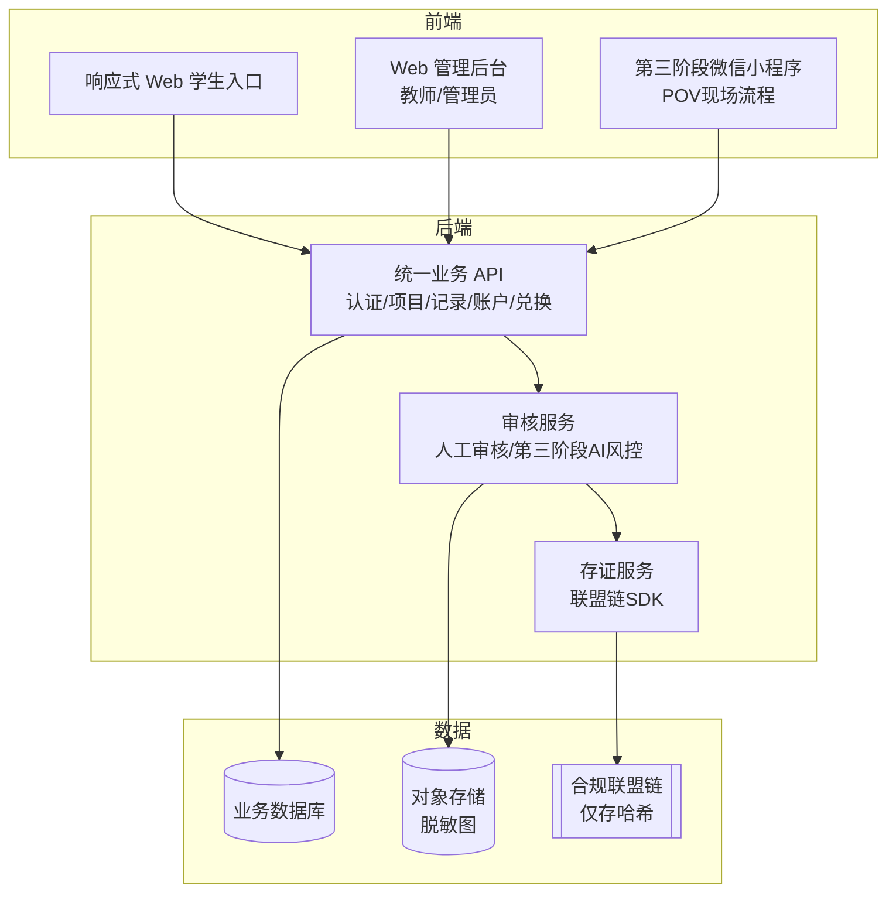

# 时间银行 · 线上系统方案（05-OnlineSystem）

> 本文档是《时间银行方案设计》（`01-TimeBankDesign.md`）的子方案，描述承载时间银行业务的线上系统。审核能力见 `02-ManualAudit.md` 与 `03-AutoAudit.md`，存证能力见 `04-Blockchain.md`。

## 1. 定位与目标

线上系统是时间银行的统一承载平台，整合**项目发布、报名、服务记录、审核（人工/自动）、时间币账户、兑换、统计与存证**等能力，提升管理效率并沉淀学生成长数据。

系统采用“**完整 Web 平台优先、微信小程序后置扩展**”的建设策略：

- **第二阶段**建设可独立运行的响应式 Web 平台，明确提供**学生入口**与**管理员/教师入口**。从项目发布、学生报名、服务记录提交、人工审核、时间币入账到统计、复核和系统管理，全部流程必须在 Web 中闭环。
- 第二阶段**不考虑微信小程序、企业微信、钉钉或其他 IM 接入**，也不得将登录、通知、审核或见证之外的核心业务依赖于这些平台。
- **第三阶段**在 Web 平台和统一后端之上增加微信小程序，主要解决 POV 现场拍摄、定位、扫码见证和端侧脱敏等移动场景；小程序是能力扩展，不是系统运行前提。

## 2. Web 前端入口

### 2.1 学生入口

- 查看并在线认领可报名志愿服务项目。
- 提交服务记录与证明材料。
- 查看审核状态、累计服务时长、时间币余额与毕业要求进度。
- 申请补录、复核、借贷或兑换，并查看处理进度。
- 查看个人账户流水、历史服务记录、退回原因和站内通知。
- 维护允许自行修改的个人资料与监护人联系信息。

学生入口采用响应式 Web，兼容桌面和手机浏览器；第二阶段不要求安装 App 或绑定任何 IM 账号。

### 2.2 管理员/教师入口

- **工作台**：待审核、待复核、异常记录、临近超时、未达标学生和近期项目概览。
- **项目管理**：创建、编辑、发布、关闭项目，配置报名时间、名额、服务时长、负责人和证明要求。
- **报名管理**：名单审核、候补、取消、签到结果和批量导入。
- **审核中心**：材料预览、初审、复核、退回、驳回、批量审核、审核意见及全过程留痕。
- **学生与组织管理**：学生、班级、年级、监护人、组织方、项目负责人和服务类别档案。
- **账户管理**：时间币入账、冲正、冻结、解冻、借贷、兑换及完整流水；任何人工调整必须填写原因并写入审计日志。
- **规则配置**：年级时长要求、换算单位、项目分类、上限、审核 SLA、借贷和兑换规则。
- **统计与报表**：按学生、班级、年级、项目、组织和学年统计，支持筛选、导出与个人进度提醒。
- **数据管理**：历史台账导入、导入校验、错误报告、数据导出、归档与备份。
- **系统管理**：角色权限、菜单权限、数据范围、站内通知模板、操作日志、登录日志和系统参数。

管理员、学生发展中心、年级教师等角色共用管理入口，并通过 RBAC 与数据范围控制实现职责隔离。

### 2.3 第三阶段小程序入口

微信小程序在第三阶段建设，主要承载：

- 学生现场拍摄、GPS/时间戳采集和打卡。
- 见证者扫码核对并确认见证。
- 端侧人脸脱敏、脱敏材料上传和原图销毁。
- 组员互证与监护人背书。
- POV 提交状态与必要的现场反馈。

项目管理、人工审核、规则配置、账户管理和统计报表仍以 Web 管理后台为准。小程序与 Web 共用统一账号体系、业务 API、数据库、审核状态和账户流水。

## 3. 关键模块

| 模块 | 功能 |
| --- | --- |
| 项目管理 | 发布、编辑、关闭志愿服务项目 |
| 报名管理 | 学生报名、名额控制、候补名单 |
| 服务记录 | 提交服务时长与证明材料、现场打卡 |
| 审核中心 | 人工审核 + AI 自动审核 + 二审/抽查（见 `02-ManualAudit.md`/`03-AutoAudit.md`） |
| AI 服务 | 端侧人脸脱敏（WASM BlazeFace）、多模态内容审核、图像真实性检测、统计学风控引擎、见证者信用评分（详见 `07-AI.md`） |
| 时间币账户 | 自动入账、余额查询、流水记录 |
| 兑换中心 | 兑换项目、兑换申请、兑换审核（校内积分核销，不上链） |
| 借贷管理 | 借贷申请、审批、归还跟踪 |
| 存证服务 | 关键元数据哈希上链、TxHash 回填（见 `04-Blockchain.md`） |
| 数据看板 | 年级统计、项目统计、达标情况 |
| 通知提醒 | 审核提醒、未达标提醒、兑换结果通知 |
| 权限管理 | 学生、家长、见证者、教师、管理员、学生负责人权限 |
| 基础数据 | 学生、班级、年级、学年、组织方、项目类别与服务规则 |
| 数据交换 | 历史台账导入、导入校验、报表导出与归档 |
| 审计运维 | 操作日志、登录日志、异常日志、系统参数、备份与恢复 |

第二阶段必须完成除“AI 服务、POV 现场打卡、自动存证”之外的核心模块，并以人工审核形成完整业务闭环；第三阶段再启用 POV 与相关 AI 能力。

## 4. 系统架构建议



- 第二阶段的 Web 学生入口与管理后台通过同一套业务 API 完成全流程，不依赖小程序或 IM。
- 第三阶段的**端侧脱敏**在小程序本地完成，原图不落盘（见 `03-AutoAudit.md`）。
- **业务数据**与**脱敏图**存于境内业务库与对象存储。
- **链上仅存哈希指纹**（见 `04-Blockchain.md`）。

## 5. 数据安全与隐私

- 学生个人信息仅限授权人员查看。
- 系统记录审核、修改、兑换、借贷、上链等关键操作日志。
- 校外组织方/见证者联系方式仅用于核验，不公开展示，敏感项仅存哈希。
- 数据导出需限权限，防止隐私泄露。
- 时间币账户变动保留流水，确保可追溯。
- 未成年人信息处理须取得监护人同意，遵循最小必要原则。
- Web 平台采用统一身份认证、RBAC 和数据范围控制；管理员敏感操作需二次确认并完整留痕。
- 文件上传需进行类型、大小、恶意内容和访问权限校验，对象存储使用私有访问与短时授权 URL。
- 关键业务操作应具备幂等、事务和冲正机制，禁止直接修改账户余额或删除已审核记录。

## 6. 实施计划

| 阶段 | 周期建议 | 主要工作 |
| --- | --- | --- |
| 一 · 线下制度试运行 | 1 个月 | 确认制度、纸质表单、审核责任、数据字段与试运行范围 |
| 二 · 完整 Web 系统 | 1–2 个学期 | 完成需求与原型、学生入口、管理员/教师后台、项目与报名、记录提交、人工审核、账户流水、统计报表、导入导出、权限与审计；迁移历史数据并完成全流程验收和全校推广 |
| 三 · 微信小程序与 POV | 1 个学期 | 基于统一后端增加现场拍摄、GPS 打卡、见证扫码、端侧脱敏、互证与背书，并接入 AI 初审、风控和可选联盟链存证 |
| 四 · 兑换与拓展 | 系统稳定后 | 基于第二阶段已建设或预留的管理能力，正式配置并启用兑换、借贷与增值规则，接入合作资源，开展数据分析与持续优化 |

第二阶段的验收标准不是“完成部分模块”，而是仅使用 Web 即可完成：

```text
管理员发布项目 → 学生报名 → 管理员处理名单 → 学生完成服务并提交记录
→ 教师审核/退回/复核 → 审核通过后时间币入账 → 学生查看账户与达标进度
→ 管理员统计、导出并通过操作日志追溯全过程
```

实施过程中，人工审核（`02-ManualAudit.md`）始终作为主流程或复核兜底通道保留；第三阶段的小程序与 POV 不得破坏 Web 业务闭环。存证上链（`04-Blockchain.md`）可在第三阶段按需启用。

## 7. 与其他方案的衔接

- 审核逻辑遵循 `02-ManualAudit.md` 与 `03-AutoAudit.md`。
- 存证逻辑遵循 `04-Blockchain.md`。
- 制度规则、时长要求、激励体系遵循 `01-TimeBankDesign.md`。
- AI 各模块的技术实现、接入方案与成本估算见 `07-AI.md`。
