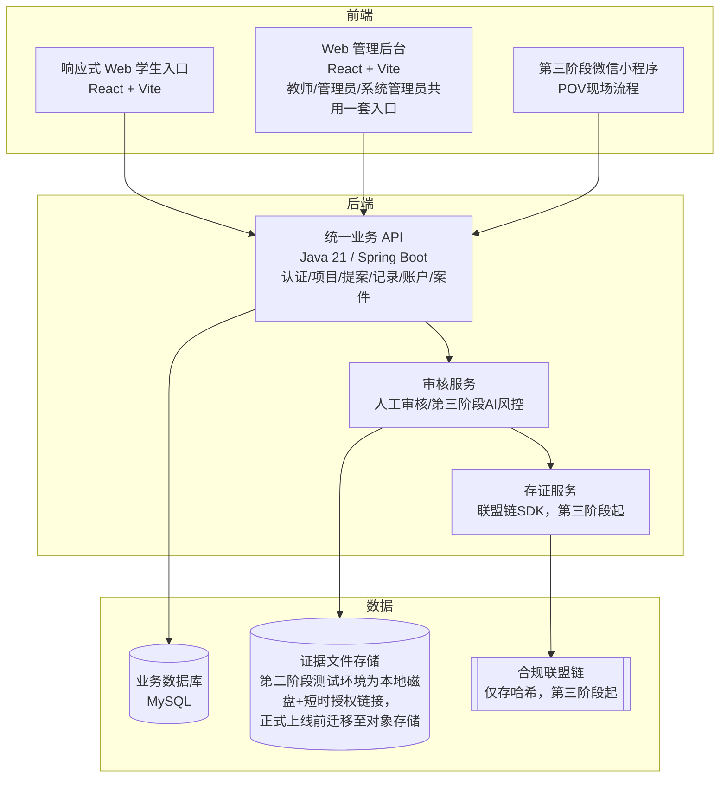

# 时间银行 · 线上系统方案（05-OnlineSystem）

> 本文档是《时间银行方案设计》（`01-TimeBankDesign.md`）的子方案，描述承载时间银行业务的线上系统。审核能力见 `02-ManualAudit.md` 与 `03-AutoAudit.md`，存证能力见 `04-Blockchain.md`。
>
> **本文档描述系统定位、模块与架构层面的设计意图，是长期有效的"为什么"；逐项功能页面/交互流程的权威规格是 `Docs/frontend/Design.md`/`_CN.md`（前端）与 `Docs/integration/APIContract.md`/`_CN.md`（接口契约），实时构建状态见 `Docs/implementation/00-Status.md`。三者与本文档的内容如有出入，以那三份"活文档"为准，本文档应据此更新，而不是反过来。**

## 1. 定位与目标

线上系统是时间银行的统一承载平台，整合**项目发布、活动提案、报名、服务记录、审核（人工/自动）、时间币账户、申诉与补录、统计与存证**等能力，提升管理效率并沉淀学生成长数据。

系统采用"**完整 Web 平台优先、微信小程序后置扩展**"的建设策略：

- **第二阶段**建设可独立运行的响应式 Web 平台，明确提供**学生入口**与**管理员/教师入口**。从项目发布、学生报名或自主发起活动提案、服务记录提交、人工审核、时间币入账到统计、申诉复核和系统管理，全部流程均已在 Web 中打通闭环——**第二阶段已基本建成并部署至共享测试环境，进入验收与上线准备阶段**，具体验收进展、已知基础设施缺口（如对象存储、灾备演练所需的第二台主机）见 `Docs/implementation/00-Status.md`（活文档，不在本文档重复记录会过期的具体数字）。
- 第二阶段**不考虑微信小程序、企业微信、钉钉或其他 IM 接入**，也不将登录、通知、审核或见证之外的核心业务依赖于这些平台。
- **第三阶段**在 Web 平台和统一后端之上增加微信小程序，主要解决 POV 现场拍摄、定位、扫码见证和端侧脱敏等移动场景；小程序是能力扩展，不是系统运行前提。第三阶段能力（POV）与**第四阶段**能力（兑换、借贷、增值/荣誉体系）在第二阶段已通过统一的**功能开关（Feature Flag）**预留了路由、权限码与数据模型入口，但默认关闭：关闭时前端不展示对应入口并统一提示"暂未开放"，后端拒绝相应写操作——绝不是路由存在但页面空白或接口报错的半成品状态。

## 2. Web 前端入口

### 2.1 学生入口

- 查看并在线报名已发布的志愿服务项目；也可**自主发起活动提案**申请组织一场面向其他学生的志愿活动——提案经审核通过前不是正式项目，不出现在项目中心，也不能开放报名；一经批准，系统在同一事务内自动生成正式项目草稿并回填关联关系，仍需管理员/教师另行发布。
- 提交服务记录与证明材料；记录来源限"已报名项目"或"自主发起"两种（第三种"校外"来源仅为历史数据，只读/可编辑重提，不再作为新记录的可选项）。
- 查看审核状态、累计服务时长、时间币余额与毕业要求进度。
- 发起**补录（材料补充）**或**复核（申诉/异议）**案件，并在统一的"我的申诉"历史列表中查看全部已发起案件及处理进度——两者共用同一套案件状态模型（草稿→已提交→审核中→已解决/需补充信息/已驳回）。
- 查看个人账户流水、历史服务记录、退回原因和站内通知。
- 维护允许自行修改的个人资料与监护人联系信息；学号、年级等权威字段不可自行修改。

学生入口采用响应式 Web，兼容桌面和手机浏览器；第二阶段不要求安装 App 或绑定任何 IM 账号。

### 2.2 管理员/教师入口

- **工作台**：待审核、待处理案件、异常记录、临近超时、未达标学生和近期项目概览。
- **项目管理**：创建、编辑、发布、关闭项目，配置报名时间、名额、服务时长、负责人和证明要求。
- **活动提案审核**：学生自主发起的活动提案队列，审核为**单层直接决定**——任一持有提案审核权限的账号（教师/管理员/系统管理员）均可直接批准、驳回或要求修改，不设"先推荐批准、再转交终审"的多级环节；批准后自动生成正式项目草稿，仍需另行发布。
- **报名管理**：名单审核、候补、取消、签到结果和批量导入。
- **审核中心**：服务记录的材料预览、初审、退回、驳回、批量审核、审核意见及全过程留痕；**案件队列**（补录、复核、以及仅限工作人员发起的人工调整）是与之分离但共用同一状态模型的独立队列与详情工作台。
- **学生与组织管理**：学生、班级、年级、监护人、组织方、项目负责人和服务类别档案。
- **账户管理**：时间币入账（服务记录审核通过后自动生成）、冲正、冻结、解冻及完整流水；任何人工调整必须填写原因并写入审计日志。余额永远不可直接编辑。兑换、借贷等第四阶段能力已预留数据模型与管理入口，但默认按功能开关关闭。
- **规则配置**：年级（初中/高中分别设定）时长要求、换算单位、项目分类、上限、审核 SLA、以及兑换/借贷规则的预留配置位。
- **角色与权限**：默认角色（学生、学生发展中心管理员、系统管理员）为受保护角色，教师及学校自定义的其他工作人员角色可在系统管理中按需增删配置——角色与数据范围不是写死的四类账号，而是可配置的 RBAC 体系。
- **统计与报表**：按学生、班级、年级、项目、组织和学年统计，支持筛选、导出与个人进度提醒。
- **数据管理**：历史台账导入、导入校验、错误报告、数据导出、归档与备份。
- **系统管理**：角色权限、菜单权限、数据范围、站内通知模板、操作日志、登录日志和系统参数。

管理员、学生发展中心、年级教师等角色共用同一管理入口（不是各自独立的门户），并通过 RBAC 与数据范围控制实现职责隔离——教师登录后直接进入该入口，只是可见范围按数据范围收窄到本人授权的项目、年级/班级及关联资源。

### 2.3 第三阶段小程序入口

微信小程序在第三阶段建设，主要承载：

- 学生现场拍摄、GPS/时间戳采集和打卡。
- 见证者扫码核对并确认见证。
- 端侧人脸脱敏、脱敏材料上传和原图销毁。
- 组员互证与监护人背书。
- POV 提交状态与必要的现场反馈。

项目管理、人工审核、规则配置、账户管理和统计报表仍以 Web 管理后台为准。小程序与 Web 共用统一账号体系、业务 API、数据库、审核状态和账户流水。

## 3. 关键模块

| 模块 | 功能 | 第二阶段状态 |
| --- | --- | --- |
| 项目管理 | 发布、编辑、关闭志愿服务项目 | 已建成 |
| 活动提案 | 学生自主发起志愿活动提案，审核通过后自动生成正式项目草稿 | 已建成 |
| 报名管理 | 学生报名、名额控制、候补名单 | 已建成 |
| 服务记录 | 提交服务时长与证明材料、项目来源/自主来源两种记录路径 | 已建成 |
| 审核中心 | 人工审核 + AI 自动审核 + 二审/抽查（见 `02-ManualAudit.md`/`03-AutoAudit.md`） | 人工审核已建成；AI/二审属第三阶段 |
| 案件处理 | 补录、复核与人工调整，统一状态模型、独立队列 | 已建成 |
| AI 服务 | 端侧人脸脱敏（WASM BlazeFace）、多模态内容审核、图像真实性检测、统计学风控引擎、见证者信用评分（详见 `07-AI.md`） | 第三阶段起 |
| 时间币账户 | 自动入账、余额查询、流水记录、冲正/冻结/解冻 | 已建成 |
| 兑换中心 | 兑换项目、兑换申请、兑换审核（校内积分核销，不上链） | 第四阶段预留，未启用 |
| 借贷管理 | 借贷申请、审批、归还跟踪 | 第四阶段预留，未启用 |
| 存证服务 | 关键元数据哈希上链、TxHash 回填（见 `04-Blockchain.md`） | 第三/四阶段按需启用 |
| 数据看板 | 年级统计、项目统计、达标情况 | 已建成 |
| 通知提醒 | 审核提醒、未达标提醒、兑换结果通知 | 站内通知已建成；兑换相关随第四阶段启用 |
| 权限管理 | 可配置角色（默认学生、学生发展中心管理员、系统管理员为受保护角色，教师及自定义角色可增删配置）+ 数据范围 | 已建成 |
| 基础数据 | 学生、班级、年级、学年、组织方、项目类别与服务规则 | 已建成 |
| 数据交换 | 历史台账导入、导入校验、报表导出与归档 | 已建成 |
| 审计运维 | 操作日志、登录日志、异常日志、系统参数、备份与恢复 | 已建成；灾备演练受限于尚未配置的第二台主机/对象存储，见 `Docs/implementation/00-Status.md` |

第二阶段完成除"AI 服务、POV 现场打卡、自动存证"之外的核心模块，并以人工审核形成完整业务闭环；兑换、借贷等第四阶段能力已预留入口与数据模型，但默认关闭；第三阶段再启用 POV 与相关 AI 能力。

## 4. 系统架构建议



- 第二阶段的 Web 学生入口与管理后台通过同一套业务 API 完成全流程，不依赖小程序或 IM；后端为单一 Java/Spring Boot 服务（无 Docker，以 systemd 常驻进程部署），与 MySQL 同机或同网段部署。
- 第三阶段的**端侧脱敏**在小程序本地完成，原图不落盘（见 `03-AutoAudit.md`）。
- **业务数据**存于境内业务库；**证据文件**第二阶段测试环境暂以本地磁盘存储、通过短时授权链接访问，作为对象存储的过渡替代方案，正式上线前按原方案迁移。
- **链上仅存哈希指纹**，第三阶段随 POV 一并启用（见 `04-Blockchain.md`）；第二阶段不依赖上链。

## 5. 数据安全与隐私

- 学生个人信息仅限授权人员查看。
- 系统对审核决定、账户变动、角色权限变更、案件处理等关键操作生成不可覆盖的审计日志；变更决定通过追加新事件记录，而非覆盖或删除历史记录。
- 校外组织方/见证者联系方式仅用于核验，不公开展示，敏感项仅存哈希。
- 数据导出需限权限，防止隐私泄露。
- 时间币账户变动保留流水，确保可追溯；余额永远不可直接编辑。
- 未成年人信息处理须取得监护人同意，遵循最小必要原则。
- Web 平台采用统一身份认证（会话 + CSRF 防护）、RBAC 和数据范围控制；管理员敏感操作需二次确认并完整留痕。
- 文件上传需进行类型、大小、恶意内容和访问权限校验；证据文件通过短时授权链接访问，不直接暴露永久 URL。
- 关键业务操作均具备幂等（幂等键）、事务和冲正机制，禁止直接修改账户余额或删除已审核记录。

## 6. 实施计划

| 阶段 | 周期建议 | 主要工作 | 当前状态 |
| --- | --- | --- | --- |
| 一 · 线下制度试运行 | 1 个月 | 确认制度、纸质表单、审核责任、数据字段与试运行范围 | 已完成 |
| 二 · 完整 Web 系统 | 1–2 个学期 | 完成需求与原型、学生入口、管理员/教师后台、项目/活动提案与报名、记录提交、人工审核、账户流水、案件处理、统计报表、导入导出、权限与审计；迁移历史数据并完成全流程验收和全校推广 | 已基本建成并部署至共享测试环境，核心业务闭环已在真实后端验证通过；全流程验收与全校推广的具体进度见 `Docs/implementation/00-Status.md` |
| 三 · 微信小程序与 POV | 1 个学期 | 基于统一后端增加现场拍摄、GPS 打卡、见证扫码、端侧脱敏、互证与背书，并接入 AI 初审、风控和可选联盟链存证 | 未开始，接口与数据模型已预留 |
| 四 · 兑换与拓展 | 系统稳定后 | 基于第二阶段已建设或预留的管理能力，正式配置并启用兑换、借贷与增值规则，接入合作资源，开展数据分析与持续优化 | 未开始，接口、权限码与账户流水类型已预留 |

第二阶段的验收标准不是"完成部分模块"，而是仅使用 Web 即可完成：

```text
管理员发布项目（或学生自主发起活动提案经审核通过） → 学生报名 → 管理员处理名单
→ 学生完成服务并提交记录 → 教师审核/退回/复核 → 审核通过后时间币入账
→ 学生查看账户与达标进度、发起补录或复核案件 → 管理员统计、导出并通过审计日志追溯全过程
```

上述闭环已在真实后端与部署环境中打通并经过人工点检验证；具体验收场景通过率、已知缺口（如大规模压测、灾备演练）见 `Docs/implementation/00-Status.md`。

实施过程中，人工审核（`02-ManualAudit.md`）始终作为主流程或复核兜底通道保留；第三阶段的小程序与 POV 不得破坏 Web 业务闭环。存证上链（`04-Blockchain.md`）可在第三阶段按需启用。

## 7. 与其他方案的衔接

- 逐项功能页面、交互流程与验收标准的权威规格见 `Docs/frontend/Design.md`/`_CN.md`；接口定义见 `Docs/integration/APIContract.md`/`_CN.md`；两者均随实际构建持续更新，是比本文档更细粒度、更新更频繁的来源。
- 审核逻辑遵循 `02-ManualAudit.md` 与 `03-AutoAudit.md`。
- 存证逻辑遵循 `04-Blockchain.md`。
- 制度规则、时长要求、激励体系遵循 `01-TimeBankDesign.md`。
- AI 各模块的技术实现、接入方案与成本估算见 `07-AI.md`。
