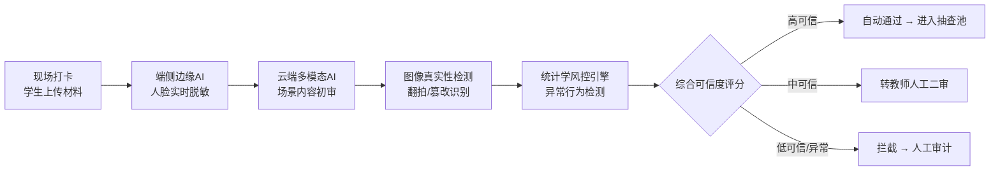

# 时间银行 · AI 技术应用方案（AI）

> 本文档是《时间银行方案设计》（`01-TimeBankDesign.md`）的子方案，详细描述 AI 技术在时间银行中的具体应用、实现路径与接入建议。各 AI 能力均服务于"真实性验证、隐私保护、风险控制"三大目标，不涉及内容生成、推荐或评分等扩展场景。AI 审核能力的调用时序见 `02-ManualAudit.md`，承载系统见 `05-OnlineSystem.md`。

---

## 1. 定位与全景

时间银行引入 AI 技术的唯一目的是**提升服务记录的真实性验证能力**，同时**降低人工审核成本**。AI 在系统中扮演"初审过滤层"，不替代教师的最终判断，不对学生作出评价性结论。



| AI 模块 | 技术分类 | 运行位置 | 作用 |
| --- | --- | --- | --- |
| 端侧人脸脱敏 | CV（人脸检测） | 手机本地（WASM） | 原图不出设备，保护未成年人隐私 |
| 多模态内容审核 | CV + 多模态 LLM | 云端（API） | 比对申报内容与照片/视频的一致性 |
| 图像真实性检测 | CV（频域分析） | 云端 | 识别翻拍屏幕、PS 合成、EXIF 篡改 |
| 统计学异常风控 | 统计学 ML | 云端（后台服务） | 检测时空矛盾、刷分行为规律 |
| 见证者信用评分 | 行为建模 ML | 云端（后台服务） | 动态评估散点见证者可信度 |

---

## 2. 端侧人脸脱敏（Edge AI · On-Device）

### 2.1 目标与约束

- **目标**：在照片上传前，在学生手机本地完成所有未成年人与受助者的面部脱敏，原图绝不离开设备。
- **约束**：必须在 300ms 内完成（见证者等待体验）；模型包不超过 2MB（小程序包体限制）；支持低端 Android 机型兼容降级。

### 2.2 技术方案

#### 主方案：WASM + BlazeFace（推荐）

- **BlazeFace** 是 Google MediaPipe 中的轻量人脸检测模型，专为移动端优化，模型大小约 **400KB**，单次推理 **< 50ms**（中端机）。
- 在微信小程序中通过 **WebAssembly（WASM）** 运行，无需 Native 插件，审核即通过。
- 脱敏方式：检测到人脸矩形框后，对框内区域执行**高斯模糊**（sigma ≥ 15，肉眼不可识别）或贴**卡通遮罩**（小太阳/小红花，增加趣味性且不可逆）。

```
┌─────────────────────────────────────────────┐
│  手机端（微信小程序 WASM 沙箱）               │
│                                             │
│  原图（内存） → BlazeFace检测 → 人脸框列表    │
│       ↓                                     │
│  Canvas API 对框内区域写入高斯模糊像素         │
│       ↓                                     │
│  脱敏图（内存）→ 上传云存储                   │
│       ↓                                     │
│  原图内存显式释放（ArrayBuffer 置空）          │
└─────────────────────────────────────────────┘
```

#### 降级方案：云端脱敏（兜底）

对 BlazeFace 加载失败或推理超时（> 500ms）的机型，切换为**上传即脱敏即焚**：
- 客户端先本地高斯模糊全图（像素级，不需模型），再上传。
- 云端使用阿里云内容安全"人脸模糊"接口做二次确认，处理后原始版本立即删除。
- 该路径隐私强度低于主方案，仅作为兜底，日志记录降级事件。

#### 方案对比

| 维度 | WASM + BlazeFace（主） | 云端脱敏（降级） |
| --- | --- | --- |
| 原图隐私 | 最优（不出设备） | 中（原图短暂上传） |
| 延迟 | 50–150ms（本地） | 200–500ms（网络 RTT） |
| 成本 | 零边际成本 | 按次计费（约 0.1 分/张） |
| 兼容性 | 需 WASM 支持（微信 ≥ 7.0.0） | 全机型兼容 |

### 2.3 与见证流程的时序衔接

方案 A（时序隔离，见 `02-ManualAudit.md` 第 4.3 节）中，脱敏**在见证者点击确认的瞬间触发**：

```
见证者点击"同意见证" → onConfirm() 回调
  → 激活 WASM BlazeFace（已预加载）
  → 对内存中原图执行推理+打码（< 150ms）
  → 上传脱敏图 + SHA-256 哈希
  → 原图 ArrayBuffer 赋 null，GC 释放
```

确保见证者看到的是原图，而上传与存储的永远是脱敏图。

---

## 3. 多模态内容审核（Cloud AI · Multimodal）

### 3.1 目标

比对学生**申报的服务类型与描述**与**上传的脱敏照片/短视频**之间的内容一致性，识别"申报养老院陪伴，实际图片为网吧游戏"等低级造假。

### 3.2 审核维度

| 维度 | 技术手段 | 示例 |
| --- | --- | --- |
| 场景识别 | 图像分类（地点/环境标签） | 识别出"公园/草地/垃圾袋"→ 匹配"环境清洁"申报 |
| 行为识别 | 动作检测（视频帧分析） | 识别出"弯腰拾取/搬运/擦拭"等公益行为动作 |
| 物体检测 | 目标检测（YOLO 系列） | 检测到清洁工具、书本、轮椅等服务相关道具 |
| 申报—画面一致性 | 多模态对齐（文本+图像） | 申报"垃圾分类宣传"，画面中需有分类桶/宣传单/公众 |
| 不适内容过滤 | 内容安全分类 | 屏蔽涉黄/涉暴内容，保护未成年人 |
| 季节—环境一致性 | 时间戳 × 植被/光照分析 | GPS 时间戳为 12 月，图片显示浓绿夏日植被 → 异常 |

### 3.3 实现路径

#### 路径 A：调用云厂商内容安全 API（推荐，初期）

国内合规的成熟 API，开箱即用，无需自建模型：

| 服务商 | 推荐产品 | 适用维度 | 计费参考 |
| --- | --- | --- | --- |
| 阿里云 | 内容安全「图片审核（大模型多模态版）」 | 场景/行为/物体/不适内容 | ~0.2 分/张（规模后） |
| 腾讯云 | 天御「图片内容安全」 | 场景标签 + 不适过滤 | ~0.2 分/张 |
| 阿里云 | 视频内容审核 | 视频帧级分析 | ~0.5 分/分钟 |

**调用方式**：后端服务（`05-OnlineSystem.md` 审核服务模块）在接收脱敏图后异步调用 API，将返回的标签列表与申报类型做规则匹配，输出初步置信分。

```
POST 脱敏图 URL → 阿里云内容安全
← 返回：{ labels: ["公园","垃圾袋","清洁行为"], score: 0.87, risk: "none" }

规则引擎：
  申报类型 = "环境清洁"
  匹配标签 ∩ 申报关键词 = { "垃圾袋","清洁行为" } → 场景一致性：通过
```

#### 路径 B：私有化部署多模态模型（中后期，高价值证书）

对与升学挂钩的高价值证书，考虑私有化部署开源多模态模型（如 **InternVL**、**Qwen-VL**）：
- 输入：脱敏图 + 学生申报文字描述
- 输出：一致性判断 + 理由摘要（供教师二审参考）
- 部署在学校或云端独立实例，数据不出系统

#### 路径对比

| 维度 | 云 API（推荐初期） | 私有化模型（高价值场景） |
| --- | --- | --- |
| 部署成本 | 极低（零开发） | 高（需 GPU 或模型推理服务） |
| 数据合规 | 需审查数据处理协议 | 数据完全自控 |
| 能力上限 | 受制于 API 能力更新 | 可定制 Prompt/规则 |
| 适用阶段 | 第三阶段 POV 起（见 `05-OnlineSystem.md`） | 第四阶段高价值证书审核 |

### 3.4 与 AutoAudit 的衔接

多模态 AI 初审输出的**场景标签列表**与**置信分**直接写入 `02-ManualAudit.md` 第 9.2 节元数据字段"AI 评分与标签"，供后续风控引擎与教师二审使用。

---

## 4. 图像真实性检测（Forgery Detection）

### 4.1 目标

识别以下三类图像造假行为：

| 造假类型 | 描述 | 检测手段 |
| --- | --- | --- |
| **翻拍屏幕** | 用手机拍摄另一台手机/电脑屏幕上的照片 | 摩尔纹检测、屏幕边框检测、亮度/色域异常 |
| **P 图合成** | Photoshop 等工具剪切拼接背景或人物 | ELA（错误级别分析）、频域 DFT 分析 |
| **EXIF 篡改** | 修改照片元数据中的拍摄时间、GPS 信息 | EXIF 完整性校验 + 与服务器时间戳/GPS 交叉验证 |

### 4.2 技术细节

#### 翻拍屏幕检测

- **摩尔纹**：显示器像素阵列与相机 CMOS 感光阵列的频率叠加会产生规律性摩尔纹条纹，可通过 **DFT（离散傅里叶变换）**在频域中检测高频周期峰值识别。
- **屏幕边框/反光**：CNN 目标检测识别屏幕边框矩形及镜面反光特征。
- **色域压缩**：屏幕翻拍会引发两次 JPEG 压缩，色域窄化，通过 **DCT 系数直方图分析**可识别双重压缩特征。

#### P 图合成检测（ELA）

**ELA（Error Level Analysis）**：
1. 将待检图以固定质量因子（如 Q=75）重新 JPEG 压缩。
2. 计算原图与重压缩图的像素差值图（误差图）。
3. 真实照片误差图各区域误差级别均匀；P 图合成区域因压缩历史不同而呈现**局部误差突变**（高亮区域）。

适用于检测背景替换与人物抠图合成，实现成本低（纯 CPU 图像运算），可服务端自建。

#### EXIF 完整性校验

```
客户端上传时同步发送：
  - 系统时间戳（ms 精度，服务端防篡改校验）
  - GPS 坐标（系统级，非 EXIF 可读写层）

服务端交叉验证：
  1. EXIF.DateTimeOriginal ≈ 服务端接收时间戳（允许 ±5min 误差）
  2. EXIF.GPSLatitude/Longitude ≈ 小程序上报 GPS（允许 ±100m 误差）
  3. EXIF 关键字段（Make/Model/Software）一致性检验
  → 任一不符 → 触发中/低可信标记
```

> 注意：EXIF 可被工具修改，因此 EXIF 校验仅作为**辅助指标**，不单独作为拦截依据，需结合其他维度综合评分。

### 4.3 接入方案

- **ELA + 频域分析**：可轻量化自建（Python `Pillow` + `NumPy` + `scipy.fft`），部署为内部 HTTP 微服务，单张处理 < 100ms，成本极低。
- **屏幕翻拍 CNN**：可调用腾讯云/阿里云图片质量评估 API 的"屏幕截图检测"能力，或使用开源模型 **MantraNet / Noiseprint** 自部署。

---

## 5. 统计学异常风控引擎（Anti-Fraud Statistical Engine）

### 5.1 设计思路

借鉴金融行业**反洗钱（AML）/ 反刷单**模型：个体的作弊行为可以模拟孤立证据，但**无法大规模伪造统计学规律**。风控引擎通过多维度异常规则联合评分，对单条记录打上"风险标签"，汇入 `02-ManualAudit.md` 可信度评分框架。

### 5.2 规则详解

#### 规则 1 · 梅特卡夫离散度过滤

**原理**：真实自发公益的见证者、地点、时间应高度**随机离散**；家庭或团伙作弊的见证链呈现**高度聚类**。

```
计算指标：
  D_witness = distinct(witness_phone_prefix) / total_records  // 见证手机号段离散度
  D_location = stddev(GPS) / mean_dist                        // 地理位置标准差
  D_time     = entropy(weekday_distribution)                  // 打卡星期分布熵值

触发条件（示例阈值，需根据实际数据调优）：
  - 过去 90 天 20 条记录中，同一见证手机号出现 ≥ 5 次 → 橙色预警
  - 见证者 UnionID Hash 在微信关系链中与学生关联度 P > 0.8 → 红色预警
  - D_location < 0.2（几乎所有公益在同一 500m 范围内）且 D_witness < 0.3 → 黄色预警
```

#### 规则 2 · 频次围栏（Velocity & Frequency Fence）

| 检测维度 | 规则 | 触发动作 |
| --- | --- | --- |
| 见证者跨学生高频 | 同一见证手机号 7 天内为 ≥ 3 名不相干学生签字 | 判为"职业见证人"，拉黑该号，关联记录降权 |
| 见证者固定绑定 | 某见证号 90% 以上见证行为指向同一学生 | 判为"专属家庭作弊账号"，触发人工核查 |
| 学生高频突刺 | 单学生单周提交记录数超均值 3σ | 橙色预警，转教师审查 |

#### 规则 3 · 时空围栏（Geo-Temporal Fencing）

```
前后两条打卡记录：
  Δt = t2 - t1（分钟）
  Δd = haversine(GPS1, GPS2)（公里）

物理可行速度 = Δd / Δt × 60（km/h）

  > 120 km/h（开车+步行极限） → 红色拦截（时空冲突，倒填日期/伪造 GPS）
  > 60  km/h（自行车极限）    → 橙色预警（需人工核实）

特殊处理：记录间有地铁/高铁出行记录（与交通数据联动，可选）时豁免。
```

#### 规则 4 · 季节与环境一致性

多模态 AI（第 3 节）输出的**植被/光照/气象标签**与**系统时间戳 + GPS 城市气候数据**交叉验证：

| AI 图像标签 | 打卡时间/地点 | 判断 |
| --- | --- | --- |
| 浓绿树叶、夏日光照 | 示例市 · 1 月 | 时间矛盾 → 红色拦截 |
| 积雪地面 | 示例市 · 7 月 | 地点/时间矛盾 → 红色拦截 |
| 室内场景、无公益道具 | 申报：户外环境清洁 | 场景矛盾 → 中可信，转二审 |

实现：维护一份**示例市月度气候模板**（每月平均植被状态、日出日落时间窗），与 AI 场景标签做简单规则匹配，无需额外模型。

### 5.3 综合评分模型

各规则输出 0–1 风险分，加权融合为最终**可信度评分（Trust Score）**：

```
TrustScore = w1 × SceneConsistency       // 多模态场景一致性
           + w2 × ForgeryClean           // 翻拍/P图检测通过
           + w3 × ExifConsistency        // EXIF 校验通过
           + w4 × GeoTemporalFeasible    // 时空可行性
           + w5 × WitnessDispersal       // 见证者离散度
           + w6 × FrequencyNormal        // 频次正常
           + w7 × SeasonConsistency      // 季节环境一致性

初始推荐权重（w1–w7）= [0.25, 0.15, 0.10, 0.15, 0.15, 0.10, 0.10]
（权重应在上线后根据误判率与漏判率持续调优）

TrustScore ≥ 0.8  → 高可信，自动通过
0.5 ≤ score < 0.8 → 中可信，转教师二审
score < 0.5       → 低可信，拦截预警
```

---

## 6. 见证者信用评分（Witness Credit Scoring）

### 6.1 目标

对无法预绑白名单的散点路人见证者进行**动态可信度画像**，防止"职业见证人"和"家庭作弊链"。

### 6.2 信用分模型

每个见证者（以 手机号 Hash + UnionID Hash 标识）维护一个**信用分（0–100，初始 60）**：

| 事件 | 信用分变化 | 说明 |
| --- | --- | --- |
| 首次见证，记录最终通过 | +5 | 正常见证行为 |
| 见证记录被教师二审确认通过 | +3 | 进一步证实可信 |
| 本次见证的学生记录被拦截/驳回 | -10 | 关联记录造假风险 |
| 7 天内见证 ≥ 3 名不相干学生 | -20 | 频次异常 |
| 见证时空与学生打卡 GPS 不匹配 | -15 | 未在现场 |
| 经人工核查确认为虚假见证 | 清零 + 永久黑名单 | |

### 6.3 信用分对可信度的影响

```
WitnessFactor = min(1.0, WitnessCredit / 80)

// WitnessCredit = 60 → WitnessFactor = 0.75（正常见证者，小幅折减）
// WitnessCredit = 80 → WitnessFactor = 1.0 （高信用见证者，满权重）
// WitnessCredit = 30 → WitnessFactor = 0.375（低信用见证者，大幅降权）

// WitnessFactor 代入第 5.3 节 TrustScore 的 w5 分项
```

### 6.4 连带信用与震慑机制

- 作弊一经核实，**学生账户 + 背书监护人 + 同行组员**的连带信用分同步下调（见 `02-ManualAudit.md` 第 7.2 节）。
- 系统在见证确认页底部显示："本证书已区块链存证，约 2% 见证将被随机电话回访"，以极低成本产生心理震慑（实际回访由家委会志愿者承担，每次仅需 10–20 秒）。

---

## 7. 接入建议与成本估算

### 7.1 各模块推荐接入方案

| 模块 | 推荐方案 | 替代方案 | 建议接入阶段 |
| --- | --- | --- | --- |
| 端侧人脸脱敏 | WASM + BlazeFace（自集成） | 云端脱敏（降级） | 第三阶段 |
| 多模态内容审核 | 阿里云内容安全图片审核 API | 腾讯云天御 / 私有化 InternVL | 第三阶段 |
| 图像真实性检测 | 自建 ELA + 频域服务（Python） | 腾讯云图片质量评估 API | 第三阶段 |
| 统计学风控引擎 | 自建规则引擎（后台服务） | 无 SaaS 替代，必须自建 | 第三阶段 |
| 见证者信用评分 | 自建信用分服务（DB 读写） | 无 SaaS 替代，必须自建 | 第三阶段 |

### 7.2 成本估算（全校规模参考）

假设每学年 500 名学生，每人平均提交 30 条记录，合计 **15,000 条/年**：

| 费用项 | 单价（估） | 年费（估） | 说明 |
| --- | --- | --- | --- |
| 阿里云图片内容审核 | 0.2 分/张 | **≈ ¥30** | 15,000 张脱敏图 |
| 阿里云云端脱敏（降级触发约 5%） | 0.1 分/张 | **≈ ¥1** | ~750 张降级处理 |
| 自建 ELA 服务器算力 | 共享 2 核 CPU | **≈ ¥100/年** | 轻量微服务，无需 GPU |
| 见证者信用分 / 风控 DB | 数据库读写 | **< ¥50/年** | 附加在主业务数据库 |
| **合计** | | **≈ ¥180/年** | 极低边际成本 |

> 以上估算不含基础服务器与数据库费用（已计入 `05-OnlineSystem.md` 架构成本）。

### 7.3 落地注意事项

1. **BlazeFace WASM 预加载**：小程序启动时后台静默加载 WASM 模块，确保打卡页面首次使用时无感知延迟。
2. **云 API 数据处理协议**：调用阿里云/腾讯云内容安全 API 前，确认其数据处理协议（DPA）满足《个人信息保护法》要求；脱敏图已无法识别个人身份，合规风险较低。
3. **风控规则版本管理**：规则阈值（如"7天内见证≥3名触发降权"）应可配置、可回滚，避免误判导致学生申诉激增。
4. **AI 误判申诉通道**：系统必须保留"对 AI 拦截结果提交申诉"入口，所有被拦截记录保留 30 天供人工复核（见 `02-ManualAudit.md` 第 12 节）。
5. **模型更新策略**：阿里云 API 能力会定期迭代，自建 ELA/频域服务无需更新；BlazeFace 模型版本固定在小程序包中，变更需重新提审。

---

## 8. 隐私与合规

| 原则 | 落地方式 |
| --- | --- |
| 原图不出设备 | 端侧脱敏后销毁原图，仅 SHA-256 哈希上链（见 `04-Blockchain.md`） |
| 最小化数据传输 | 多模态 API 仅传入脱敏图 URL，不传原图；云厂商 API 请求后图片在其侧即时删除（合同约定） |
| AI 结果不直接定性 | AI 评分仅作为"初审建议"，最终审核权归教师；不对学生个人生成 AI 标签存档 |
| 未成年人专项保护 | 脱敏图经 BlazeFace 处理后，人脸已不可识别；即使数据泄露，无法还原学生肖像 |

---

## 9. 与其他方案的衔接

- **`02-ManualAudit.md`**：本文档 AI 模块的输出（场景标签、翻拍检测结果、TrustScore）直接写入 AutoAudit 第 9.2 节"AI 评分与标签"元数据字段；POV 审核流程见 AutoAudit 第 4 节。
- **`05-OnlineSystem.md`**：第二阶段先建设可独立闭环的完整 Web 系统；第三阶段为 POV 增加微信小程序，并在小程序前端集成端侧脱敏。多模态审核与图像检测在“审核服务”模块中调用，统计学风控与信用评分在“审核服务”后台运行。
- **`04-Blockchain.md`**：脱敏图 SHA-256 哈希（端侧脱敏后计算）上链存证；AI 评分本身不上链，仅供审核参考。
- **`06-Legal.md`**：AI 调用云 API 须确认数据处理主体；端侧脱敏模式下数据不出本地，合规最优；统计风控不涉及个人信用评分，仅为内部审核工具，不受征信相关法规约束。
