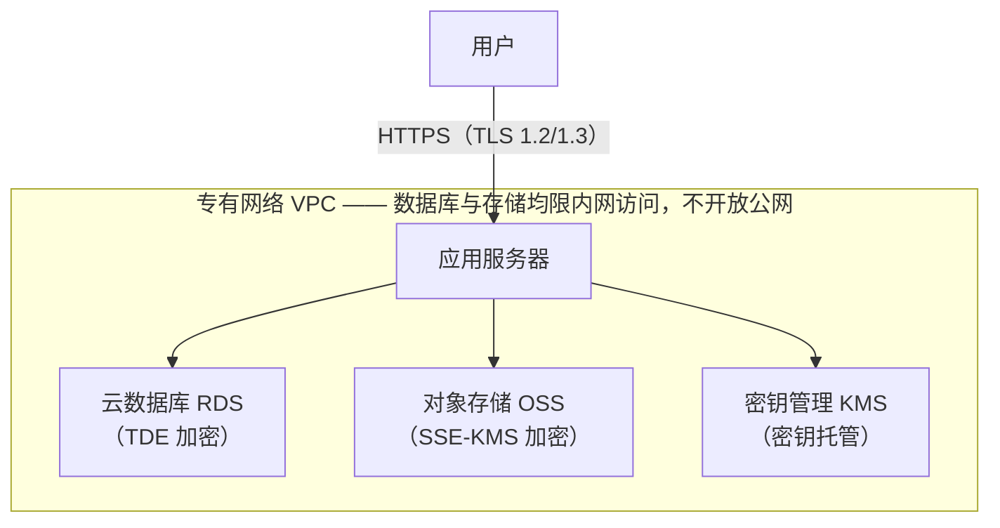

# 学校公益服务时长记录系统：等保一级安全设计方案

> 本文是本系统面向学校的**安全设计方案与合规说明**，阐述系统采用的安全架构、
> 为满足网络安全等级保护第一级所提供的技术措施，以及**学校侧需具备的基础设施前提**。
> 本文不是内部实施计划。改动本文时请同步更新
> `Design/english/08-mlps-level1-security-design-guide.md`。

---

## 1. 定级结论与合规依据

### 1.1 系统定位
本系统用于记录和管理学生公益服务时长及证明材料（照片、扫描件）。使用者为学校管理员、
审核教师与学生。系统仅服务于学校内部事务，不面向社会公众，不接入公共服务网络。系统一旦
中断或受损，影响范围限于学校内部管理事务，不危害国家安全、社会秩序或公共利益。

### 1.2 定级结论
依据《网络安全等级保护定级指南》及等保 2.0 标准，本系统定级为
**网络安全等级保护第一级（用户自主保护级）**。

第一级系统由运营者**自主保护**，不强制要求向公安机关网监部门备案，也不强制要求委托
第三方资质机构出具《等级测评报告》。本文及其附属材料即作为自主保护的设计依据与自查底稿。

### 1.3 与定级无关、但始终适用的三项义务

为避免误解，以下三项不因"第一级免测评"而免除，本方案均已覆盖：

1. **网络日志留存不少于 6 个月**——《网络安全法》第二十一条的法定要求，与等保级别无关。
   见 §10。
2. **《个人信息保护法》（PIPL）独立适用**。本系统处理未成年人信息；不满十四周岁未成年人
   的个人信息属于**敏感个人信息**，需取得监护人单独同意。学校作为个人信息处理者承担该
   义务，本系统作为**受托处理方**，按学校指示处理并提供相应安全保障。
3. **源头掩码后的数据仍属个人信息**。学校保留"掩码值→真实学生"的映射关系，因此系统侧
   持有的是**去标识化**数据而非**匿名化**数据（PIPL 第七十三条），安全保障义务不因此免除。
   其真实价值在于：即使发生数据泄露，泄露内容不足以直接识别到具体学生，后果显著降低。

### 1.4 密码算法说明
第一级不触发商用密码应用安全性评估（密评，通常自第三级起适用）。因此本方案采用
**AES-256-GCM** 等通用强算法即可满足要求，无需国密 SM4。系统将加密算法置于统一接口之后，
若学校后续因其他要求需切换为 SM4，可在不改动业务代码的前提下替换。

---

## 2. 安全架构总览

本方案遵循四条设计原则：

1. **数据最小化**——不收集业务不需要的个人信息；身份信息在进入系统前即由学校完成掩码。
2. **纵深防御**——传输、存储、访问控制、审计四层独立生效，任一层失效不导致全面失守。
3. **默认拒绝**——所有接口默认需要鉴权与数据范围校验；所有外部输入默认不可信。
4. **可追溯**——所有数据变更与凭证查看均留痕，且留痕不可被业务操作篡改。

目标部署形态：

---

## 3. 学校侧需具备的基础设施（合规前提）

本方案中的部分安全能力由云平台提供，需学校侧具备下列服务。系统已按这些服务的接口完成
设计，开通后即可对接。

| 组件 | 用途 | 对应安全要求 | 必要性 |
| :--- | :--- | :--- | :--- |
| **云数据库 RDS（MySQL）** | 承载业务数据，开启 **TDE 透明数据加密** | 数据存储保密性 | **生产环境必需** |
| **对象存储 OSS** | 存放凭证照片与扫描件，私有读写 + **SSE-KMS 落盘加密** | 数据存储保密性 | **生产环境必需** |
| **密钥管理服务 KMS** | 托管 TDE 与 OSS 加密主密钥；应用通过实例角色获取临时凭据 | 密钥管理、无静态凭据 | **生产环境必需** |
| **专有网络 VPC** | RDS 与 OSS 仅内网连通，数据库端口不暴露公网 | 网络访问控制 | **生产环境必需** |
| **域名与 TLS 证书** | 全站 HTTPS | 传输保密性 | **必需** |
| **日志存储空间** | 满足 6 个月留存的日志容量 | 《网络安全法》§21 | **必需** |
| 短信服务／企业微信／钉钉 | 多因素认证（如选用，见 §8） | 身份鉴别增强 | 可选，取决于 §8 决策 |

**关于开发与测试环境**：开发测试阶段允许使用本地磁盘存储替代 OSS，以降低搭建成本。
为防止该替代方案被误用于生产，系统内置**配置闸门**：当运行环境标识为生产、而存储仍为
本地磁盘时，应用**启动即失败并给出明确提示**，不会以降级状态静默运行。

**关于数据库的兼容性**：系统使用标准 MySQL 8.0，阿里云 RDS MySQL 与之完全兼容。
TDE 在 SQL 层之下透明完成加解密，**应用侧无需任何代码改动**，迁移时仅调整连接配置。

---

## 4. 身份与数据最小化

### 4.1 学生身份在进入系统前即完成掩码

系统**不接收学生的完整真实身份**。学校在导入前按下列约定完成脱敏，云端自始至终不持有
可直接识别到个人的信息。掩码后的值仍是普通字符串，因此检索、排序、筛选等功能完全不受影响。

| 字段 | 约定格式 | 示例 |
| :--- | :--- | :--- |
| 姓名 `displayName` | 中文名隐去中间字；英文名仅保留姓氏首字母 | `Alex L.(李*红)` |
| 学号 `studentNumber` | 学校生成的稳定标识符，Crockford base32，不含真实学号信息 | `HKTZ4HKV` |

中英文两部分采用**一致的掩码强度**：英文名保留名与姓氏首字母（`Alex L.`），不保留完整
姓氏，避免出现"中文已掩码而英文仍可直接识别"的情况。教师在其所负责的班级范围内
（通常不足 100 人）凭掩码姓名足以辨识学生；管理员在跨年级场景下可借助年级、班级与学号
哈希共同区分。

### 4.2 学号哈希的硬性要求

**哈希必须对同一学生永久稳定、且全校唯一。**

- 系统对学号建立唯一性约束，碰撞将导致导入失败并明确报错，不会静默覆盖数据。
  采用 **Crockford base32**：其字母表刻意剔除 I、L、O、U，避免与 1、0 混淆——
  该值需由教师在屏幕上读取、打印于卡片并回填录入。8 位可表示约 1.1×10¹²
  种取值，在 5000 名学生规模下碰撞概率约二十二万分之一（原 8 位十六进制
  在同等规模下约为三百四十分之一）。
- **不得按学年或按批次重新生成哈希。** 服务记录编号形如
  `TB-{学年}-{年级}-{学号}-{序号}`，学号直接构成编号的一部分。若同一学生的哈希发生变化，
  已发放的记录编号、历史记录关联及后续增量导入的匹配将同时失效。
- 不建议使用带星号的掩码学号（如 `******24`）：末位若干数字的取值空间过小，在数百人规模
  下必然碰撞，且星号进入记录编号后将损害其唯一性与可读性。

**学号不是登录凭证。** 学生使用系统生成的 8 位数字登录名登录（见 §8.1），学号仅作为名册
主键、服务记录编号的组成部分与教师检索依据。因此学号在屏幕上显示或打印于卡片上不构成
凭证泄露——即使外泄，也无法据以登录。

### 4.3 系统不收集的信息

按数据最小化原则，下列信息**不进入系统**：

- **监护人姓名与联系方式**——系统无任何使用场景，不予收集。
- **学生名册邮箱**——不予收集。
- **身份证号、家庭住址、生物特征等**——不在系统数据模型内。

登录账号保留可选的邮箱字段，仅供未来的邮件通知功能使用（面向有此需求的学校），不强制
填写，且与学生名册数据分离。**账号找回不依赖邮箱，也不依赖手机号——因为系统根本不设
自助找回**：忘记密码须线下联系管理员，由其核实身份后重新签发一次性激活码（见 §8.3）。
因果关系不可颠倒：并非"因为不收集联系方式，所以找回只能走线下"，而是**这两项互为支撑**
——不设自助找回，使联系方式成为不必要的数据；不收集联系方式，也使自助找回无法被日后
悄然加回。任何要求收集学生手机号或家长邮箱的功能提案，都应先按本节与 §8.3 重新审视其
必要性。

---

## 5. 存储加密

### 5.1 数据库：TDE 透明数据加密
业务数据库开启 **TDE**，数据在写入磁盘时自动加密，读取时自动解密，主密钥由 KMS 托管。
该机制作用于 SQL 层之下，因此覆盖全部字段（含姓名、学号），而**不影响任何检索与排序功能**。

### 5.2 备份加密
数据库备份文件**独立加密存放**，密钥与备份分离保管。这一点单列说明是因为：TDE 保护的是
在线数据文件，**导出的备份文件不在其保护范围内**，需由备份环节自行加密，否则备份将成为
整个数据链路上最薄弱的一环。

### 5.3 对象存储加密
凭证照片与扫描件存放于**私有读写**的 OSS Bucket，开启 **SSE-KMS** 服务端加密，文件落盘
自动加密。Bucket 禁止公网匿名读取，任何访问均需经系统鉴权后签发临时凭据。

### 5.4 密钥管理
应用代码与配置文件中**不硬编码任何数据库密码或加密密钥**。生产环境通过云主机实例角色
（RAM Role）动态申请短时有效的临时凭据，在内存中完成加解密操作，凭据到期自动失效。

### 5.5 关于字段级加密的说明
本方案**不对姓名、学号等字段单独做应用层加密**，理由如下，供学校技术评估参考：

- 身份信息已在**源头完成掩码**（§4.1），系统持有的本就不是完整身份，再行加密收益有限。
- TDE 已覆盖同样的威胁场景（磁盘、快照、数据文件被窃），且不损失任何功能。
- 字段级加密会使密文无法参与数据库检索与排序，将直接破坏教师按姓名查找学生、按姓名排序
  等日常功能；以核心可用性换取与 TDE 重叠的防护，不是合理的取舍。
- 备份加密（§5.2）已覆盖"导出文件外泄"这一 TDE 不涵盖的场景，且一次性覆盖全部字段。

---

## 6. 凭证文件安全

凭证是本系统中敏感度最高的数据——照片可能包含未成年人面部与所在位置。相应措施如下。

### 6.1 访问控制
- **私有存储**：Bucket 私有读写，无任何可公开访问的固定地址。
- **短时签名链接**：前端展示凭证时，由后端鉴权后签发**有效期不超过 300 秒**的临时链接，
  过期自动失效，无法转发他人长期使用，也无法被外部直接引用。
- **范围校验**：教师仅能调取其数据范围内学生的凭证，越权请求返回"不存在"，不泄露资源
  是否存在。

### 6.2 元数据剥离
学生用手机直接拍摄的照片常携带 **GPS 定位坐标与设备标识**——这正是未成年人位置数据的
典型泄露途径。系统在接收照片时**强制解码并重新编码**，彻底丢弃全部元数据。若解码失败，
按拒收处理，不会将未经处理的原始文件放行入库。

### 6.3 上传内容校验
- **真实类型校验**：依据文件头字节（magic byte）判定真实类型，不信任文件扩展名与客户端
  声明的类型，防止改扩展名上传可执行文件。
- **大小限制**：超出上限直接拒绝。
- **完整性摘要**：计算并留存 SHA-256 摘要，形成凭证防篡改证据链。校验时以系统存储的文件
  为准。

### 6.4 水印与责任追溯
管理端查看凭证时，系统在**文件内容本身**叠加水印，内容包含**查看人账号、查看时间与
"仅供公益时长核验"用途声明**，用于泄露震慑与事后追溯。

- 水印在**每次查看时按查看人实时生成**，不同查看者得到的水印不同，因此一旦发生外传，
  可据此定位泄露来源。
- 水印叠加在服务端完成，**不采用前端遮罩方式**——前端遮罩可通过直接打开图片地址绕过，
  无法达成追溯目的。
- **图片**（JPEG／PNG）水印由服务端图像处理生成。
- **PDF**（扫描件）水印采用 **Apache PDFBox** 在页面内容流中叠加，同样逐次按查看人生成。
  系统**继续完整支持 PDF 凭证的上传与预览**。

PDF 另需两项专门处理，因其格式本身可携带主动内容：

- **净化**：上传时移除 PDF 内嵌的 JavaScript、自动执行动作与内嵌文件，仅保留页面内容。
- **解析防护**：限制页数与文件大小，拒绝加密（带口令）或结构损坏的 PDF，避免解析阶段被
  恶意构造的文件消耗资源。

> 若学校对 PDF 水印的**防移除强度**有更高要求（PDFBox 叠加的水印属页面内容，具备专业工具
> 者仍可移除），可选择在查看时将 PDF 栅格化为图片后再加水印。代价是失去文字选取与检索
> 能力。本方案默认采用前者（保留可用性，水印用于**追溯与震慑**而非防破解），如学校要求可
> 切换。

---

## 7. 数据导入校验规则

批量导入是外部数据进入系统的主要入口。**全部校验均在服务端完成**，前端校验仅用于改善
填写体验，不作为安全边界。

### 7.1 处理原则

1. **拒绝，而非自动修正。** 不合规的数据行直接退回并指明原因，系统不会擅自"修正"后写入——
   静默改写学生数据会破坏与学校源数据的一致性。
2. **两阶段执行。** 先执行只读的校验阶段并出具报告，确认无误后再执行提交阶段；提交阶段
   **完整重跑全部校验**，不信任上一阶段的中间结果。
3. **整份文件全部有效才提交**，避免半份数据入库造成难以收拾的中间状态。这一条由两道
   机制共同成立，而非仅靠流程约定：校验阶段只要发现任意一行无效，任务即终止于"校验未通过"
   状态，**无法进入提交**；提交阶段本身是**单一事务**，其中任何一行在重新校验时不再有效，
   整份文件连同已写入的行一并回滚。因此不存在"跳过坏行、导入其余"这种中间结果，也不需要
   断点续传——没有半份数据可续。
4. **逐行错误报告**：给出行号、字段、错误类型与说明，便于学校定位修正。

### 7.2 数据有效性校验

| 校验类型 | 规则 |
| :--- | :--- |
| 必填 | 学号、姓名不得为空 |
| 文件内唯一 | 同一份文件内学号不得重复 |
| 全局唯一 | 学号不得与系统内已有学生重复 |
| 引用有效 | 年级、班级、学年必须是系统中已存在的有效值 |
| 引用一致 | 班级必须隶属于所填写的年级 |
| 格式 | 毕业年份为不早于 2000 的整数；入学日期为 `yyyy-MM-dd` |
| 长度 | 姓名不超过 100 字符，学号不超过 32 字符 |
| 学号格式 | 仅允许 Crockford base32 字符（数字与字母，不含 I、L、O、U），与 §4.2 约定一致 |

**校验通过后的账号开通**：提交阶段为每名新学生生成一个全校唯一的 8 位随机数字登录名，
唯一性由数据库唯一约束保证，发生碰撞时自动重取，不会写入重复值。该账号在学生完成激活
前**没有可用密码，因而无法登录**（见 §8.3）。

### 7.3 不安全内容拦截

下列内容即使"格式合法"也一律拒绝，以防经由数据通道引入攻击：

| 风险 | 规则 |
| :--- | :--- |
| **表格公式注入** | 拒绝以 `=`、`+`、`-`、`@`、制表符或回车开头的文本字段。此类内容在导出文件被电子表格软件打开时会被当作公式执行，可用于窃取数据或诱导点击。系统在导入时拒绝、导出时转义，双向防护 |
| **控制字符** | 拒绝 NUL 字节及其他 C0/C1 控制字符 |
| **显示欺骗** | 拒绝双向文本覆写字符（如 U+202E），此类字符可使界面上显示的内容与实际存储内容不一致 |
| **超量数据** | 单份文件的行数与体积设有上限，超限直接拒绝，防止耗尽服务器资源 |
| **字段错位** | 采用符合 RFC 4180 的解析方式处理引号与逗号，确保姓名中含逗号时不会发生列错位 |

### 7.4 权限与留痕
- 导入导出接口受角色权限与数据范围双重约束，教师无法导出其负责范围之外的学生数据。
- 每次导入导出均写入审计日志：操作人、时间、来源 IP、文件摘要、影响行数。
- 处理过程产生的临时文件在任务结束时确定性删除。

---

## 8. 身份鉴别与多因素认证（MFA）

### 8.1 现有身份鉴别措施
- **登录标识单一化**：登录只接受"登录名"一种标识。学生为系统生成的 8 位随机数字（不含
  前导零，以字符串存储），教职工为 `teacher001` 形式；全系统单一命名空间、单一唯一索引。
  不采用"先按登录名、再按学号、再按工号"的回退匹配——同一个输入值可能命中甲的登录名与
  乙的学号，回退顺序一旦判断有误即登入他人账号。登录名比对不区分大小写。
- 密码经**加盐哈希**存储（bcrypt），系统内不存在可还原的密码明文。
- **强制密码策略**（见 §8.2）与登录失败锁定（连续失败达阈值后锁定账号一段时间），防止暴力破解。
- 会话使用 `Secure`、`HttpOnly`、`SameSite` 属性的 Cookie，并实施 CSRF 防护。
- **无公开注册入口**，账号一律由管理员创建或经名册导入生成。
- **无自助密码找回**：系统不提供"忘记密码"自助通道，忘记密码由管理员线下核实身份后处置
  （见 §8.3）。
- **免认证接口只有七个，其中只有两个与凭证相关**：登录、激活、登出、CSRF 令牌获取、
  两个健康探针，以及登录页所需的校名接口（另有 `/actuator/**`，仅回环可达，不经反向代理
  暴露）。**关键在于这两个凭证相关接口都不会因调用方指名某个账号而签发凭证**：登录要求
  出示该账号的密码；激活**根本不接受登录名参数**——激活码本身就是检索键，该接口因此从不
  需要、也从不确认某个码属于哪名学生（§8.3）。其余五个不触及任何账号：登出只销毁调用方
  自己的会话，CSRF 令牌与账号无关，探针返回运行状态，校名接口只返回一个学校名称。
  > 此处原文为"免认证接口全系统仅有两个"。该表述与代码不符（2026-09-21 自查发现），
  > 但其**实质结论成立**——差别在于另外五个接口根本不涉及账号，而不在于有无凭证签发。
  > 一条可被逐条核对的清单，胜过一句无法核对的断言。

### 8.2 密码策略

**全系统统一一套密码规则**，适用于**每一处设置密码的场景**——学生首次激活时自设密码、
管理员创建教职工账号时设置初始密码、用户自行修改密码。三处调用同一份校验实现，不存在
"某个入口标准更松"的可能。

| 规则 | 要求 |
| :--- | :--- |
| 长度 | **不少于 12 个字符**，不超过 128 个字符 |
| 复杂度 | 小写字母、大写字母、数字、符号四类中**至少包含 3 类** |
| 弱口令拦截 | 拒绝常见弱口令；**且拒绝任何包含某个弱口令词的密码**（如 `Xq7-Password-Zz`），因为把弱口令补足长度并不使其变强 |
| 系统名称拦截 | 拒绝包含 `timebank` 等系统自身名称的密码——被要求为本系统设置密码时，这是最容易被想到的选择 |
| 登录名拦截 | 拒绝包含本人登录名的密码（不区分大小写）。学生拿到凭证单后的第一反应往往是复用纸上的数字 |
| 规律串拦截 | 拒绝全部由同一字符构成、以及等差递增／递减的连续串（如 `abcdefghijkl`、`123456789012`） |

**为什么是"四选三"而不是"四类全要"。** 强制每一名十二岁的学生都输入一个符号，实际产出的
是 `Password1!` 这类形式合规、强度很低的密码，以及写在铅笔盒内侧的纸条——后者会直接抵消
凭证单设计的全部意义。四选三既满足等保对"强制密码策略"的检查要求，也仍在学生可承受范围内。

**为什么复杂度规则之外还需要弱口令库。** 仅凭长度与复杂度，`Password1234` 是合规的：
12 位、三类字符。真正拦下这类密码的是弱口令库，而非组合规则。两者必须同时存在。

**校验在服务端强制执行。** 前端在用户输入时实时提示各项要求是否满足，并在全部满足前禁用
提交按钮——但这只是体验改善，**不是安全边界**。规则的权威实现位于服务端领域层，三处设置
密码的路径全部经过它；即使绕过前端直接调用接口，同样会被拒绝，并按字段返回具体未满足项，
使调用方一次看清全部问题，而非每次只被告知一条。

### 8.3 账号开通与首次激活

学生账号由名册导入生成，教职工账号由管理员创建，**两者在创建时都不存在任何密码**——既不由
服务端生成，也不由管理员自拟。因此系统中不存在任何密码明文，也不产生"初始密码清单"这类
必须一次性分发并销毁的高危中间物。首次访问通过**一次性激活码**完成，账号本人在激活时
自行设置密码。

| 措施 | 说明 |
| :--- | :--- |
| **无密码即不可登录** | 未激活账号不存在密码哈希，在结构上无法登录。凭证单送达学生之前，账号不可能被使用——该保证由数据结构本身成立，不依赖流程纪律。认证前置检查同时要求「状态为启用」**且**「存在密码哈希」，因此即便有人手工把账号状态改为启用，仍然无法登录 |
| **激活码摘要存储** | 激活码以 **SHA-256 摘要**存储并按摘要检索，库中不留明文。此处**刻意未采用 bcrypt**：按 §2.5 的设计，激活码以自身为检索键（学生无需输入登录名即可兑换），而加盐哈希不可用于检索。其防护强度因此并非来自摘要算法，而来自**单次使用 + 短有效期 + 此时账户尚无任何数据**三者叠加——与保护密码的机制不同，不应等同看待 |
| **单次使用** | 激活码一经成功使用即失效 |
| **限期有效** | 默认签发后 7 天失效，有效期由学校配置，并**打印在凭证单上**明确告知 |
| **过期状态独立** | 逾期未激活的账号进入独立的"已过期"状态，不与"已锁定"混用——否则管理员无法区分"被暴力破解锁定"与"凭证单未领取"，而两者处置方式不同 |
| **激活即设密码** | 仅当密码设置成功才计为已激活，避免中途放弃留下状态歧义 |
| **全局失败预算** | 除按来源 IP 限流外，激活接口另设**全站级失败次数预算**（每小时数百次）。分布式猜测可绕过单 IP 限流，却绕不过全局预算；正常激活流量集中而稀少，该阈值不影响正常使用 |
| **重发不波及已激活者** | 凭证单遗失需重新签发时，仅对该批次中**仍未激活**的学生重新生成激活码，已自行设置密码的学生不受影响 |
| **密码重置同路径** | 学生忘记密码时走同一条激活码路径，不引入第二套凭证机制，也无需邮箱或手机号 |
| **教职工账号同样走此路径** | 教师与管理员账号同样**不设密码**创建，处于同一待激活状态，并签发同一张凭证单上的同一枚一次性激活码。若改由管理员自拟初始密码，新教师凭据的唯一副本就会存在于用来转交它的那条消息里——那正是本节声称系统不会产生的"初始密码清单"，只是换了个存放位置而非被消除。**没有任何角色是例外**，正是这一点让上面那句承诺可被核验，而不只是一句关于学生的陈述 |

**系统不设自助密码找回，这是设计决定，而非尚未实现。** 忘记密码的唯一处置路径是**线下
联系管理员**——当面，或经纸质／邮件申请——由管理员核实身份后重新签发一次性激活码与凭证
单（即上表所述的同一条路径）。登录页"忘记密码？请联系管理员"就是这条制度的完整表述，
其后没有隐藏的自助通道。

这样设计有三条理由：

1. **免认证接口不得为任意账号签发凭证。** 一个"输入登录名即发起重置"的接口，无论把凭证
   投递到哪里，其本质都是：任何知道某个登录名的人，都能让系统为该账号生成一份可用凭证。
   本系统学生登录名为 8 位数字，一张流出的凭证单、一次同学间的随口相告，就足以构成"知道
   登录名"。§8.2 的强密码策略与 §8.1 的失败锁定保护的是**猜密码**这条路径，对**绕开密码另开
   一条签发路径**并无作用。等保一级要求身份鉴别机制不可被旁路，此处的取舍正是为此。
2. **凭证投递需要一个可信通道，而本系统按 §4.3 刻意不收集任何学生联系方式。** 自助找回
   必须把凭证送到"本人"手上，而系统能证明属于本人的通道只有邮箱或手机号。为支撑找回功能
   去收集未成年人的联系方式，等于用一项便利换取一批本可不存在的个人信息，与 §4.3 的数据
   最小化原则直接冲突。线下核实不需要这类数据：管理员本就认识学生，学校本就有花名册。
3. **凭证机制只应有一套。** §8.3 向学校作出的保证是"服务端自始至终不生成初始密码、系统
   中不存在任何密码明文"。两套并行的凭证机制意味着这条保证要在两处同时成立，而其中一处
   失守即告失效。合并为一条路径后，该保证由**代码中只存在这一条设置密码的路径**这一事实
   保障，并由自动化检查持续验证，而非依赖流程纪律。

需要说明的是，这不是"留待后续版本补齐"的功能缺口。系统曾存在一组基于一次性令牌的自助
找回接口（`/auth/forgot-password` 与 `/auth/reset-password`），前端从未接入；因其与上述
三条理由相悖，已连同其数据表一并移除。**权衡的代价是明确的**：忘记密码的学生无法在夜间
自行恢复，须等到次日找到管理员。对一个学生仅能访问本人服务记录、且账号本身不承载任何
可变现价值的校内系统而言，这一延迟的代价，低于向互联网暴露一个可为任意账号签发凭证的
免认证接口。

**凭证单（credential slip）的安全约定**——凭证单是承载登录名与激活码的纸质件，是本系统
中敏感度仅次于凭证照片的产物：

- 每名学生一张，内容为姓名、登录名、二维码与可手工输入的激活码。二维码与文本承载的是
  **同一个**激活码，不是两套凭证。
- **每一张**凭证单单独印有**签发溯源行**（签发人、签发时间、有效截止时间），而非每页
  只印一次——纸张可能被裁切，页级标记只会留在其中一张上。
- 凭证单同时印出**站点根域名文本**。本设计要求学生扫码后在打开的页面中输入凭证，这恰是
  钓鱼所利用的行为模式；纸面印出真实域名，使学生有据可核对浏览器地址栏。
- 凭证单 PDF 的生成与下载受角色权限与数据范围双重约束，并写入审计日志（签发人、时间、
  批次、份数）。

### 8.4 关于 MFA 的现状说明

本系统**预留了 MFA 能力但尚未启用**，原因有二：

1. 系统目前处于**开发与测试阶段**，启用 MFA 会中断自动化测试流程。正式上线前将提供
   "非生产环境豁免 + 生产环境强制"的配置方式解决该问题。
2. **更重要的是：MFA 的技术路线需与学校共同决策**，而非由系统方单方面决定。不同路线在
   成本、用户负担、隐私影响与对学校现有信息化环境的依赖上差异显著，需结合学校实际情况
   选择。

### 8.5 MFA 技术路线对比

| 路线 | 安全强度 | 成本 | 用户负担 | 隐私影响 | 依赖条件 |
| :--- | :--- | :--- | :--- | :--- | :--- |
| **① 动态口令 TOTP**（身份验证器 App） | 高。离线生成，不经网络传输，不受运营商与短信链路影响 | **零成本**，无按次费用 | 需安装 App 并完成一次绑定；换手机需重新绑定 | **无新增个人信息** | 无外部依赖 |
| **② 短信验证码** | 中。存在 SIM 卡补办、短信劫持风险 | 按条计费，长期持续支出 | **最低**，用户最熟悉 | **需收集手机号**，与本方案数据最小化原则相冲突 | 需开通短信服务 |
| **③ 企业微信／钉钉扫码** | 高。依托企业级身份体系 | 学校若已部署则近似零成本 | 低，教师通常已安装 | 身份与第三方平台关联 | **学校须已部署**企业微信或钉钉 |
| **④ 微信小程序确认** | 高 | 需小程序开发与认证 | 低，无需额外安装 | 需绑定微信身份 | 可与三期"服务见证"小程序合并建设 |
| **⑤ 邮箱验证码** | 较低。邮箱本身常为单因素保护 | 低 | 中，需查收邮件 | 需可用邮箱 | 需邮件服务 |
| **⑥ 通行密钥／硬件密钥**（WebAuthn） | **最高**，可抵抗钓鱼 | 硬件密钥需采购；设备生物识别免费 | 中，需注册设备 | 无新增个人信息 | 需较新浏览器 |

### 8.6 适用范围建议

MFA 不必对全体用户一刀切。建议按账号权限分级：

| 账号类型 | 建议 | 理由 |
| :--- | :--- | :--- |
| 系统管理员、学校管理员 | **强制启用** | 可见全校数据，权限最高，是重点保护对象 |
| 审核教师 | 建议启用，可由学校决定 | 可见其负责范围内的学生数据 |
| 学生 | **不要求** | 学生多为未成年人，强制安装认证 App 负担过重；其账号仅能访问本人数据，风险有限 |

### 8.7 建议方案

若学校**已部署企业微信或钉钉**，建议采用**路线③**，教师无需额外安装即可使用，落地成本
最低。

若学校**未部署**上述平台，建议采用**路线①（TOTP）**：零成本、不引入任何新的个人信息、
不依赖运营商链路，且对境外或多校区场景同样适用。

**不建议优先选择短信验证码（路线②）**：它要求系统收集并存储手机号，与本方案"不收集
监护人及学生联系方式"的数据最小化设计直接冲突，且需承担长期按条计费成本，安全强度反而
低于免费的 TOTP。

最终路线请由学校在上述对比基础上确定，系统按选定路线实施。

---

## 9. 传输与接口安全

| 项目 | 措施 |
| :--- | :--- |
| 传输加密 | 全站强制 **HTTPS**（80 端口整体跳转 443），仅启用 **TLS 1.2 / 1.3**，禁用已知存在缺陷的低版本协议与密码套件。该限制须同时写在**反向代理的全局默认配置**中，而不只写在本站点的 server 块里——否则日后新增的站点会默认继承到含 TLS 1.0／1.1 的发行版默认值 |
| 传输安全策略 | 启用 HSTS，`max-age` **不少于 1 年**（当前 `31536000`），强制浏览器后续始终以 HTTPS 访问。暂不启用 `includeSubDomains` 与 `preload`：后者是一份加入容易、退出缓慢的公共名单，在学校尚未确定生产域名前不应代其决定 |
| 内容安全策略 | 配置 CSP，限制脚本来源，降低跨站脚本（XSS）影响面 |
| 会话安全 | Cookie 配置 `Secure`、`HttpOnly`、`SameSite`；客户端本地存储不保存任何敏感明文 |
| 跨站请求伪造 | 实施 CSRF 令牌校验 |
| 访问控制 | 每一个接口均实施基于角色的权限校验（RBAC）与数据范围校验，防止水平越权与垂直越权 |
| 输入处理 | 全部外部输入经校验与转义，防止注入与跨站脚本 |
| 数据库连接 | 数据库仅在专有网络内可达，不开放公网端口；跨主机连接启用 TLS |

---

## 10. 日志与审计

### 10.1 留存要求
应用审计日志、服务器与数据库操作日志、访问日志**集中留存不少于 6 个月**，满足
《网络安全法》第二十一条的法定要求。

### 10.2 审计日志特性
- **追加写入、不可修改**：审计记录一经写入即不可通过业务功能修改或删除，从结构上保证
  追溯有效性。
- **覆盖全部数据变更**：所有新增、修改、审核决定、时长入账等操作均留痕。
- **记录要素**：操作人、操作时间、来源 IP、操作类型、对象标识、变更前后状态。
- **审核决定不可覆盖**：改变审核结论时追加新的决定记录，而非修改原记录，完整保留决策
  过程。

### 10.3 时长账户的可追溯性
学生时长账户余额**完全由流水推导得出**，系统不提供直接修改余额的功能。任何更正与冲销
均以新增一条反向流水的方式实现，原始记录永久保留，账目全程可回溯、可核对。

---

## 11. 等保一级要求对照

| 控制项 | 本方案对应措施 |
| :--- | :--- |
| 身份鉴别 | 单一登录名标识、**统一强密码策略（≥12 位、四选三、弱口令与登录名拦截，§8.2）**、加盐哈希存储、登录失败锁定、无公开注册、**无自助密码找回**（§8.1／§8.3）；首次开通经一次性激活码，**任何角色在任何环节都不存在初始密码**——既非服务端生成，亦非管理员自拟（§8.2／§8.3）；MFA 见 §8 |
| 访问控制 | RBAC + 数据范围双重校验，最小权限分配，越权请求不泄露资源存在性 |
| 安全审计 | 追加写入且不可篡改的审计日志，覆盖全部数据变更，留存 ≥6 个月 |
| 入侵防范 | 输入校验、文件真实类型校验、上传内容净化、接口限流、最小化端口开放 |
| 恶意代码防范 | 上传文件类型白名单与内容净化；PDF 主动内容移除 |
| 数据保密性 | 传输 TLS 1.2/1.3；存储 TDE 与 OSS SSE-KMS；备份独立加密 |
| 数据完整性 | 凭证 SHA-256 摘要证据链；账户余额由不可变流水推导 |
| 数据备份恢复 | 数据库定期备份并加密存放，密钥与备份分离保管 |
| 剩余信息保护 | 临时文件确定性删除；图片元数据强制剥离 |
| 个人信息保护 | 源头掩码、不收集非必要个人信息、动态签名链接、水印追溯 |

---

## 12. 实施与验收自查表

本表用于第一级"自主保护"的自查留档：实施与验收过程中逐项确认并勾选，作为归档材料
（§13）的组成部分。标注**【学校】**的条目需学校侧配合确认，其余由系统实施方完成。

**"当前实现"列记录的是截至 2026-09-21 系统的实际状态**，据代码与已部署环境逐项核对，
不是对未来实施结果的承诺。**"验收"列仍为空待勾**：它记录的是学校在正式环境完成确认的
时点，与实现状态是两件事——实现状态为"已实现"也不代表学校已在生产环境验收。

**关于外部依赖。** 本文 §3 所列的 RDS、OSS、KMS 与 VPC 属**学校侧需开通的云服务**，
目前尚未提供。系统当前部署形态为**单台服务器**：自建 MySQL 8.0、凭证文件存放于应用服务器
本地磁盘、nginx 终结 TLS。因此凡依赖上述服务方能成立的条目一律标记为 **⏳ 待基础设施**，
而非"未实现"——这类条目的系统侧对接设计已完成（§3、§5），但**在服务开通前既无法实施、
也无法验证**，不应在自查表中呈现为已通过或不通过。

| 标记 | 含义 |
| :--- | :--- |
| ✅ | 已实现，并经代码核对或实际环境验证 |
| ⚠️ | 部分实现，或与本文正文描述存在差异——差异均在"说明"列写明 |
| ⏳ | 待外部基础设施（RDS／OSS／KMS／VPC）开通后方可实施与验证 |
| ⬜ | 尚未实现 |
| — | 需学校侧执行或确认，系统侧无可核对对象 |

### 12.1 基础设施前提

| 编号 | 检查项 | 当前实现 | 说明 | 验收 |
| :--- | :--- | :--- | :--- | :--- |
| P-01 | **【学校】** 云数据库 RDS 已开通并启用 TDE | ⏳ | 当前为单机自建 MySQL 8.0，未启用 TDE（社区版不提供该能力）。RDS 迁移仅调整连接配置，应用侧无需改动（§3） | [ ] |
| P-02 | **【学校】** OSS Bucket 已开通，配置为私有读写 | ⏳ | 当前凭证经 `LocalFileStorage` 存于应用服务器本地磁盘 | [ ] |
| P-03 | **【学校】** OSS 已开启 SSE-KMS 服务端加密 | ⏳ | 同 P-02 | [ ] |
| P-04 | **【学校】** KMS 已开通，主密钥由 KMS 托管 | ⏳ | 当前数据库口令与文件令牌密钥经 systemd 环境文件注入（权限受限、不入代码库） | [ ] |
| P-05 | RDS 与 OSS 仅经 VPC 内网连通，数据库端口未开放公网 | ⚠️ | 当前数据库监听 `127.0.0.1:3306`，与应用同机，未对外暴露——就"不可从公网触达"而言等效，但不是 VPC 方案。迁移 RDS 后须按本项重新确认 | [ ] |
| P-06 | **【学校】** 域名与 TLS 证书已就绪 | ⚠️ | 测试环境已就绪（Let's Encrypt，自动续期）；**生产域名与证书待学校提供** | [ ] |
| P-07 | **【学校】** 日志存储容量满足 6 个月留存 | ⚠️ | 测试服务器已配置 180 天留存（见 O-01）；生产侧容量需学校按实际日志量核定 | [ ] |

### 12.2 数据与存储

| 编号 | 检查项 | 当前实现 | 说明 | 验收 |
| :--- | :--- | :--- | :--- | :--- |
| D-01 | 数据库 TDE 已生效 | ⏳ | 依赖 P-01 | [ ] |
| D-02 | 加密主密钥与数据分离备份，且已验证可恢复 | ⏳ | 依赖 P-04 | [ ] |
| D-03 | 数据库备份文件独立加密存放，密钥与备份分离保管 | ⏳ | 当前测试环境无制度化备份流程；该项须随生产环境一并建立，不应默认由 RDS 自动备份覆盖（§5.2 的要点正是 TDE 不保护导出文件） | [ ] |
| D-04 | 应用与配置中无硬编码密码或密钥，生产环境经实例角色获取临时凭据 | ⚠️ | 前半已满足：代码库内无任何口令或密钥，`deploy.sh`／`verify.sh` 一律从环境读取。后半（RAM Role 临时凭据）依赖 P-04 | [ ] |
| D-05 | 系统未收集监护人姓名、监护人联系方式、学生名册邮箱 | ✅ | `Student` 实体不含相关字段；早期遗留的 `guardian_name`／`guardian_contact` 两列已由迁移脚本 `V26` 删除 | [ ] |
| D-06 | **【学校】** 姓名掩码格式已按 §4.1 约定执行（中英文掩码强度一致） | — | 由学校在导入前执行；系统不校验掩码强度（也无法校验——它收到的本就只是字符串） | [ ] |
| D-07 | **【学校】** 学号哈希稳定性已确认：同一学生跨学年、跨批次哈希不变 | — | 系统侧的唯一性约束与格式校验已生效（见 I-01）；"跨学年不变"这一点只能由学校在生成端保证 | [ ] |
| D-08 | 生产环境下使用本地磁盘存储时应用启动即失败 | ✅ | 2026-09-21 收紧（问题 148）：改为真正的白名单——使用本地磁盘时，环境标识**只要不在已知的非生产名单内**（含缺失、未设置）即拒绝启动，错误信息列出可接受取值。此前的缺口（缺失时仅告警）已消除：集成测试与 Docker 栈均已显式声明环境标识，默认值因此可以是致命的。实测：标识为 `uat` 时进程以退出码 1 终止，标识为 `local`／`test-server` 时正常启动 | [ ] |

### 12.3 凭证文件

| 编号 | 检查项 | 当前实现 | 说明 | 验收 |
| :--- | :--- | :--- | :--- | :--- |
| F-01 | Bucket 禁止公网匿名读取，无固定可访问地址 | ⏳ | 依赖 P-02。当前本地磁盘存储目录不在 Web 根目录下，无法经静态路径直取，取用一律经后端鉴权 | [ ] |
| F-02 | 凭证经有效期 ≤300 秒的签名链接调取 | ✅ | `DownloadTokenService` 固定 300 秒；曾以实际等待超时的方式验证过其确实失效 | [ ] |
| F-03 | 照片元数据（GPS／设备标识）强制剥离，解码失败按拒收处理 | ✅ | 解码后重编码，元数据随之丢弃；解码失败抛出异常，不放行原始文件 | [ ] |
| F-04 | 文件头字节真实类型校验 + 大小限制 | ✅ | `BasicFileScanner` | [ ] |
| F-05 | SHA-256 摘要入库，校验以系统存储文件为准 | ✅ | | [ ] |
| F-06 | 图片水印按查看人逐次生成（含账号、时间、用途声明） | ✅ | 标识已由登录名改为**姓名与邮箱**（RFC 5322 邮箱形式），较登录名更易追溯到具体的人；无邮箱的账号回退至登录名 | [ ] |
| F-07 | PDF 水印经 Apache PDFBox 按查看人逐次生成 | ✅ | | [ ] |
| F-08 | PDF 内嵌 JavaScript、自动执行动作与内嵌文件已移除 | ✅ | `PdfSanitizer` | [ ] |
| F-09 | PDF 页数与体积设限；加密或结构损坏的 PDF 予以拒绝 | ✅ | 拒绝而非修复 | [ ] |
| F-10 | 越范围调取凭证返回"不存在"，不泄露资源存在性 | ✅ | | [ ] |

### 12.4 数据导入

| 编号 | 检查项 | 当前实现 | 说明 | 验收 |
| :--- | :--- | :--- | :--- | :--- |
| I-01 | 必填、文件内唯一、全局唯一、引用有效与一致、格式、长度校验 | ✅ | 规则集按导入类型配置（`ImportRuleSet`） | [ ] |
| I-02 | 两阶段执行，提交阶段完整重跑校验 | ✅ | 提交阶段对每一行重新执行与校验阶段同一份行校验器，不复用中间结果 | [ ] |
| I-03 | 整份文件全部有效才提交，不产生半份数据 | ✅ | 2026-09-21 改实现（问题 146）：任一行无效即止于 `VALIDATION_FAILED`，无法进入提交；提交本身为单一事务，提交阶段重新校验发现的无效行会使整份文件回滚。断点续传随之删除——已无半份数据可续 | [ ] |
| I-04 | 表格公式注入：导入拒绝 + 导出转义，双向防护 | ✅ | 导出侧触发字符含 `=`、`+`、`-`、`@`、制表符与回车——制表符与回车同样必须计入，电子表格会先跳过它们再判定是否为公式 | [ ] |
| I-05 | 控制字符与双向覆写字符予以拒绝 | ✅ | | [ ] |
| I-06 | 按 RFC 4180 解析引号与逗号，姓名含逗号不致列错位 | ✅ | `Rfc4180Reader` | [ ] |
| I-07 | 单份文件行数与体积上限 | ✅ | 默认 10 000 行／10 MiB，按导入类型可配 | [ ] |
| I-08 | 导入导出受权限与数据范围约束，教师无法导出范围外数据 | ✅ | 导出权限已按类型拆分；系统管理员不持有任何导入导出权限 | [ ] |
| I-09 | 导入导出写入审计日志（操作人、时间、IP、文件摘要、影响行数） | ✅ | 2026-09-21 补齐（问题 149）：导入现写两条——`import.create`（上传时，含类型、SHA-256、字节数）与 `import.commit`（在提交事务**内部**，含类型、SHA-256、提交行数），故回滚的导入不会留下"已导入"的记录。上传单列是因为：自问题 146 起，含无效行的文件整份不导入，若只记提交，被拒的导入将毫无痕迹。同时修复了一个连带问题：提交在后台线程执行，此前该线程上写出的每一条审计（含逐行的 `student.create`）都没有 IP、请求号为 `no-request`；现将请求方身份随任务带入工作线程（`RequestContext.runWithin`，`finally` 清理） | [ ] |
| I-10 | 处理过程临时文件确定性删除 | ✅ | | [ ] |

### 12.5 身份鉴别、账号开通与 MFA

| 编号 | 检查项 | 当前实现 | 说明 | 验收 |
| :--- | :--- | :--- | :--- | :--- |
| A-01 | 密码加盐哈希存储，系统内无可还原明文 | ✅ | bcrypt | [ ] |
| A-02 | 登录失败锁定已启用 | ✅ | | [ ] |
| A-02a | 密码策略已生效：≥12 位、四类字符至少三类、拦截弱口令／系统名称／登录名／规律串 | ✅ | | [ ] |
| A-02b | 三处设置密码的路径共用同一份服务端校验，绕过前端直接调用接口同样被拒 | ✅ | | [ ] |
| A-03 | 无公开注册入口，账号一律由管理员创建或经导入生成 | ✅ | | [ ] |
| A-04 | 登录仅接受登录名一种标识，无按学号／工号的回退匹配；比对不区分大小写 | ✅ | | [ ] |
| A-05 | 学生登录名为 8 位随机数字、无前导零、以字符串存储，且全库唯一 | ✅ | | [ ] |
| A-06 | 服务端任何环节均不生成初始密码 | ✅ | | [ ] |
| A-07 | 未激活账号不存在密码哈希，无法登录；认证前置检查同时校验「状态为启用」与「存在密码哈希」 | ✅ | | [ ] |
| A-08 | 激活码以 SHA-256 摘要存储、单次使用、限期失效；有效期可配置且已印于凭证单 | ✅ | | [ ] |
| A-09 | 逾期未激活账号进入独立"已过期"状态，可与"已锁定"区分 | ✅ | | [ ] |
| A-10 | 激活接口同时具备单 IP 限流与全站级失败次数预算 | ✅ | 两者均在应用内实现，不依赖反向代理配置 | [ ] |
| A-11 | 重新签发仅覆盖仍未激活的学生，不影响已设置密码者 | ✅ | | [ ] |
| A-12 | 凭证单逐张印有签发溯源行与站点根域名；生成下载受权限与数据范围约束并写入审计日志 | ✅ | 站点根域名由部署环境变量提供，缺失则拒绝部署 | [ ] |
| A-13 | **【学校】** MFA 技术路线已依 §8.5 对比结论确定并签认 | ⬜ | 尚未与学校确认；§8.4 已说明这是待共同决策事项，而非实施遗漏 | [ ] |
| A-14 | 管理员账号已强制启用 MFA | ⬜ | 依赖 A-13 | [ ] |
| A-15 | 非生产环境豁免配置已就位，不影响自动化测试 | ⬜ | 随 MFA 一并实施 | [ ] |
| A-16 | 不存在任何自助密码找回入口；免认证接口中只有登录与激活与凭证相关，且均不会因调用方指名某账号而签发凭证 | ✅ | 自助找回接口与其数据表已移除，并由架构测试 `NoSelfServicePasswordRecoveryTest` 持续守护，重新加回会使构建失败。2026-09-21（问题 150）：§8.1 原先"免认证接口仅有两个"的表述与代码不符，已改为逐条列出的七个接口，并说明其中只有登录与激活涉及凭证、其余五个根本不触及账号。同日清理了反向代理中仍指向已移除找回路径的限流规则（实测该两条路径返回 404，登录的限流仍然生效） | [ ] |

### 12.6 传输与接口

| 编号 | 检查项 | 当前实现 | 说明 | 验收 |
| :--- | :--- | :--- | :--- | :--- |
| T-01 | 全站强制 HTTPS | ✅ | 80 端口整体 301 跳转至 443 | [ ] |
| T-02 | 仅启用 TLS 1.2／1.3，低版本协议与缺陷套件已禁用 | ✅ | 2026-09-21 收敛（问题 147）：反向代理的全局默认亦改为 `TLSv1.2 TLSv1.3`，不再依赖站点级配置覆盖。实测（强制客户端发出低版本 ClientHello）：TLS 1.0／1.1 被以 protocol version 告警拒绝，1.2／1.3 正常完成握手 | [ ] |
| T-03 | HSTS 已启用，`max-age` ≥ 1 年 | ✅ | 2026-09-21 由 30 天调整为 `max-age=31536000`（问题 147），实测响应头已生效。`includeSubDomains`／`preload` 暂不启用，理由见 §9 | [ ] |
| T-04 | CSP 已配置 | ✅ | `default-src 'self'`，禁止被内嵌（`frame-ancestors 'none'`） | [ ] |
| T-05 | Cookie 配置 `Secure`／`HttpOnly`／`SameSite`；本地存储无敏感明文 | ✅ | 会话 Cookie 三项属性齐备。前端本地存储仅保留当前用户的展示信息与语言偏好，不含口令、会话令牌或凭证地址 | [ ] |
| T-06 | CSRF 令牌校验已启用 | ✅ | 双提交 Cookie | [ ] |
| T-07 | 每个接口均实施 RBAC 与数据范围双重校验 | ✅ | 由架构测试 `PermissionAnnotationTest` 强制：任何未标注权限的接口会使构建失败 | [ ] |
| T-08 | 跨主机数据库连接启用 TLS | ⏳ | 当前应用与数据库同机（`127.0.0.1:3306`），未触发跨主机场景；迁移 RDS 后必须启用，届时按本项验证 | [ ] |

### 12.7 日志与审计

| 编号 | 检查项 | 当前实现 | 说明 | 验收 |
| :--- | :--- | :--- | :--- | :--- |
| O-01 | **法定项**：应用、服务器、数据库、访问日志集中留存 ≥6 个月 | ⚠️ | 测试服务器：访问日志 180 天、系统日志 180 天、应用审计与登录日志按月分区保留 12 个月（均已核对配置）。**"集中"留存尚未建立**——当前为各自本地留存；生产侧的集中方案需与学校一并确定 | [ ] |
| O-02 | 审计日志追加写入，业务功能无法修改或删除 | ✅ | 审计仓储只暴露写入与查询方法，不存在更新或删除入口——是结构上的不可改，而非约定 | [ ] |
| O-03 | 全部数据变更均留痕，并经真实查询验证确已写入 | ✅ | 历次验收均以真实 `GET /audit-logs` 查询复核，不以代码走读替代 | [ ] |
| O-04 | 审核决定以追加方式记录，不覆盖原决定 | ✅ | | [ ] |
| O-05 | 时长账户余额完全由不可变流水推导，无直接改余额入口 | ✅ | | [ ] |

### 12.8 待办汇总

从上表中筛出的、**不依赖学校基础设施**即可处理的条目——这些才是系统实施方现阶段的欠账：

| 编号 | 事项 | 性质 |
| :--- | :--- | :--- |
| A-13／A-14／A-15 | MFA 路线未定、未启用 | 待学校决策后实施（§8.4） |
| O-01 | 日志"集中"留存方案未定 | 待与学校确定生产运维方案 |

标记为 ⏳ 的条目（P-01～P-05、D-01～D-04 的后半、F-01、T-08）不在此表内：它们不是欠账，
而是**在学校开通 RDS／OSS／KMS／VPC 之前无法开始**的工作。

---

## 13. 归档清单

1. 《系统定级报告（等保一级）》
2. 《系统安全与隐私保护设计方案》（即本文档）
3. 《学生数据导入格式与掩码约定》——交付学校的导入约定，须包含 §4.2 的**哈希稳定性**要求
4. 《学生账号开通与凭证单签发管理规范》——激活码有效期设定、凭证单的分发方式、领取
   签收与用后销毁要求（见 §8.3）
5. 《多因素认证路线选型确认单》——§8.5 对比结论与学校最终选择
6. 《网络安全日志留存与运维管理规范（6 个月）》
