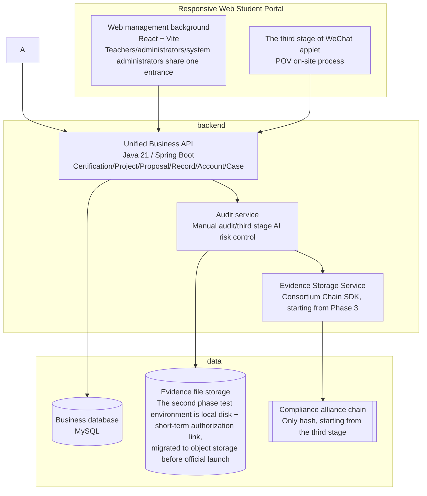

# Time Bank · Online System Solution (05-OnlineSystem)

> This document is a sub-scheme of "Time Bank Solution Design" (`01-TimeBankDesign.md`), describing the online system that carries time bank business. For audit capabilities, see `02-ManualAudit.md` and `03-AutoAudit.md`, and for evidence storage capabilities, see `04-Blockchain.md`.
>
> **This document describes the long-lived design intent for system positioning, modules, and architecture—the “why.” The authoritative page-by-page and interaction specifications are `Docs/frontend/Design.md`/`_CN.md` for the frontend and `Docs/integration/APIContract.md`/`_CN.md` for the API contract. Current implementation status is tracked in `Docs/implementation/00-Status.md`. If those three living documents differ from this document, they take precedence and this document should be updated accordingly.**

## 1. Positioning and Goals


The online system is Time Bank’s unified delivery platform, integrating **project publication, activity proposals, registration, service records, reviews (manual and automated), time coin accounts, appeals and supplemental entries, statistics, and evidence storage** to improve management efficiency and build students’ growth records.

The system adopts the construction strategy of "**Complete Web platform first, WeChat mini program post-expansion**":

- **The second phase** builds a responsive web platform that can run independently, clearly providing **student entrance** and **administrator/teacher entrance**. From project release, student registration or self-initiated activity proposals, service record submission, manual review, time coin accounting to statistics, appeal review and system management, all processes have been closed-looped on the Web - **The second phase has been basically completed and deployed to the shared test environment, entering the acceptance and online preparation phase**. For details on the acceptance progress and known infrastructure gaps (such as object storage and the second host required for disaster recovery drills), see `Docs/implementation/00-Status.md` (living document, specific numbers that will expire if not repeated in this document).
- **Phase 2 does not include WeChat Mini Program, WeCom, DingTalk, or other IM integrations**, and core services do not depend on those platforms.
- **The third phase** adds WeChat applet on the Web platform and unified backend, mainly solving mobile scenarios such as POV on-site shooting, positioning, QR code witnessing and end-side desensitization; the applet is a capability expansion, not a prerequisite for system operation. The third phase capabilities (POV) and the **fourth phase** capabilities (exchange, loan, value-added/honor system) have reserved routing, permission codes and data model entrances through a unified **Feature Flag** in the second phase, but they are closed by default: when closed, the front end does not display the corresponding entrances and uniformly prompts "not yet open", and the back end rejects the corresponding write operations - it is by no means a semi-finished state where the routing exists but the page is blank or the interface reports an error.

## 2. Web front-end entrance

### 2.1 Student entrance

- View and register online for published volunteer service projects; you can also **Self-initiated activity proposal** apply to organize a volunteer activity for other students - until the proposal is reviewed and approved, it is not a formal project, does not appear in the project center, and cannot be open for registration; once approved, the system will automatically generate a formal project draft within the same transaction and backfill the association, which still needs to be released separately by the administrator/teacher.
- Submit service records and supporting materials; the record sources are limited to "registered projects" or "self-initiated" (the third "off-campus" source is only historical data, read-only/editable and no longer available as an option for new records).
- Check the review status, accumulated service hours, time coin balance and graduation requirements progress.
- Initiate a **supplementary entry (material supplement)** or **review (appeal/objection)** case, and view all initiated cases and their processing progress in the unified "My Appeal" history list - both share the same case status model (draft → submitted → under review → resolved/requires additional information/rejected).
- View personal account flow, historical service records, return reasons and site notifications.
- Maintain personal information and guardian contact information that are allowed to be modified by oneself; authoritative fields such as student number and grade cannot be modified by oneself.

The student portal uses responsive Web and is compatible with desktop and mobile browsers; the second stage does not require the installation of apps or binding of any IM accounts.

### 2.2 Administrator/teacher entrance

- **Workbench**: Overview of pending reviews, pending cases, exception records, approaching timeouts, underachieving students and recent projects.
- **Project Management**: Create, edit, publish, close projects, configure registration time, quota, service length, person in charge and certification requirements.
- **Activity proposal review**: For activity proposal queues initiated by students independently, the review is **single-level direct decision** - any account (teacher/administrator/system administrator) with proposal review permissions can directly approve, reject or request modifications. There is no multi-level link of "first recommending approval and then forwarding for final review"; after approval, a formal project draft will be automatically generated and still needs to be released separately.
- **Registration Management**: List review, waiting list, cancellation, sign-in results and batch import.
- **Audit Center**: material preview, preliminary review, return, rejection, batch review, review comments and traces of the entire process of service records; **Case Queue** (re-entry, review, and manual adjustments initiated by staff only) is an independent queue and details workbench that is separated from it but shares the same status model.
- **Student and Organization Management**: student, class, grade, guardian, organizer, project leader and service category files.
- **Account Management**: Time coin entry (automatically generated after the service record is approved), reversal, freezing, unfreezing and complete flow; any manual adjustment must fill in the reason and write it in the audit log. Balances can never be edited directly. The data model and management entrance have been reserved for the fourth phase capabilities such as exchange and lending, but they are turned off by default by pressing the function switch.
- **Rule Configuration**: Reserved configuration slots for grade (separately set for junior high school/high school) duration requirements, conversion units, project categories, upper limits, review SLA, and exchange/loan rules.
- **Roles and Permissions**: The default roles (students, student development center administrators, and system administrators) are protected roles. Teachers and other school-defined staff roles can be added, deleted, and configured as needed in system management—roles and data ranges are not hard-coded four types of accounts, but a configurable RBAC system.
- **Statistics and Reports**: Statistics by students, classes, grades, projects, organizations and academic years, supporting filtering, exporting and personal progress reminders.
- **Data Management**: Historical ledger import, import verification, error reporting, data export, archiving and backup.
- **System Management**: role permissions, menu permissions, data range, site notification templates, operation logs, login logs and system parameters.

Roles such as administrators, student development centers, grade teachers, etc. share the same management portal (not independent portals), and realize responsibility isolation through RBAC and data scope control - teachers directly enter this portal after logging in, but the visible scope is narrowed according to the data scope to the projects, grades/classes and related resources authorized by them.

### 2.3 The entrance to the third stage mini program

The WeChat mini program is in the third phase of construction and mainly carries:

- On-site photography, GPS/time stamp collection and check-in of students.
- The witness scans the QR code to check and confirm the witness.
- End-side face desensitization, desensitization material upload and original image destruction.
- Mutual certification between team members and endorsement by guardians.
- POV submission status with necessary live feedback.

Project management, manual review, rule configuration, account management and statistical reports are still subject to the Web management background. Mini Programs and the Web share a unified account system, business API, database, review status, and account flow.

## 3. Key modules

| Module | Function | Phase 2 Status |
| --- | --- | --- |
| Project Management | Publish, edit, close volunteer service projects | Completed |
| Activity Proposal | Students independently initiate volunteer activity proposals, and after approval, a formal project draft will be automatically generated | Completed |
| Registration management | Student registration, quota control, waiting list | Completed |
| Service records | Submit service length and certification materials, project source/independent source two record paths | Completed |
| Audit Center | Manual review + AI automatic review + second review/spot check (see `02-ManualAudit.md`/`03-AutoAudit.md`) | Manual review has been completed; AI/second review is the third stage |
| Case processing | Supplementary entry, review and manual adjustment, unified status model, independent queue | Completed |
| AI service | Client-side face desensitization (WASM BlazeFace), multi-modal content review, image authenticity detection, statistical risk control engine, witness credit score (see `07-AI.md` for details) | From the third stage |
| Time coin account | Automatic account entry, balance inquiry, flow record, correction/freeze/unfreeze | Completed |
| Redemption Center | Redemption items, redemption applications, redemption review (on-campus points are written off, not uploaded to the chain) | The fourth phase is reserved, not activated |
| Loan management | Loan application, approval, return tracking | The fourth phase is reserved, not enabled |
| Evidence storage service | Key metadata hashing on the chain, TxHash backfilling (see `04-Blockchain.md`) | The third/fourth stage is enabled on demand |
| Data dashboard | Grade statistics, project statistics, compliance status | Completed |
| Notification reminders | Review reminders, failure reminders, and redemption result notifications | Site notifications have been completed; redemption related information will be activated with the fourth phase |
| Permission management | Configurable roles (default students, student development center administrators, and system administrators are protected roles, teachers and custom roles can be added or deleted) + data range | Completed |
| Basic data | Students, classes, grades, academic years, organizers, project categories and service rules | Completed |
| Data exchange | Historical ledger import, import verification, report export and archiving | Completed |
| Audit operation and maintenance | Operation logs, login logs, exception logs, system parameters, backup and recovery | Completed; disaster recovery drill is limited by the unconfigured second host/object storage, see `Docs/implementation/00-Status.md` |

In the second stage, core modules other than "AI services, POV on-site check-in, and automatic evidence storage" are completed, and a complete business closed loop is formed with manual review; entrances and data models have been reserved for fourth-stage capabilities such as exchange and lending, but are closed by default; in the third stage, POV and related AI capabilities are enabled.

## 4. System architecture suggestions



- In the second stage, the Web student portal and management backend complete the entire process through the same set of business APIs, without relying on mini programs or IM; the backend is a single Java/Spring Boot service (no Docker, deployed with systemd resident process), deployed on the same machine or network segment as MySQL.
- The third stage of **end-side desensitization** is completed locally in the mini program, and the original image is not saved on the disk (see `03-AutoAudit.md`).
- **Business data** is stored in the domestic business database; **Evidence documents** The second phase test environment is temporarily stored on local disks and accessed through short-term authorized links as a transitional alternative to object storage. It will be migrated according to the original plan before the official launch.
- **Only hash fingerprints remain on the chain**, the third phase is enabled along with POV (see `04-Blockchain.md`); the second phase does not depend on the chain.

## 5. Data Security and Privacy

- Student personal information can only be viewed by authorized personnel.
- The system generates non-overwriteable audit logs for key operations such as review decisions, account changes, role permission changes, and case processing; change decisions are made by appending new event records instead of overwriting or deleting historical records.
- The contact information of off-campus organizers/witnesses is only used for verification and will not be displayed publicly. Only hashes of sensitive items will be stored.
- Data export requires restricted permissions to prevent privacy leaks.
- Changes in the Time Coin account are retained to ensure traceability; the balance can never be edited directly.
- The processing of minors' information must obtain the consent of their guardians and follow the principle of the least necessary.
- The web platform adopts unified identity authentication (session + CSRF protection), RBAC and data range control; sensitive operations by administrators require secondary confirmation and complete traces.
- File uploads need to be verified for type, size, malicious content and access rights; evidence files are accessed through short-term authorization links and do not directly expose permanent URLs.
- Key business operations all have idempotent (idempotent keys), transactions and reversal mechanisms, and it is prohibited to directly modify account balances or delete audited records.

## 6. Implementation plan

| Stages | Cycle recommendations | Main tasks | Current status |
| --- | --- | --- | --- |
| 1. Offline system trial operation | 1 month | Confirmation system, paper forms, review responsibilities, data fields and trial operation scope | Completed |
| 2. Complete Web system | 1–2 semesters | Complete requirements and prototypes, student portal, administrator/teacher backend, project/activity proposal and registration, record submission, manual review, account flow, case processing, statistical reports, import and export, permissions and audit; migrate historical data and complete full-process acceptance and school-wide promotion | It has been basically built and deployed to the shared test environment, and the core business closed loop has been verified in the real back-end; see the specific progress of full-process acceptance and school-wide promotion `Docs/implementation/00-Status.md` |
| Three · WeChat mini program and POV | 1 semester | Based on the unified backend, add on-site shooting, GPS check-in, witness code scanning, client-side desensitization, mutual certification and endorsement, and access to AI preliminary review, risk control and optional alliance chain evidence storage | Not started, interface and data model have been reserved |
| Four · Exchange and expansion | After the system is stable | Based on the management capabilities that have been built or reserved in the second phase, formally configure and enable exchange, lending and value-added rules, access cooperation resources, carry out data analysis and continuous optimization | Not started yet, interfaces, permission codes and account flow types have been reserved |

The acceptance criteria for the second phase is not "complete some modules" but rather be completed using only the web:

```text
The administrator publishes the project (or the student-initiated activity proposal is reviewed and approved) → student registration → administrator processing list
→ Students complete services and submit records → Teacher review/return/review → Time coins will be credited to the account after passing the review
→ Students check their accounts and progress toward standards, initiate supplementary enrollment or review cases → Administrators collect statistics, export and trace the entire process through audit logs
```

The above closed loop has been connected in the real backend and deployment environment and has been verified by manual inspection; for specific acceptance scenario pass rates and known gaps (such as large-scale stress testing and disaster recovery drills), see `Docs/implementation/00-Status.md`.

During the implementation process, manual audit (`02-ManualAudit.md`) is always reserved as the main process or review channel; the mini programs and POV in the third stage must not destroy the web business closed loop. Deposit certificate on-chain (`04-Blockchain.md`) can be enabled on demand in the third phase.

## 7. Connection with other solutions

- For authoritative specifications of item-by-function pages, interaction processes and acceptance criteria, see `Docs/frontend/Design.md`/`_CN.md`; for interface definitions, see `Docs/integration/APIContract.md`/`_CN.md`; both are continuously updated with the actual construction and are sources that are more granular and updated more frequently than this document.
- The audit logic follows `02-ManualAudit.md` and `03-AutoAudit.md`.
- The evidence storage logic follows `04-Blockchain.md`.
- System rules, time requirements, and incentive systems follow `01-TimeBankDesign.md`.
- For the technical implementation, access plan and cost estimate of each AI module, see `07-AI.md`.
