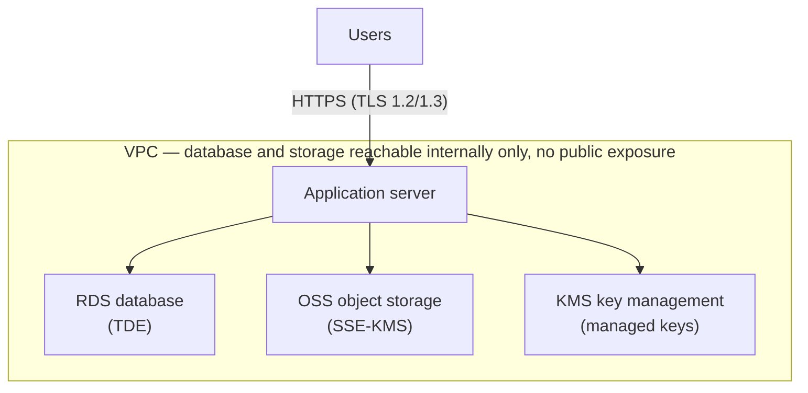

# School Volunteer Service Hours System: MLPS Level 1 Security Design Proposal

> This is the **security design proposal and compliance statement** presented to the school.
> It sets out the security architecture the system uses, the technical measures provided to
> satisfy Level 1 of China's Multi-Level Protection Scheme, and the **infrastructure the
> school must provide**. It is not an internal implementation plan.
> `Design/chinese/08-mlps-level1-security-design-guide.md` is the authoritative source;
> update both in the same change.

---

## 1. Classification and compliance basis

### 1.1 System scope
The system records and manages students' volunteer service hours and supporting evidence
(photos, scans). Its users are school administrators, reviewing teachers, and students. It
serves internal school administration only, is not open to the general public, and is not
connected to public service networks. If the system were disrupted or damaged, the impact
would be confined to internal school administration and would not endanger national
security, public order, or the public interest.

### 1.2 Classification
Under the MLPS classification guide and the MLPS 2.0 standard, this system is classified at
**Level 1 (user self-protection level)**.

Level 1 systems are **self-protected by the operator**: filing with public security
cybersecurity authorities is not mandatory, and a third-party assessment report from an
accredited body is not required. This document and its companion materials constitute the
design basis and self-assessment record for that self-protection.

### 1.3 Three obligations that apply regardless of classification

To avoid misunderstanding, the following are not waived by Level 1's exemption from
assessment, and this proposal covers all three:

1. **Network logs must be retained for at least six months** — required by Article 21 of
   the Cybersecurity Law, independent of MLPS level. See §10.
2. **PIPL applies independently.** The system processes minors' information; personal
   information of minors under 14 is **sensitive personal information** requiring separate
   guardian consent. The school bears that obligation as the personal information handler;
   this system acts as an **entrusted processor**, processing on the school's instructions
   and providing the corresponding safeguards.
3. **Source-masked data is still personal information.** The school retains the mapping from
   masked value to real student, so what the system holds is **de-identified** rather than
   **anonymized** data (PIPL Article 73), and the security obligations remain. The real
   benefit is that even in the event of a breach, the exposed content is insufficient to
   identify an individual student directly, which substantially reduces the consequences.

### 1.4 Cryptographic algorithms
Level 1 does not trigger the commercial cryptography assessment (密评, which generally
applies from Level 3). Strong general-purpose algorithms such as **AES-256-GCM** are
therefore sufficient, and the Chinese national SM4 algorithm is not required. The system
keeps encryption behind a single interface, so if the school later needs SM4 for other
reasons it can be substituted without changing business logic.

---

## 2. Security architecture overview

The design follows four principles:

1. **Data minimization** — personal information the business does not need is not collected;
   identity is masked by the school before it ever enters the system.
2. **Defense in depth** — transport, storage, access control, and audit operate
   independently, so a failure in one layer does not collapse the whole.
3. **Deny by default** — every endpoint requires authentication and data-scope checks; all
   external input is untrusted by default.
4. **Traceability** — every data change and every evidence view leaves a record, and those
   records cannot be altered through business functions.

Target deployment:

---

## 3. Infrastructure the school must provide

Some security capabilities in this proposal are provided by the cloud platform and require
the following services on the school's side. The system is already designed against these
interfaces and can connect once they are enabled.

| Component | Purpose | Security requirement addressed | Necessity |
| :--- | :--- | :--- | :--- |
| **RDS (MySQL)** | Hosts business data with **TDE** enabled | Confidentiality of stored data | **Required in production** |
| **OSS object storage** | Stores evidence photos and scans, private access + **SSE-KMS** | Confidentiality of stored data | **Required in production** |
| **KMS** | Holds the master keys for TDE and OSS; the application obtains temporary credentials via an instance role | Key management, no static credentials | **Required in production** |
| **VPC** | RDS and OSS reachable only over the internal network; no public database port | Network access control | **Required in production** |
| **Domain and TLS certificate** | Site-wide HTTPS | Transport confidentiality | **Required** |
| **Log storage capacity** | Enough capacity for six-month retention | Cybersecurity Law Art. 21 | **Required** |
| SMS service / WeCom / DingTalk | Multi-factor authentication, if selected (§8) | Stronger authentication | Optional, depends on §8 |

**On development and test environments:** local disk storage may substitute for OSS during
development and testing to keep setup costs down. To prevent that substitute reaching
production, the system includes a **configuration gate**: if the runtime environment is
marked production while storage is still local disk, the application **fails at startup with
an explicit message** rather than running silently in a degraded state.

**On database compatibility:** the system uses standard MySQL 8.0, with which Aliyun RDS
MySQL is fully compatible. TDE encrypts and decrypts transparently below the SQL layer, so
**no application code changes are required**; migration only adjusts connection settings.

---

## 4. Identity and data minimization

### 4.1 Student identity is masked before it enters the system

The system **does not receive students' complete real identities**. The school
de-identifies data before import according to the convention below, so the cloud never holds
directly identifying information. Masked values remain ordinary strings, so search, sort,
and filter functions are entirely unaffected.

| Field | Agreed format | Example |
| :--- | :--- | :--- |
| Name `displayName` | Chinese name with the middle character hidden; English name reduced to given name plus surname initial | `Alex L.(李*红)` |
| Student number `studentNumber` | A stable identifier generated by the school in Crockford base32, carrying no real student-number information | `HKTZ4HKV` |

The Chinese and English parts use **consistent masking strength**: the English name keeps
the given name and the surname initial only (`Alex L.`), not the full surname, so there is
no situation where the Chinese name is masked while the English name still identifies the
student directly. Within the class group a teacher is responsible for — typically under 100
students — the masked name is sufficient to tell students apart; across year groups, an
administrator can distinguish them using grade, class, and the student-number hash together.

### 4.2 Mandatory requirements for the student-number hash

**The hash must be permanently stable for a given student and unique school-wide.**

- The system enforces uniqueness on the student number. A collision causes the import to
  fail with an explicit error rather than silently overwriting data. The format is
  **Crockford base32**, whose alphabet deliberately omits I, L, O and U so that nothing can
  be misread as 1 or 0 — this is a value teachers read off a screen, print on a card and
  type back in. Eight characters give roughly 1.1e12 possible values: about a 1 in 226,000
  collision probability at 5,000 students, against about 1 in 344 for the eight hexadecimal
  digits this replaced.
- **Hashes must not be regenerated per academic year or per batch.** Service record numbers
  take the form `TB-{year}-{grade}-{studentNumber}-{seq}`, so the student number forms part
  of the record number itself. If a student's hash changes, previously issued record
  numbers, historical record linkage, and incremental import matching all break together.
- Asterisk-masked student numbers (such as `******24`) are not recommended: the value space
  of the last few digits is too small, collisions are certain at a few hundred students, and
  asterisks inside a record number damage both its uniqueness and its readability.

**The student number is not a login credential.** Students log in with a system-generated
eight-digit username (§8.1); the student number serves only as the roster key, as a component
of service record numbers, and as something teachers search on. Displaying it on screen or
printing it on a card is therefore not a credential exposure — it cannot be used to log in
even if it leaks.

### 4.3 Information the system does not collect

Under data minimization, the following **do not enter the system**:

- **Guardian names and contact details** — the system has no use case for them.
- **Student roster email addresses** — not collected.
- **ID numbers, home addresses, biometric data** — not part of the system's data model.

Login accounts retain an optional email field used only for future mail notifications (for
schools that need them). It is not mandatory and is kept separate from student roster data.
**Account recovery depends on neither email nor a mobile number — because there is no
self-service recovery at all**: a forgotten password means contacting an administrator, who
verifies identity offline and reissues a single-use activation code (§8.3). The causality runs
both ways and should not be collapsed into one direction: it is not merely that recovery is
offline *because* no contact details are collected. **The two hold each other up** — having no
self-service recovery is what makes contact details unnecessary, and collecting no contact
details is what stops self-service recovery from being quietly added back later. Any proposal
that would require collecting a student's mobile number or a parent's email should be
re-examined against this section and §8.3 first.

---

## 5. Storage encryption

### 5.1 Database: transparent data encryption
The business database runs with **TDE** enabled, so data is encrypted automatically when
written to disk and decrypted on read, with the master key held in KMS. Because this
operates below the SQL layer, it covers every field including names and student numbers,
**without affecting any search or sort functionality**.

### 5.2 Backup encryption
Database backup files are **encrypted independently**, with keys kept separately from the
backups. This is called out separately because TDE protects online data files and **exported
backup files fall outside its protection** — backups must be encrypted by the backup process
itself, or they become the weakest link in the chain.

### 5.3 Object storage encryption
Evidence photos and scans are stored in a **private** OSS bucket with **SSE-KMS**
server-side encryption enabled, so files are encrypted on write. The bucket forbids
anonymous public reads; all access requires temporary credentials issued after the system
authorizes the request.

### 5.4 Key management
No database password or encryption key is hardcoded in application code or configuration
files. In production the application obtains short-lived temporary credentials dynamically
through a cloud instance role (RAM Role), performs cryptographic operations in memory, and
the credentials expire automatically.

### 5.5 Note on field-level encryption
This proposal **does not apply separate application-layer encryption to individual fields**
such as name or student number, for the following reasons, offered for the school's
technical review:

- Identity is already **masked at source** (§4.1), so the system does not hold a complete
  identity to begin with, and encrypting it again adds little.
- TDE already covers the same threats (stolen disks, snapshots, or data files) with no loss
  of functionality.
- Field-level encryption makes ciphertext unusable for database search and sorting, which
  would directly break everyday functions such as looking up a student by name or sorting by
  name. Trading core usability for protection that overlaps with TDE is not a sound
  trade-off.
- Backup encryption (§5.2) already covers the one scenario TDE does not — leaked export
  files — and does so for every field at once.

---

## 6. Evidence file security

Evidence is the most sensitive data in the system: photographs may show minors' faces and
locations. The following measures apply.

### 6.1 Access control
- **Private storage:** the bucket is private, with no permanently accessible public address.
- **Short-lived signed links:** when the frontend displays evidence, the backend authorizes
  the request and issues a temporary link valid for **no more than 300 seconds**, which
  expires automatically, cannot be forwarded for lasting use, and cannot be hot-linked
  externally.
- **Scope checks:** teachers can retrieve evidence only for students within their data
  scope; out-of-scope requests return "not found" and do not reveal whether the resource
  exists.

### 6.2 Metadata stripping
Photographs taken directly on a student's phone commonly carry **GPS coordinates and device
identifiers** — a classic leakage path for minors' location data. On receipt, the system
**decodes and re-encodes** every image, discarding all metadata. If decoding fails the file
is rejected rather than stored unprocessed.

### 6.3 Upload content validation
- **True type checking:** the real file type is determined from magic bytes rather than the
  file extension or the client-declared type, preventing an executable from being uploaded
  under a renamed extension.
- **Size limits:** files over the limit are rejected.
- **Integrity digest:** a SHA-256 digest is computed and stored, forming a tamper-evident
  chain for the evidence. Verification is always performed against the file the system
  stores.

### 6.4 Watermarking and traceability
When evidence is viewed in the administrative portal, the system overlays a watermark **into
the file content itself**, carrying the **viewer's account, the time of viewing, and a
statement that the material is for volunteer-hours verification only**, for deterrence and
after-the-fact traceability.

- The watermark is **generated per view, for the specific viewer**, so different viewers
  receive different watermarks and the source of any leak can be identified.
- Watermarking is performed server-side and **does not use a frontend overlay** — a frontend
  overlay can be bypassed by opening the image address directly and would defeat the
  traceability purpose.
- **Images** (JPEG/PNG) are watermarked by server-side image processing.
- **PDFs** (scans) are watermarked using **Apache PDFBox**, overlaid into the page content
  stream and likewise generated per viewer. The system **continues to fully support PDF
  evidence upload and preview**.

PDFs require two additional measures, because the format can carry active content:

- **Sanitization:** embedded JavaScript, automatic actions, and embedded files are removed on
  upload, retaining only page content.
- **Parsing protection:** page count and file size are limited, and encrypted
  (password-protected) or structurally corrupt PDFs are rejected, so a maliciously crafted
  file cannot consume resources during parsing.

> If the school requires stronger **resistance to watermark removal** (a PDFBox overlay is
> page content, and someone with professional tools could still remove it), PDFs can instead
> be rasterized to images at view time and watermarked then. The cost is losing text
> selection and search. This proposal defaults to the former — preserving usability, with the
> watermark serving **traceability and deterrence** rather than tamper-proofing — and can be
> switched if the school requires it.

---

## 7. Data import validation rules

Bulk import is the main entry point for external data. **All validation is performed
server-side**; frontend validation exists only to improve the filling-in experience and is
not a security boundary.

### 7.1 Processing principles

1. **Reject rather than auto-correct.** Non-compliant rows are returned with the reason; the
   system never silently "fixes" and stores them, because quietly rewriting student data
   would break consistency with the school's source of record.
2. **Two phases.** A read-only validation phase produces a report; only after confirmation
   does the commit phase run, and it **re-runs every check in full** rather than trusting the
   earlier result.
3. **Commit only if the entire file is valid**, so a half-loaded dataset never creates an
   intractable intermediate state. Two mechanisms hold this rather than a procedural
   convention: a single invalid row ends validation in a *failed* state from which commit
   cannot be started, and the commit itself is **one transaction**, so a row that is no
   longer valid when re-checked rolls the whole file back along with the rows already
   applied. There is therefore no "skip the bad rows and load the rest" outcome, and no need
   for resumable checkpoints — there is no half-loaded file to resume.
4. **Per-row error reports** give the row number, field, error type, and explanation so the
   school can locate and correct them.

### 7.2 Data validity checks

| Check type | Rule |
| :--- | :--- |
| Required | Student number and name must not be empty |
| Unique within file | A student number must not repeat within one file |
| Globally unique | A student number must not duplicate an existing student |
| Valid reference | Grade, class, and academic year must already exist in the system |
| Consistent reference | The class must belong to the stated grade |
| Format | Graduation year is an integer no earlier than 2000; enrolment date is `yyyy-MM-dd` |
| Length | Name up to 100 characters; student number up to 32 |
| Student number format | Crockford base32 only (digits and letters excluding I, L, O, U), matching the §4.2 format |

**Account creation after validation passes**: the commit stage generates one school-wide
unique eight-digit random username per new student. Uniqueness is enforced by a database
constraint, and a collision is retried automatically rather than written through. The account
**has no usable password, and so cannot be logged into**, until the student activates it
(§8.3).

### 7.3 Unsafe content rejection

The following are rejected even when technically well-formed, to prevent attacks entering
through the data channel:

| Risk | Rule |
| :--- | :--- |
| **Spreadsheet formula injection** | Text fields beginning with `=`, `+`, `-`, `@`, tab, or carriage return are rejected. Such content is executed as a formula when an exported file is opened in spreadsheet software, and can be used to exfiltrate data or lure clicks. The system rejects on import and escapes on export, for protection in both directions |
| **Control characters** | NUL bytes and other C0/C1 control characters are rejected |
| **Display spoofing** | Bidirectional override characters (such as U+202E) are rejected, since they can make the displayed text differ from what is stored |
| **Oversized data** | Row count and file size are capped per file and rejected beyond the limit, preventing resource exhaustion |
| **Column misalignment** | Quotes and commas are parsed per RFC 4180, so a name containing a comma does not shift columns |

### 7.4 Authorization and record-keeping
- Import and export endpoints are constrained by both role permissions and data scope; a
  teacher cannot export students outside their responsibility.
- Every import and export writes an audit record: operator, time, source IP, file digest,
  and number of affected rows.
- Temporary files created during processing are deleted deterministically when the job ends.

---

## 8. Authentication and multi-factor authentication (MFA)

### 8.1 Authentication measures in place
- **A single login identifier**: the login form accepts a username and nothing else. Students
  get a system-generated eight-digit random number (no leading zeros, stored as a string);
  staff keep `teacher001`-style names. One namespace system-wide, one unique index. There is
  no fallback matching of "username first, then student number, then staff ID" — one typed
  value could match one person's username and another person's student number, and a
  misordered fallback logs somebody into the wrong account. Username comparison is
  case-insensitive.
- Passwords are stored **salted and hashed** (bcrypt); no recoverable plaintext password
  exists in the system.
- A **strong password policy** (§8.2) and login-failure lockout (the account locks for a period
  after consecutive failures) defend against brute force.
- Sessions use cookies with `Secure`, `HttpOnly`, and `SameSite` attributes, with CSRF
  protection.
- There is **no public registration**; accounts are created by administrators or generated by
  roster import.
- There is **no self-service password recovery**. No "forgot password" channel exists; a
  forgotten password is handled by an administrator who verifies identity offline (§8.3).
- There are **seven unauthenticated endpoints, and only two of them touch credentials**:
  login, activation, logout, CSRF-token retrieval, two health probes, and the school-name
  endpoint the login page needs (plus `/actuator/**`, reachable on loopback only and never
  exposed through the reverse proxy). **What matters is that neither credential endpoint will
  issue anything because a caller named an account**: login requires that account's password,
  and activation **takes no username at all** — the code is its own lookup key, so the
  endpoint never has to be told, and therefore never has to confirm, which student a code
  belongs to (§8.3). The other five touch no account: logout destroys only the caller's own
  session, a CSRF token is tied to no account, the probes report liveness, and the school-name
  endpoint returns a school's name.
  > This previously read "the system has exactly two unauthenticated endpoints". That did not
  > match the code (found in the 2026-09-21 self-assessment), though **the conclusion it drew
  > was sound** — the difference is that the other five involve no account at all, not that
  > they issue credentials. A list that can be checked line by line beats an assertion that
  > cannot.

### 8.2 Password policy

**One rule, applied at every point a password is set** — a student choosing theirs
at activation, an administrator setting a staff account's initial password, and a
user changing their own. All three call the same validator, so there is no entry
point with a laxer standard.

| Rule | Requirement |
| :--- | :--- |
| Length | **At least 12 characters**, at most 128 |
| Complexity | **At least 3 of 4** classes: lowercase, uppercase, digit, symbol |
| Weak-password blocklist | Common passwords are refused — **and so is any password merely containing one** (`Xq7-Password-Zz`), because padding a weak word out to length does not strengthen it |
| Product name | Refused if it contains the system's own name (`timebank`), which is the first thing anyone asked to pick a password *for this system* reaches for |
| Username | Refused if it contains the account's own username, case-insensitively. A student's first instinct is to reuse the number printed on their slip |
| Runs | Refused if it is a single repeated character, or a constant-step run (`abcdefghijkl`, `123456789012`, and reverses) |

**Why three of four rather than all four.** Requiring a symbol of every
twelve-year-old produces `Password1!` — formally compliant, weak in practice — and
passwords written inside a pencil case, which would defeat the entire point of the
credential slip. Three of four satisfies an MLPS reviewer looking for 强制密码策略
while staying within what a child can actually manage.

**Why a blocklist is needed on top of the complexity rule.** On length and
composition alone, `Password1234` passes: twelve characters, three classes. What
actually rejects it is the blocklist, not the composition rule. Both are required.

**Enforcement is server-side.** The interface shows, as the user types, which
requirements are met, and keeps the submit button disabled until all of them are —
but that is a courtesy, **not the security boundary**. The authoritative
implementation is a domain-layer rule that all three set-password paths call, so
bypassing the interface and calling the API directly is refused identically. It
returns every unmet requirement at once as field errors, rather than revealing one
per round trip.

### 8.3 Account creation and first-time activation

Student accounts are created by roster import, staff accounts by an administrator, and in
**neither case does any password exist at creation** — none generated by the server, and none
typed by an administrator either. No password plaintext therefore exists in the system, and no
"initial password list" — the kind of high-risk artefact that must be distributed once and then
destroyed — is ever produced. First access happens through a **single-use activation code**, and
the account's owner chooses their own password during activation.

| Measure | Detail |
| :--- | :--- |
| **No password means no login** | An unactivated account has no password hash and is structurally impossible to log into. No account can be used before its credential slip reaches the student — the guarantee holds by data structure, not by process discipline. The pre-authentication check requires *both* an enabled status **and** a stored password hash, so setting an account to enabled by hand still does not make it usable |
| **Activation codes stored as a digest** | Codes are stored as a **SHA-256 digest** and looked up by that digest; no plaintext is held. bcrypt is **deliberately not used** here: by the §2.5 design the code is its own lookup key (a student redeems it without typing a username), and a salted hash cannot be looked up. The protection therefore does not come from the digest algorithm but from **single use + a short validity window + the account holding no data yet** — a different mechanism from the one protecting passwords, and not to be read as equivalent to it |
| **Single use** | A code is invalidated the moment it is successfully redeemed |
| **Time-limited** | Expires 7 days after issue by default; the school configures the window, and it is **printed on the credential slip** |
| **Expiry is its own state** | An account that expires unactivated enters a distinct "expired" state rather than reusing "locked" — otherwise an administrator cannot tell an account locked by brute force from one whose slip was never collected, and the two need different responses |
| **Activated means the password was set** | Activation counts only once the password is successfully set, so an abandoned half-activation leaves no ambiguous state |
| **A global failure budget** | Beyond per-IP rate limiting, the activation endpoint carries a **system-wide failure budget** (a few hundred per hour). Distributed guessing can evade a per-IP limit but not a global budget, and legitimate activation traffic is concentrated and rare enough that the threshold never interferes |
| **Reissue spares activated students** | When slips are lost, reissue regenerates codes only for members of the batch **still unactivated**; students who already chose a password are untouched |
| **Password reset uses the same path** | A student who forgets their password goes through the same activation-code path. No second credential mechanism, and no email address or mobile number required |
| **Staff accounts use the same path too** | A teacher or administrator account is created with **no password**, in the same pending state, and is issued the same single-use code on the same slip. Were an administrator to type an initial password instead, the only copy of a new teacher's credential would live in whatever message was used to pass it on — precisely the "initial password list" this section says the system does not produce, relocated rather than removed. **No role is an exception**, which is what makes the promise above checkable rather than a statement about students only |

**There is no self-service password recovery, by design — this is a decision, not something
not yet built.** The only route for a forgotten password is to **contact an administrator
offline** — in person, or by a paper or email request — who verifies the person's identity and
then reissues a single-use activation code and slip, the same path described in the table
above. The login page's *"Forgot password? Contact admin"* is the complete statement of that
policy; there is no self-service channel behind it.

Three reasons:

1. **No unauthenticated endpoint may mint a credential for an arbitrary account.** An endpoint
   that starts a reset from a typed username is, whatever it does with the resulting
   credential, a way for anyone who knows a username to make the system generate a usable
   credential for that account. Student usernames here are eight digits; one slip left on a
   desk, or one classmate saying it out loud, is enough to "know a username". The strong
   password policy in §8.2 and the lockout in §8.1 protect the *guessing* path — they do nothing about a
   second issuing path that goes around passwords entirely. MLPS Level 1 requires that the
   authentication mechanism cannot be bypassed, and this is what that means here.
2. **Delivering a credential needs a trusted channel, and §4.3 deliberately collects no
   student contact details.** Self-service recovery has to reach *the person*, and the only
   channels the system could prove belong to them are an email address or a mobile number.
   Collecting a minor's contact details to support a recovery feature trades a convenience for
   a body of personal data that otherwise need not exist — squarely against §4.3's
   minimization. Offline verification needs none of it: the administrator already knows the
   student, and the school already has a roster.
3. **There should be exactly one credential mechanism.** The promise §8.3 makes to schools is
   that the server never generates a password and no password plaintext exists anywhere. Two
   parallel credential mechanisms mean that promise has to hold in two places at once, and
   fails if either gives way. With one path, it is guaranteed by the fact that **only one
   code path in the system sets a password**, checked continuously by an automated rule rather
   than resting on process discipline.

This is not a gap awaiting a later release. A token-based self-service pair
(`/auth/forgot-password` and `/auth/reset-password`) did exist, was never wired into the
frontend, and has been removed along with its table for exactly the three reasons above.
**The cost is explicit**: a student who forgets their password at night cannot recover it
themselves and must find an administrator the next day. For a school-internal system where a
student account reaches only that student's own service records, and where the account carries
nothing of realisable value, that delay is a smaller cost than exposing an unauthenticated
endpoint that issues credentials for any named account.

**Security conventions for the credential slip** — the slip is the printed article carrying a
username and an activation code, making it the most sensitive product of this system after
evidence photographs:

- One slip per student, carrying the name, the username, a QR code, and the typed activation
  code. The QR and the text carry **the same** code, not two separate credentials.
- **Every individual slip** carries its own **provenance line** (issued by, issued at, valid
  before), rather than one line per printed page — the sheet may be cut, and a page-level mark
  survives on only one of the pieces.
- The slip also prints the **site's root domain in text**. This design asks a student to scan
  a code and then type a credential into whatever page opens, which is precisely the behaviour
  phishing exploits; printing the real domain gives them something to check the address bar
  against.
- Generating and downloading slip PDFs is bound by role permissions and data scope, and is
  written to the audit log (issuer, time, batch, number of slips).

### 8.4 Current status of MFA

The system **has MFA capability reserved but not yet enabled**, for two reasons:

1. The system is currently in its **development and testing stage**, and enabling MFA would
   interrupt automated test procedures. Before go-live, a configuration of "exempt in
   non-production, enforced in production" will resolve this.
2. **More importantly, the MFA approach requires a joint decision with the school** rather
   than being chosen unilaterally by the system provider. The options differ substantially in
   cost, user burden, privacy impact, and dependence on the school's existing IT environment,
   and the choice must fit the school's actual circumstances.

### 8.5 Comparison of MFA approaches

| Approach | Security | Cost | User burden | Privacy impact | Dependencies |
| :--- | :--- | :--- | :--- | :--- | :--- |
| **① TOTP** (authenticator app) | High. Generated offline, never transmitted, unaffected by carrier or SMS interception | **Zero**, no per-use fee | Must install an app and enrol once; re-enrolment when changing phones | **No new personal information** | None |
| **② SMS one-time code** | Medium. Vulnerable to SIM swap and SMS interception | Per-message charge, an ongoing cost | **Lowest** — the most familiar to users | **Requires collecting mobile numbers**, conflicting with this proposal's data minimization | Requires an SMS service |
| **③ WeCom / DingTalk scan** | High. Backed by an enterprise identity system | Near zero if the school already uses one | Low — teachers usually have it installed | Identity linked to a third-party platform | **The school must already run** WeCom or DingTalk |
| **④ WeChat Mini Program confirmation** | High | Requires mini-program development and certification | Low — no extra app needed | Requires binding a WeChat identity | Could be built together with the Phase 3 witness mini-program |
| **⑤ Email one-time code** | Lower. The mailbox itself is often single-factor | Low | Medium — must check email | Requires a usable mailbox | Requires a mail service |
| **⑥ Passkeys / security keys** (WebAuthn) | **Highest**, phishing-resistant | Hardware keys must be purchased; device biometrics are free | Medium — devices must be registered | No new personal information | Requires a recent browser |

### 8.6 Recommended scope

MFA need not apply uniformly to all users. We suggest tiering by privilege:

| Account type | Recommendation | Rationale |
| :--- | :--- | :--- |
| System and school administrators | **Mandatory** | They can see school-wide data and hold the highest privileges |
| Reviewing teachers | Recommended; the school may decide | They can see student data within their scope |
| Students | **Not required** | Students are mostly minors, and requiring an authenticator app is a disproportionate burden; their accounts reach only their own data |

### 8.7 Recommendation

If the school **already runs WeCom or DingTalk**, we recommend **approach ③**: teachers need
install nothing further, and it is the cheapest to adopt.

If the school does **not** run either, we recommend **approach ① (TOTP)**: zero cost, no new
personal information, no dependence on carrier infrastructure, and it works equally well for
overseas or multi-campus situations.

**We do not recommend SMS codes (approach ②) as a first choice**: it requires the system to
collect and store mobile numbers, directly conflicting with this proposal's decision not to
collect students' or guardians' contact details, carries an ongoing per-message cost, and is
less secure than free TOTP.

The final choice rests with the school on the basis of the comparison above; the system will
be implemented to match.

---

## 9. Transport and interface security

| Item | Measure |
| :--- | :--- |
| Transport encryption | Site-wide **HTTPS** (port 80 redirects wholesale to 443), **TLS 1.2 / 1.3 only**, with known-weak protocol versions and cipher suites disabled. The restriction belongs in the reverse proxy's **global default** as well as this site's own server block — otherwise a site added later inherits the distribution default, which still names TLS 1.0 and 1.1 |
| Transport policy | HSTS enabled with `max-age` of **at least one year** (currently `31536000`), so browsers always use HTTPS thereafter. `includeSubDomains` and `preload` are deliberately not set: preload is a public list that is easy to join and slow to leave, and committing a domain to it before the school has settled its production domain is not ours to decide |
| Content security policy | CSP configured to restrict script sources and limit the impact of cross-site scripting |
| Session security | Cookies set `Secure`, `HttpOnly`, `SameSite`; no sensitive plaintext in client-side storage |
| Cross-site request forgery | CSRF token validation enabled |
| Access control | Every endpoint enforces role-based permission checks and data-scope checks, preventing both horizontal and vertical privilege escalation |
| Input handling | All external input is validated and escaped, preventing injection and cross-site scripting |
| Database connections | The database is reachable only within the VPC, with no public port; cross-host connections use TLS |

---

## 10. Logging and audit

### 10.1 Retention
Application audit logs, server and database operation logs, and access logs are retained
centrally for **no less than six months**, meeting the requirement of Article 21 of the
Cybersecurity Law.

### 10.2 Audit log properties
- **Append-only and immutable:** once written, audit records cannot be modified or deleted
  through business functions, which guarantees traceability structurally.
- **Covers every data change:** creation, modification, review decisions, and hour crediting
  all leave records.
- **Recorded fields:** operator, time, source IP, operation type, object identifier, and
  before/after state.
- **Review decisions are never overwritten:** changing a conclusion appends a new decision
  record rather than editing the original, preserving the full decision history.

### 10.3 Traceability of hour accounts
A student's hour balance is **derived entirely from transactions**; the system provides no
function to edit a balance directly. Corrections and reversals are made by appending an
offsetting transaction, so original records are retained permanently and the account is fully
auditable.

---

## 11. Mapping to MLPS Level 1 requirements

| Control area | Measures in this proposal |
| :--- | :--- |
| Identification and authentication | A single login identifier, a **uniform strong password policy (≥12 chars, 3-of-4 classes, blocklist and username rejection, §8.2)**, salted hashing, login lockout, no public registration, **no self-service password recovery** (§8.1/§8.2); first access by single-use activation code with **no initial password of any kind, for any role** — neither server-generated nor administrator-typed (§8.2/§8.3); MFA per §8 |
| Access control | RBAC plus data-scope checks, least privilege, no resource-existence disclosure on out-of-scope requests |
| Security audit | Append-only, tamper-resistant audit log covering every data change, retained ≥6 months |
| Intrusion prevention | Input validation, true file-type checking, upload sanitization, rate limiting, minimal open ports |
| Malicious code prevention | Upload type allow-list and content sanitization; removal of PDF active content |
| Data confidentiality | TLS 1.2/1.3 in transit; TDE and OSS SSE-KMS at rest; independently encrypted backups |
| Data integrity | SHA-256 evidence chain; balances derived from immutable transactions |
| Backup and recovery | Regular database backups stored encrypted, with keys held separately |
| Residual information protection | Deterministic temporary-file deletion; mandatory image metadata stripping |
| Personal information protection | Masking at source, no collection of unnecessary personal information, short-lived signed links, watermark traceability |

---

## 12. Implementation and acceptance self-assessment

This table is the self-assessment record for Level 1 self-protection: each item is confirmed
and ticked during implementation and acceptance, and forms part of the archived materials
(§13). Items marked **[School]** require confirmation from the school; the rest are completed
by the implementer.

**The "Built" column records what the system actually does as of 2026-09-21**, checked item by
item against the code and the deployed environment. It is not a forecast. **The "Accepted"
column is still unticked by design**: it records the school signing an item off in the real
production environment, which is a different question from whether the system implements it.

**On the external dependencies.** RDS, OSS, KMS, and the VPC listed in §3 are **cloud services
the school provisions**, and they are not available yet. The system currently runs on **a single
server**: self-hosted MySQL 8.0, evidence files on the application server's local disk, nginx
terminating TLS. Every item that cannot hold without those services is therefore marked
**⏳ awaiting infrastructure** rather than "not implemented" — the system-side design for each is
complete (§3, §5), but until the services exist the work **can neither be done nor verified**,
and showing it as passed or failed would be equally untrue.

| Mark | Meaning |
| :--- | :--- |
| ✅ | Implemented, and checked against the code or a live environment |
| ⚠️ | Partially implemented, or differing from this document's own prose — the difference is stated in Notes |
| ⏳ | Awaiting external infrastructure (RDS/OSS/KMS/VPC) before it can be implemented or verified |
| ⬜ | Not implemented |
| — | The school performs or confirms this; there is nothing system-side to check |

### 12.1 Infrastructure prerequisites

| ID | Check | Built | Notes | Accepted |
| :--- | :--- | :--- | :--- | :--- |
| P-01 | **[School]** RDS provisioned with TDE enabled | ⏳ | Currently self-hosted MySQL 8.0 on one host, no TDE (the community edition does not offer it). Migrating to RDS changes connection configuration only (§3) | [ ] |
| P-02 | **[School]** OSS bucket provisioned and set to private access | ⏳ | Evidence currently stored on the application server's local disk via `LocalFileStorage` | [ ] |
| P-03 | **[School]** OSS SSE-KMS server-side encryption enabled | ⏳ | Per P-02 | [ ] |
| P-04 | **[School]** KMS provisioned; master keys held in KMS | ⏳ | Database password and file-token secret are currently injected through a permission-restricted systemd environment file, never the repository | [ ] |
| P-05 | RDS and OSS reachable only via VPC; no public database port | ⚠️ | The database listens on `127.0.0.1:3306` on the same host as the application and is not publicly reachable — equivalent on "unreachable from the internet", but not a VPC design. Re-confirm after the RDS migration | [ ] |
| P-06 | **[School]** Domain and TLS certificate ready | ⚠️ | Ready in the test environment (Let's Encrypt, auto-renewing); **the production domain and certificate are still for the school to supply** | [ ] |
| P-07 | **[School]** Log storage capacity sufficient for six months | ⚠️ | 180-day retention configured on the test server (see O-01); production capacity still needs sizing by the school against real log volume | [ ] |

### 12.2 Data and storage

| ID | Check | Built | Notes | Accepted |
| :--- | :--- | :--- | :--- | :--- |
| D-01 | Database TDE active | ⏳ | Depends on P-01 | [ ] |
| D-02 | Master key backed up separately from data, and recovery verified | ⏳ | Depends on P-04 | [ ] |
| D-03 | Database backups encrypted, with keys held separately | ⏳ | No institutional backup process in the test environment. This must be established with production rather than assumed covered by RDS automatic backups — §5.2's whole point is that TDE does not protect an exported file | [ ] |
| D-04 | No hardcoded passwords or keys; production credentials obtained via instance role | ⚠️ | First half met: no password or key anywhere in the repository, and `deploy.sh`/`verify.sh` read everything from the environment. The second half (RAM Role temporary credentials) depends on P-04 | [ ] |
| D-05 | Guardian name, guardian contact, and roster email are not collected | ✅ | The `Student` entity carries no such field; the legacy `guardian_name`/`guardian_contact` columns were dropped by migration `V26` | [ ] |
| D-06 | **[School]** Name masking follows the §4.1 convention (consistent across Chinese and English) | — | Performed by the school before import. The system does not check masking strength, and could not — what reaches it is a string | [ ] |
| D-07 | **[School]** Student-number hash stability confirmed: unchanged across years and batches | — | The uniqueness constraint and format check are in force system-side (see I-01); "unchanged across years" can only be guaranteed where the value is generated | [ ] |
| D-08 | Application fails at startup if local disk storage is used in production | ✅ | Tightened 2026-09-21 (issue 148) into the allow-list it always claimed to be: on local disk, **any** environment not on the known non-production list — including missing and unset — refuses to start, and the message names the accepted values. The old gap (an unset marker only warned) is closed because the integration suite and the Docker stack now declare their environment, which is what let the default become fatal. Measured: `uat` exits with code 1; `local` and `test-server` start normally | [ ] |

### 12.3 Evidence files

| ID | Check | Built | Notes | Accepted |
| :--- | :--- | :--- | :--- | :--- |
| F-01 | Bucket forbids anonymous public reads; no fixed accessible address | ⏳ | Depends on P-02. The local storage directory is outside the web root, so there is no static path to it; every retrieval goes through the backend | [ ] |
| F-02 | Evidence retrieved via signed links valid ≤300 seconds | ✅ | `DownloadTokenService` fixes this at 300 seconds; verified once by waiting out a real expiry rather than reading the constant | [ ] |
| F-03 | Photo metadata (GPS/device) stripped; decode failure treated as rejection | ✅ | Decode-and-re-encode drops metadata; a failed decode throws rather than passing the original through | [ ] |
| F-04 | Magic-byte true type checking plus size limits | ✅ | `BasicFileScanner` | [ ] |
| F-05 | SHA-256 digest stored; verification against the stored file | ✅ | | [ ] |
| F-06 | Image watermark generated per viewer (account, time, purpose statement) | ✅ | The identifier is now the viewer's **name and email** in RFC 5322 mailbox form rather than their username, which traces to a person more directly; an account with no email falls back to the username | [ ] |
| F-07 | PDF watermark generated per viewer via Apache PDFBox | ✅ | | [ ] |
| F-08 | Embedded JavaScript, automatic actions, and embedded files removed from PDFs | ✅ | `PdfSanitizer` | [ ] |
| F-09 | PDF page-count and size limits; encrypted or corrupt PDFs rejected | ✅ | Rejected, not repaired | [ ] |
| F-10 | Out-of-scope evidence requests return "not found" without disclosing existence | ✅ | | [ ] |

### 12.4 Data import

| ID | Check | Built | Notes | Accepted |
| :--- | :--- | :--- | :--- | :--- |
| I-01 | Required, in-file unique, globally unique, valid and consistent reference, format, length checks | ✅ | Rule sets are configured per import type (`ImportRuleSet`) | [ ] |
| I-02 | Two-phase execution with full re-validation at commit | ✅ | Commit re-runs the same row validator on every row and trusts nothing cached from validation | [ ] |
| I-03 | Commit only when the whole file is valid; no partial loads | ✅ | Code changed 2026-09-21 (issue 146): any invalid row ends the job in `VALIDATION_FAILED`, which commit will not accept, and the commit itself is one transaction — a row that fails re-validation at commit time rolls the whole file back. Checkpoint-resume went with it; there is no half-applied file left to resume | [ ] |
| I-04 | Formula injection: rejected on import, escaped on export | ✅ | The export triggers include `=`, `+`, `-`, `@`, tab, and carriage return — the last two matter, because a spreadsheet skips them before deciding whether a cell is a formula | [ ] |
| I-05 | Control characters and bidirectional override characters rejected | ✅ | | [ ] |
| I-06 | RFC 4180 parsing of quotes and commas; names with commas do not misalign | ✅ | `Rfc4180Reader` | [ ] |
| I-07 | Row-count and file-size caps per file | ✅ | 10,000 rows / 10 MiB by default, configurable per import type | [ ] |
| I-08 | Import/export constrained by permissions and data scope | ✅ | Export permissions are split per export type; the system administrator holds no import or export permission at all | [ ] |
| I-09 | Import/export audited (operator, time, IP, file digest, affected rows) | ✅ | Closed 2026-09-21 (issue 149): import now writes `import.create` on upload (type, SHA-256, byte size) and `import.commit` **inside the commit transaction** (type, SHA-256, rows committed), so an import that rolled back leaves no row claiming it happened. The upload is recorded separately because since issue 146 a file with any bad row is a complete no-op, and auditing only the commit would leave a rejected import with no trace at all. This also fixed a related defect: the commit runs on a background thread, where every audit row it wrote — including the per-row `student.create` entries — previously carried no IP and a `no-request` id. The requester's identity now travels with the job (`RequestContext.runWithin`, cleared in a `finally`) | [ ] |
| I-10 | Temporary files deleted deterministically | ✅ | | [ ] |

### 12.5 Authentication, account creation, and MFA

| ID | Check | Built | Notes | Accepted |
| :--- | :--- | :--- | :--- | :--- |
| A-01 | Passwords salted and hashed; no recoverable plaintext | ✅ | bcrypt | [ ] |
| A-02 | Login-failure lockout enabled | ✅ | | [ ] |
| A-02a | Password policy in force: ≥12 characters, at least 3 of 4 character classes, rejecting common passwords / the product name / the username / runs | ✅ | | [ ] |
| A-02b | All three set-password paths share one server-side validator; bypassing the UI and calling the API is refused identically | ✅ | | [ ] |
| A-03 | No public registration; accounts created by administrators or roster import only | ✅ | | [ ] |
| A-04 | Login accepts a username only, with no fallback to student number or staff ID; comparison is case-insensitive | ✅ | | [ ] |
| A-05 | Student usernames are eight random digits, no leading zeros, stored as strings, unique database-wide | ✅ | | [ ] |
| A-06 | The server generates no initial password at any point | ✅ | | [ ] |
| A-07 | Unactivated accounts have no password hash and cannot be logged into; the pre-authentication check verifies both an enabled status and a stored hash | ✅ | | [ ] |
| A-08 | Activation codes stored as a SHA-256 digest, single-use, time-limited; the window is configurable and printed on the slip | ✅ | | [ ] |
| A-09 | Accounts that expire unactivated enter a distinct "expired" state, distinguishable from "locked" | ✅ | | [ ] |
| A-10 | The activation endpoint enforces both per-IP rate limiting and a system-wide failure budget | ✅ | Both live in the application, not in reverse-proxy configuration | [ ] |
| A-11 | Reissue covers only still-unactivated students, leaving those who set a password untouched | ✅ | | [ ] |
| A-12 | Every slip carries a provenance line and the site root domain; slip generation and download are permission- and scope-bound and audit-logged | ✅ | The site root comes from a deployment variable whose absence refuses the deploy | [ ] |
| A-13 | **[School]** MFA approach selected and signed off per the §8.5 comparison | ⬜ | Not yet settled with the school; §8.4 already states this is a joint decision rather than an implementation oversight | [ ] |
| A-14 | MFA enforced for administrator accounts | ⬜ | Depends on A-13 | [ ] |
| A-15 | Non-production exemption configured so automated testing is unaffected | ⬜ | Ships with MFA | [ ] |
| A-16 | No self-service password recovery entry point exists; of the unauthenticated endpoints only login and activation touch credentials, and neither issues one because a caller named an account | ✅ | The recovery endpoints and their table are gone, and `NoSelfServicePasswordRecoveryTest` fails the build if they return. 2026-09-21 (issue 150): §8.1's "exactly two unauthenticated endpoints" did not match the code and now lists all seven, saying which two touch credentials and why the other five touch no account. The same day, the reverse proxy's rate-limit rule still naming the removed recovery paths was cleaned up — those paths return 404, and login's rate limit was measured still firing afterwards | [ ] |

### 12.6 Transport and interfaces

| ID | Check | Built | Notes | Accepted |
| :--- | :--- | :--- | :--- | :--- |
| T-01 | Site-wide HTTPS enforced | ✅ | Port 80 redirects wholesale (301) to 443 | [ ] |
| T-02 | TLS 1.2/1.3 only; weak versions and cipher suites disabled | ✅ | Converged 2026-09-21 (issue 147): the reverse proxy's global default is now `TLSv1.2 TLSv1.3` too, rather than relying on the site-level include to override it. Measured with a client forced to offer the old versions: TLS 1.0 and 1.1 are refused with a protocol-version alert, 1.2 and 1.3 complete | [ ] |
| T-03 | HSTS enabled, `max-age` ≥ 1 year | ✅ | Raised from 30 days to `max-age=31536000` on 2026-09-21 (issue 147); confirmed in the served response header. `includeSubDomains`/`preload` deliberately not set — see §9 | [ ] |
| T-04 | CSP configured | ✅ | `default-src 'self'`, framing refused (`frame-ancestors 'none'`) | [ ] |
| T-05 | Cookies `Secure`/`HttpOnly`/`SameSite`; no sensitive plaintext in local storage | ✅ | All three attributes set on the session cookie. Local storage holds the current user's display information and language preference only — no password, session token, or evidence URL | [ ] |
| T-06 | CSRF token validation enabled | ✅ | Double-submit cookie | [ ] |
| T-07 | Every endpoint enforces RBAC and data-scope checks | ✅ | Enforced by the `PermissionAnnotationTest` architecture test: an endpoint without a permission annotation fails the build | [ ] |
| T-08 | Cross-host database connections use TLS | ⏳ | Application and database are currently on one host (`127.0.0.1:3306`), so the requirement is not yet triggered. Mandatory after the RDS migration, and verified then | [ ] |

### 12.7 Logging and audit

| ID | Check | Built | Notes | Accepted |
| :--- | :--- | :--- | :--- | :--- |
| O-01 | **Statutory**: application, server, database, and access logs retained ≥6 months | ⚠️ | Test server: access logs 180 days, system logs 180 days, application audit and login logs partitioned monthly with 12-month retention — all checked against the live configuration. **Central retention is not yet established** — each stream is retained locally today; the production arrangement is still to settle with the school | [ ] |
| O-02 | Audit log append-only; not modifiable or deletable through business functions | ✅ | The audit repository exposes only a write and queries — there is no update or delete path. Structural, not a convention | [ ] |
| O-03 | All data changes recorded, verified by real queries | ✅ | Each verification pass confirms this with a real `GET /audit-logs` query rather than by reading the code | [ ] |
| O-04 | Review decisions appended, never overwriting the original | ✅ | | [ ] |
| O-05 | Hour balances derived solely from immutable transactions; no direct balance edit | ✅ | | [ ] |

### 12.8 Outstanding

The items above that **do not depend on school infrastructure** — these, and only these, are the
implementer's current debt:

| ID | Item | Nature |
| :--- | :--- | :--- |
| A-13/A-14/A-15 | MFA approach undecided, not enabled | Implement once the school decides (§8.4) |
| O-01 | No central log-retention arrangement | Settle with the school alongside production operations |

Items marked ⏳ (P-01–P-05, the second half of D-01–D-04, F-01, T-08) are deliberately not in
this list: they are not debt but work that **cannot start** until the school provisions RDS, OSS,
KMS, and the VPC.

---

## 13. Archive list

1. System Classification Report (MLPS Level 1)
2. System Security and Privacy Protection Design Proposal (this document)
3. Student Data Import Format and Masking Convention — the import agreement handed to the
   school, which must include the **hash stability** requirement from §4.2
4. Student Account Creation and Credential Slip Issuance Standard — the activation-code
   validity window, how slips are distributed, and the requirements for signing them out and
   destroying them after use (§8.3)
5. MFA Approach Selection Confirmation — the §8.5 comparison and the school's final choice
6. Network Security Log Retention and Operations Management Standard (six months)
