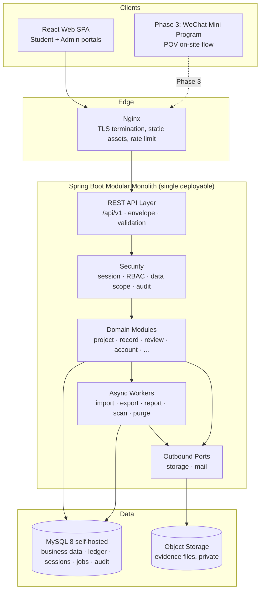

# TimeBank · Backend Design

> This document defines the top-level backend design for the TimeBank Phase 2 web platform: architecture, module decomposition, technology stack, and the reasoning behind each significant technical choice. It is the counterpart to `Docs/frontend/Design.md` and implements the contract defined in `Docs/integration/APIContract.md`. It does **not** contain table DDL, field-level schemas, or a task-level implementation plan — those follow after this document is reviewed and approved.

---

## Part A · Context

## 1. Purpose and Scope

The backend is the single authority for business rules, permissions, state transitions, and account consistency in the TimeBank system. Every capability reaches the frontend through the versioned REST API defined in `APIContract.md`.

**In scope for Phase 2:**

- Authentication, RBAC, and data-scope enforcement.
- Projects, registrations, student event proposals, service records, review workflow, appeals.
- Time-coin accounts and the immutable transaction ledger.
- Progress tracking against grade/phase hour requirements.
- Rules configuration, base data, notifications, dashboards, reports.
- File/evidence upload and controlled access.
- Historical ledger import, data export, audit and login logs.

**Explicitly out of scope for Phase 2 (but must be designed for):**

- Phase 3: POV on-site witness flow, WeChat Mini Program clients, AI review/risk scoring, blockchain attestation.
- Phase 4: redemption, borrowing, value-added/bonus rules.

These are reserved as extension seams (§14) and must not be half-built. Disabled features are gated by feature flags and reject mutations at the API boundary.

## 2. Fixed Constraints (Inherited, Not Re-Litigated)

| Constraint | Source | Implication |
| --- | --- | --- |
| Java + Spring Boot + MySQL | Project decision | No debate on language/framework/RDBMS family |
| REST, `/api/v1`, camelCase JSON, envelope responses | `APIContract.md` §2 | API layer shape is already specified |
| Backend owns all business rules and permissions | `Design.md` §2.1, `APIContract.md` §1 | No rule duplication in frontend; every request re-validated |
| Balances change only through transactions | `APIContract.md` §2.9, §3.7 | No balance-mutating endpoint may exist |
| Submitted/reviewed records are never physically deleted | `APIContract.md` §2.9 | Correction by reversal, not deletion |
| Reviews and approvals are non-overwritable events | `APIContract.md` §3.5 | Append-only decision history |
| Data and nodes stay within mainland China | `06-Legal.md` | Domestic cloud, domestic object storage |
| Minors' personal data, minimum-necessary principle | `05-OnlineSystem.md` §5, `06-Legal.md` | Desensitization, scoped access, short-lived URLs |
| Time coins are non-financial | `01-TimeBankDesign.md` §4.2, `06-Legal.md` | No transfer between students, no cash-out, no tradeable semantics |

## 3. Scale Envelope
`REVIEW-IMPORTANT`: For each single deployment (one school), the project shall support a school with 5000+ students and 500+ teachers, with a peak concurrent user count of 300, do not guess the scale from the mock data of frontend.

### 3.1 Design Target (per deployment / per school)

| Dimension | Design target | Headroom target | Derivation |
| --- | --- | --- | --- |
| Students | 5,000 | 6,000 | Given |
| Teachers / staff / admins | 500 | 600 | Given |
| Total accounts | ~5,500 | ~6,600 | Sum |
| Peak concurrent users | 300 | 500 | Given |
| Service records / year | ~100,000 | ~150,000 | 5,000 students × ~20 records/yr (≈50 h/yr ÷ ~2.5 h per record) |
| Account transactions / year | ~105,000 | ~160,000 | ≈1 per approved record + ~5% adjustments/reversals |
| Evidence files / year | ~200,000 | ~300,000 | ≈2 per record |
| Notifications / year | ~300,000 | ~450,000 | ≈3 per record lifecycle (submitted / reviewed / credited) |
| Projects + proposals / year | ~500 | ~1,000 | Scaled from current ratios |
| Sustained request rate (peak hour) | ~60 req/s | ~150 req/s | 300 concurrent × 1 action/6 s + polling |
| Burst request rate | ~200 req/s | ~500 req/s | Post-event mass submission window |

### 3.2 Data Volume

Volumes are governed by the **tiered retention policy** (§16.3): MySQL holds a hot working set of enrolment + 1 year post-graduation, while the long-term record lives in object storage. The two tiers therefore size very differently.

**MySQL steady state** (reached ~7 years after launch, then flat):

| Table | Steady-state rows | Derivation |
| --- | --- | --- |
| `notification` | ~600,000 | ~1 year retained by age |
| `login_log` | ~1,100,000 | 5,500 users × ~200 logins/yr, 1 year hot |
| `file` (metadata) | ~900,000 | ≈2 per retained record |
| `audit_log` | ~500,000 | 1 year hot |
| `account_transaction` | ~470,000 | ≈1.05 per retained record |
| `service_record` | ~450,000 | 6 enrolled cohorts accumulating + 1 graduated cohort retained |
| **Total database size** | **~10–20 GB** | Comfortably held in the InnoDB buffer pool on a modest host |

**Object storage** (also bounded, not continuously growing):

| Asset | Steady state | Note |
| --- | --- | --- |
| Evidence files | ~550–700 GB | ~7 years retained (6 enrolled + 1 post-graduation), lifecycle-tiered, then deleted with the cohort |

**Why bounded beats large.** The 1-year post-graduation window means the system reaches a steady state and stays there, rather than growing for its whole operational life. Three consequences follow, all favourable:

1. **Restore time — and therefore RTO — drops sharply.** A ~15 GB database restores in a fraction of the time a ~60 GB one does. Given self-hosted MySQL operated by a small team (R1, §17.2), this is the single most valuable side effect of the shorter window.
2. **The working set fits in RAM comfortably**, which is the dominant performance lever (§16.4).
3. **Large-table risk recedes.** With the biggest table around 1.1M rows rather than 11M, migrations, index additions, and `COUNT(*)` queries stay routine. The discipline in §16.1 remains required — it is what keeps them routine — but the failure modes are less punishing.

**Sizing still targets the pre-purge peak**, since the first cohort purge occurs seven years after launch and the system must run correctly until then.

**Consequence — this is a mid-sized system, not a small one and not a large one.** The revised numbers change the engineering posture in three specific ways:

1. **Scalability is no longer free, but it is still not distributed.** ~60 req/s sustained and a ~10–20 GB hot dataset fit comfortably on two stateless application instances and one well-provisioned MySQL instance. Nothing here requires sharding, a message broker, microservices, or a search cluster.
2. **Query discipline becomes load-bearing.** At hundreds of thousands to low millions of rows, an unindexed filter, an N+1 fetch, or an unbounded list will be a visible problem rather than a harmless inefficiency. Indexing, pagination, projection, and streaming move from "good practice" to "acceptance criteria" (§16).
3. **Retention and archival are a design requirement, not an afterthought** — and are what keep the figures above bounded at all. The tiered policy in §16.3 is load-bearing for capacity, not merely for compliance, so it must be built rather than deferred.

> **Revised complexity budget:** spend on correctness, auditability, privacy, **and disciplined data access**. Distributed infrastructure justified by throughput or horizontal scale remains presumptively wrong at 300 peak concurrent users; per-query and per-table discipline is now mandatory.

This principle decides D1 (Redis), D2 (WebSocket), D5 (messaging), D6 (persistence), and §17 (deployment) below.

### 3.3 What Changed From the Frontend Mock Data

The frontend mock fixtures (`MOCK_ADMIN_STATS`: 186 students) describe a **pilot cohort**, not the deployment target. They are demo data and must not be used to size anything. The two decisions most sensitive to this correction are **D1 (Redis)** and **§17 (deployment topology)**; both are re-derived against 5,000 students below, and D12 (derived balances) is now conclusively ruled out rather than merely disfavoured.

## 4. Guiding Principles

1. **Correctness over throughput.** Prefer a locking, transactional, obviously-correct implementation over a fast one. The ledger and review pipeline must be defensible during a graduation audit years from now.
2. **One transaction per business decision.** Review approval writes the review event, updates the record, creates the account transaction, updates progress, and creates the notification atomically or not at all (`APIContract.md` §4.7).
3. **Append-only where it matters.** Reviews, account transactions, audit logs, and revisions are never updated or deleted, only superseded.
4. **The backend never trusts the client.** Permissions, status transitions, hour calculations, and data scope are re-derived server-side on every request.
5. **Boring, mainstream technology.** This system will be maintained by a small team, possibly with turnover, at a school. Every dependency must earn its operational cost.
6. **Extension by seam, not by speculation.** Phase 3/4 get interfaces and reserved namespaces, not partial implementations.
7. **Privacy by construction.** Sensitive contact fields are excluded from list responses by default; access to evidence is short-lived and logged.
8. **Bounded work per request.** Every query is indexed, paginated, and projected. No endpoint may load an unbounded result set, and no report may be computed synchronously over the full ledger. At 1M+ row tables this is a correctness property, not an optimization.
9. **Every table has a lifecycle.** Each table is classified at design time as permanent (ledger, records), archivable (notifications, jobs), or expiring (logs, sessions, idempotency keys). Unbounded growth without a policy is a defect.

---

## Part B · Architecture

## 5. System Architecture



**Deployment topology (Phase 2):** Nginx (or a cloud load balancer) in front of **two stateless Spring Boot instances**, a **self-hosted MySQL primary with a replica** (review decision Q1), and one private object-storage bucket — all in a single domestic cloud region. Two application instances are chosen for rolling deploys and fault tolerance at 5,000 students, not for throughput; one instance would carry the load. See §17.

**Statelessness is a hard requirement**, and it is what makes the two-instance topology cost almost nothing: sessions live in MySQL (D4), uploads go directly to object storage (D9), scheduled jobs are ShedLock-guarded, and async jobs are claimed by lease (D5). No sticky sessions, no shared filesystem.

## 6. Application Layering

Each domain module is internally layered; the layering is a rule about dependency direction, not a mandate for four classes per entity.

| Layer | Responsibility | Rules |
| --- | --- | --- |
| **Web** (`*Controller`) | HTTP binding, request validation, envelope shaping, permission annotations | No business logic. Never returns entities; only DTOs. |
| **Application** (`*Service`) | Use-case orchestration, transaction boundaries, idempotency, event emission | Owns `@Transactional`. Calls domain + repositories + ports. |
| **Domain** (entities, value objects, state machines, policies) | Invariants, status transitions, hour/coin calculation | No Spring, no SQL. Pure and unit-testable. |
| **Infrastructure** (repositories, port adapters) | Persistence, object storage, external services | Implements interfaces declared by the application/domain layer. |

**Dependency rule:** Web → Application → Domain; Infrastructure implements interfaces owned by the inner layers. Domain never imports Infrastructure.

**Anti-pattern to avoid explicitly:** a shared `entity/` package imported by every module. Entities belong to their owning module; cross-module reads go through the owning module's service interface or a read-model query, not by reaching into another module's tables.

## 7. Module Decomposition

Modules mirror the business domains in `Docs/frontend/Design.md` §12 so that frontend and backend share one vocabulary. Package root: `cn.<school>.timebank`.

| Module | Package | Owns | Phase |
| --- | --- | --- | --- |
| Platform / common | `common` | Envelope, error model, request ID, pagination, filtering, idempotency, optimistic locking helpers | 2 |
| Security | `security` | Authentication, session, permission codes, data-scope resolution | 2 |
| IAM | `iam` | Users, roles, permissions, login logs, account lock/reset | 2 |
| Student directory | `student` | Students, classes, grades, academic years, guardians, status changes | 2 |
| Organization | `organization` | Partner organizations, service categories | 2 |
| Project | `project` | Project lifecycle, capacity, registration windows | 2 |
| Proposal | `proposal` | Student event proposals, approval chain, project generation | 2 |
| Enrollment | `enrollment` | Registrations, waitlist, confirmation, completion (the contract's `Application`) | 2 |
| Service record | `servicerecord` | Records, revisions, evidence binding, submission validation | 2 |
| Review | `review` | Review queue, decisions, assignment, SLA | 2 |
| Case flow | `caseflow` | Appeals, supplements, manual corrections (the contract's `Case`) | 2 |
| Account | `account` | Accounts, immutable transaction ledger, freeze, adjustment, reversal | 2 |
| Progress | `progress` | Requirement rules evaluation, per-student progress projection | 2 |
| Rules | `rules` | Rule versions, publication, effective windows, impact preview | 2 |
| Notification | `notification` | In-app notifications, templates, announcements | 2 |
| Reporting | `reporting` | Dashboards, statistics, report queries | 2 |
| Data exchange | `dataexchange` | Import jobs, validation, commit, export jobs, archiving | 2 |
| File | `file` | Upload intents, metadata, scanning, short-lived access URLs | 2 |
| Audit | `audit` | Append-only operation audit log | 2 |

Phase 3 and Phase 4 modules (`pov`, `risk`, `attestation`, `redemption`, `borrowing`) are **not built and not stubbed** — see §14.

**Naming notes:** `case` is a Java reserved word, so the contract's `Case` resource maps to `caseflow`. `Application` is avoided as a package name to prevent confusion with Spring's application context and with `SpringApplication`; the REST path stays `/applications` per the contract while the internal module is `enrollment`.

**Module boundary enforcement:** Spring Modulith (or, if that is judged too much ceremony, an ArchUnit test) verifies that cross-module access goes only through published interfaces. This matters because the modular monolith's only real failure mode is silent erosion into a big ball of mud.

---

## Part C · Technology Stack

## 8. Stack Summary

| Concern | Choice | Notes |
| --- | --- | --- |
| Language / runtime | **Java 21 (LTS)** | Virtual threads, records, pattern matching, sealed types for status modelling |
| Framework | **Spring Boot 3.4.x** | Baseline for Boot 3 / Jakarta EE 10 |
| Web | **Spring MVC** (blocking) + virtual threads | See D3; WebFlux explicitly rejected |
| Security | **Spring Security 6** | Session-based auth, method-level permission checks |
| Session store | **Spring Session JDBC** | See D4 |
| Persistence | **Spring Data JPA (Hibernate 6)** + **JdbcTemplate** for reporting | See D6 |
| Database | **MySQL 8.0+ / 8.4 LTS**, InnoDB, `utf8mb4_0900_ai_ci` | Chinese content requires utf8mb4 throughout |
| Migrations | **Flyway** (versioned SQL) | See D7 |
| Object storage | **S3-compatible port**: Aliyun OSS (prod) / MinIO (dev) | See D9 |
| Caching | **Caffeine** via Spring Cache | Dictionaries, rules, school info only |
| Rate limiting | **Nginx `limit_req`** (security-critical) + **Bucket4j** in-memory (soft business limits) | Login and password reset are limited centrally at the edge so two instances cannot double an attacker's allowance |
| Scheduling | **Spring `@Scheduled` + ShedLock (JDBC)** | ShedLock makes the jump to 2 instances safe |
| Async execution | **Spring `@Async`** + DB-backed job table | See D5 |
| API docs | **springdoc-openapi** (code-first) | See D10 |
| Validation | Jakarta Bean Validation (Hibernate Validator) | Mapped to `fieldErrors` in the error envelope |
| Mapping | MapStruct | Entity ↔ DTO, compile-time, no reflection surprises |
| Excel / CSV | Apache POI (SXSSF) or EasyExcel | Import/export of ledgers; streaming to bound memory |
| Testing | JUnit 5, AssertJ, MockMvc, **Testcontainers (MySQL)** | See §19 |
| Observability | Spring Boot Actuator + structured JSON logging | See §18 |
| Build | Maven (multi-module optional; single module to start) | Gradle acceptable if the team prefers it |
| Container | Docker + Docker Compose | See §17 |

**Deliberately absent:** Redis (D1), WebSocket/STOMP (D2), Kafka/RabbitMQ (D5), Elasticsearch, service mesh, microservices (D11), reactive stack (D3). Each is addressed with a revisit trigger.

---

## Part D · Key Decisions

Each decision below states the question, the realistic options, a comparison, the decision, and — critically — the **revisit trigger** that would overturn it. The revisit trigger is what makes a "no" reversible rather than dogmatic.

## D1. Is Redis Needed?

**Question:** Should the system include Redis for sessions, caching, rate limiting, idempotency, locking, or queuing?

This decision was re-derived after the scale correction in §3 (5,000 students, 500 staff, 300 peak concurrent, two application instances). The conclusion changed in nuance but not in headline: Redis is **not required**, but it is now a *reasonable* addition rather than an obviously wrong one, so the reasoning is given per-role rather than as a blanket rejection.

| Job Redis usually does | Load at design scale | Alternative without Redis | Verdict |
| --- | --- | --- | --- |
| Session store | ~60 req/s × (1 read + 1 last-access write) ≈ 120 ops/s on a ~5,500-row table, all primary-key access | **Spring Session JDBC** — survives restart, already shared across both instances | MySQL is sufficient; see decision note |
| Caching | Rules, categories, grades, permissions, school info — kilobytes to low megabytes, low churn | **Caffeine** per instance, TTL + explicit eviction on rule publication | Sufficient, with a caveat |
| Rate limiting | Login/reset/upload/export throttling across 2 instances | **Nginx** `limit_req` for security-critical paths (centralized) + **Bucket4j** in-memory for soft business limits | Sufficient |
| Idempotency keys | Must be **transactionally consistent with the business write** | **MySQL table with unique constraint**, same transaction | Redis is *categorically worse* here |
| Distributed lock | Scheduled jobs across 2 instances | **ShedLock (JDBC)** | Sufficient |
| Job queue | Import/export/report jobs; durable and queryable via `GET /imports/{id}` | **MySQL job table with lease claim** (needed anyway as the `Job` resource) | Sufficient |

**The two roles where scale genuinely weakened the no-Redis case:**

- **Per-instance cache coherence.** With two instances, a rule published on instance A is stale on instance B until its TTL expires. This is acceptable *specifically because* rule changes are versioned and carry an effective time (§12 invariant 7) — they are never expected to take effect within seconds. A 60-second TTL bounds the staleness, and the effective-time semantics mean no decision is made against a stale rule. If a future feature needs sub-second global invalidation, that is a genuine Redis trigger.
- **Rate limiting arithmetic.** In-memory buckets on two instances give an attacker 2× the intended allowance. This is mitigated by putting the security-critical limits (login, password reset) at Nginx, which is centralized, and leaving only soft business limits in-process.

**Options considered:**

| Option | Pros | Cons |
| --- | --- | --- |
| **A. No Redis; MySQL + Caffeine + Nginx (recommended)** | No stateful service to install, secure, monitor, patch, and back up; idempotency stays transactional; no second datastore to keep consistent; **no new hard availability dependency for authentication** | Cache staleness bounded by TTL across instances; session access costs a DB round-trip; soft rate limits are per-instance |
| B. Redis for cache + rate limiting only, MySQL keeps sessions/idempotency/jobs | Solves both weaknesses above; Redis stays a **soft** dependency — a cache miss falls back to the DB, so an outage degrades rather than breaks | An extra managed service (~¥100–200/month) for problems that are currently bounded and acceptable |
| C. Redis for everything including sessions | Fastest; conventional | Makes Redis a **hard** availability dependency for login — a Redis outage logs out 5,500 users, whereas MySQL is already a hard dependency so sessions there add no new failure mode; tempts idempotency/locks out of the DB transaction, a real correctness risk |

**Decision: A for launch, with B as the pre-approved upgrade.**

MySQL comfortably absorbs ~120 session ops/s and every other role listed. The design keeps Redis a one-line configuration change rather than a refactor: Spring Session, Spring Cache, and Bucket4j all have pluggable backends, so adopting option B later means swapping a starter dependency and a properties block — no application code changes.

**Option C is rejected at any scale.** Sessions and idempotency stay in MySQL permanently, because the former would add a new hard failure mode for authentication and the latter must share a transaction with the business write.

**Revisit triggers (→ adopt option B):**
- Measured MySQL contention attributable to session or cache traffic.
- Scaling beyond ~4 application instances, where per-instance cache duplication and rate-limit dilution stop being acceptable.
- A requirement for sub-second, cluster-wide cache invalidation.
- Phase 3 POV introducing high-volume short-lived shared state (witness QR nonces) — though a MySQL table with a TTL sweep should be measured first.

## D2. Is WebSocket Needed?

**Question:** Do notifications, review queue updates, job progress, or the Phase 3 witness flow require a persistent bidirectional connection?

`APIContract.md` §3.8 already anticipates this: *"The frontend polls the job query endpoint; long-lived connections are not a required dependency."*

**Where real-time-ish behaviour is plausibly wanted:**

| Scenario | Latency actually required | Adequate mechanism |
| --- | --- | --- |
| Unread notification badge | Tens of seconds | Poll `/notifications/unread-count` every 30–60 s |
| Teacher review queue refresh | Manual/次-level | Refetch on navigation and on user action |
| Import/export/report job progress | 1–3 s while a modal is open | Poll `/imports/{id}` every 2 s, only while visible |
| Phase 3: student waiting for witness confirmation | 2–5 s during a ~60 s window | Poll every 2 s during the window, or SSE |

**Polling cost at the corrected scale.** 300 concurrent users polling the unread badge every 30 s is **10 req/s** — roughly 15% of the ~60 req/s peak-hour load. Job-progress polling is negligible because it only runs while a modal is open. This is affordable, but it is no longer free, which imposes a hard requirement (below) rather than a nicety.

**Options considered:**

| Option | Pros | Cons |
| --- | --- | --- |
| **A. HTTP polling (recommended)** | Zero new infrastructure; works through any proxy/school network; trivially debuggable; fully stateless, so it survives the two-instance topology and rolling restarts without sticky sessions; already assumed by the API contract | ~10 req/s of background load at peak; requires the polled endpoints to be genuinely cheap |
| B. Server-Sent Events (SSE) | Unidirectional server→client push is exactly the shape of the need; plain HTTP, no new protocol or broker; simple in Spring MVC (`SseEmitter`); 300 concurrent connections is trivial under virtual threads | 300 held connections split across 2 instances means a notification must reach the instance holding the connection — needing either a DB/Redis fanout or per-instance polling of the DB anyway; needs proxy buffering disabled; still requires a polling fallback |
| C. WebSocket + STOMP | Full duplex; standard Spring support | Bidirectional capability is never needed — no collaborative editing, no chat, no presence; adds handshake/auth/reconnect/heartbeat complexity; **with 2 instances it needs sticky sessions or an external broker**, reintroducing exactly the infrastructure D1 avoided; harder through school networks; a second authentication surface to secure |

**Decision: A — polling for Phase 2. No WebSocket. SSE (option B) remains the sanctioned upgrade path for a specific screen that is measured to need it, most likely the Phase 3 witness-confirmation wait.**

The system has no bidirectional, low-latency, multi-party interaction. Reviews are not collaborative; notifications are informational. Note that the multi-instance topology actively *strengthens* this decision: both SSE and WebSocket would require cross-instance message fanout to deliver an event to the instance holding a given user's connection, whereas polling is indifferent to which instance answers.

**Design implication (now a hard requirement, not a nicety).** Because polling carries ~10 req/s at peak, every polled endpoint must be:

- a single indexed query (`unread-count` is a covering index on `(user_id, is_read)`, not a row scan);
- free of N+1 fetches;
- `ETag`/`304`-capable so an unchanged badge costs a conditional request and no serialization;
- served with a configurable client interval, so the poll frequency can be tuned in production without a frontend release.

**Revisit triggers:**
- A product requirement for genuine real-time collaboration (e.g. two teachers reviewing the same queue with live locking).
- Phase 3 UX testing showing the witness wait feels broken under polling.
- Peak concurrency growing well beyond 300 such that background polling becomes a double-digit percentage of total load *and* the polled endpoints are already optimized.

## D3. Blocking MVC vs Reactive WebFlux

| Option | Pros | Cons |
| --- | --- | --- |
| **A. Spring MVC + Java 21 virtual threads (recommended)** | Simple imperative code; JPA/JDBC work naturally; stack traces and debuggers behave; virtual threads remove the thread-per-request ceiling entirely | Blocking drivers, but the connection pool — not the thread pool — becomes the real limit, which is the correct place for backpressure |
| B. Spring WebFlux + R2DBC | High concurrency per thread | Reactive JPA does not exist (R2DBC means hand-written SQL); transactions, security context, and MDC propagation all get harder; debugging cost is real; solves a throughput problem this system does not have |

**Decision: A.** Enable `spring.threads.virtual.enabled=true`.

The scale correction strengthens this choice rather than weakening it. At 300 concurrent users with occasional slow requests (report queries, upload completion), a classic 200-thread Tomcat pool could plausibly saturate and queue; virtual threads remove that ceiling without any reactive rewrite. The binding constraint then becomes the HikariCP connection pool, which is where load shedding *should* happen — a request waiting for a database connection is honest backpressure, whereas a request waiting for a platform thread is an artificial bottleneck.

**Caveat to verify during implementation:** virtual threads pin to their carrier on `synchronized` blocks in older library code. Hibernate, HikariCP, and the MySQL driver must be on versions where this is not a factor, and a load test at 300 concurrent (§19) is the check.

## D4. Session vs JWT Authentication

`APIContract.md` §2.2 recommends `Secure`, `HttpOnly`, `SameSite` cookies. Confirming and justifying that:

| Option | Pros | Cons |
| --- | --- | --- |
| **A. Server-side session in cookie (recommended)** | **Instant revocation** — required by `POST /users/{id}/unlock`, deactivation, and password reset; no token stored in JS-accessible storage (contract §9 forbids writing tokens to browser storage/logs); XSS cannot exfiltrate an `HttpOnly` cookie; simple mental model | Requires a session store (MySQL, see D1) and CSRF protection |
| B. Stateless JWT in localStorage | No session store; horizontal scale | Cannot revoke before expiry without a blocklist (which reintroduces the session store, worse); localStorage is XSS-readable — unacceptable for minors' data; refresh-token rotation adds complexity |
| C. JWT in HttpOnly cookie | XSS-safe storage | Still no revocation; still needs CSRF handling; gains nothing over A at this scale |

**Decision: A.** Spring Session JDBC, `HttpOnly` + `Secure` + `SameSite=Lax` cookie, CSRF token required on mutations, `Origin`/`Referer` validation, idle timeout (e.g. 8 h staff / 12 h student, configurable) and absolute timeout.

**Phase 3 caveat worth flagging now:** a WeChat Mini Program cannot rely on browser cookie semantics. Rather than retrofitting later, the authentication layer is designed around an `AuthenticationPrincipal` resolved by a pluggable resolver, so Phase 3 can add a **short-lived opaque bearer token** path (server-side token record, same revocation semantics) for Mini Program clients without touching any controller or service. Opaque server-side tokens are preferred over JWT for the same revocation reason.

## D5. Async Work: In-Process vs Message Broker

Async work in this system: import validation/commit, export/report generation, evidence virus scanning, and the cohort retention purge.

**Workload at the corrected scale.** A historical-ledger import now covers 5,000 students and potentially several years of records — on the order of **100,000–500,000 rows per import**. A full-school annual export is ~100,000 records. These are real batch jobs, not trivial ones, though they run rarely (a handful per term).

| Option | Pros | Cons |
| --- | --- | --- |
| **A. DB-backed job table + dedicated `@Async` executor (recommended)** | The `Job` resource must exist in the DB anyway for `GET /imports/{id}` status polling; durable across restarts; inspectable and re-runnable by an admin with SQL; zero new infrastructure; handles 500k rows in minutes with chunked processing | Needs explicit chunking, checkpointing, and pool isolation — all specified below |
| B. RabbitMQ / Kafka | Decoupling; retries; scale | An entire broker to run and monitor for a few jobs per term; job status must still be mirrored into the DB to serve the API; the workload is low-frequency-high-volume, which is the shape brokers help least with |
| C. Spring Batch | Purpose-built chunking, restart, skip policies; genuinely designed for 500k-row imports | Its own schema and abstractions layered on top of the job table the contract already requires; two overlapping job models to reconcile in the API |

**Decision: A**, with three requirements that the increased volume makes mandatory:

1. **Chunked, streaming processing.** Import readers stream from object storage (SAX/streaming Excel via EasyExcel or POI SXSSF), process in chunks of ~500–1,000 rows per transaction, and never materialize the full file in memory. Exports stream directly to object storage. Heap must be bounded regardless of file size.
2. **Checkpointing.** Job rows carry `status`, `progress`, `processedRows`, `checkpointOffset`, `resultRef`, `errorRef`, and lease columns (`claimedBy`, `claimedAt`, `leaseExpiresAt`). A job interrupted by a deploy or crash resumes from its checkpoint rather than restarting — at 500k rows, restart-from-zero is not acceptable.
3. **Executor isolation.** Background jobs run on a **dedicated, bounded executor**, never the request-handling pool. A 500k-row import must not degrade p95 latency for 300 concurrent users. Consider restricting heavy jobs to one instance, or to off-peak windows, via a job-class-to-executor mapping.

Scheduled sweeps (ShedLock-guarded) reclaim jobs whose lease expired, which is what makes the two-instance topology safe.

**Revisit trigger (→ option C):** imports exceeding ~1M rows, or a need for sophisticated skip/retry/restart policies that begin to reimplement Spring Batch badly. At that point adopting Spring Batch *behind* the existing `Job` API resource is the migration, so the contract stays stable.

## D6. Persistence: JPA vs MyBatis vs jOOQ

| Option | Pros | Cons |
| --- | --- | --- |
| **A. Spring Data JPA primary + JdbcTemplate for reporting (recommended)** | `@Version` gives the optimistic locking the contract mandates, for free; `@EntityListeners` gives created/updated auditing for free; entity-level invariants live in the domain model; JPQL/Criteria handles the transactional side; raw SQL is available exactly where it is better | Dynamic multi-field filtering needs Specifications or Querydsl; N+1 must be watched; two query styles in one codebase |
| B. MyBatis(-Plus) only | Full SQL control; familiar to many Chinese teams; excellent for reporting | Optimistic locking, auditing, and dirty-checking become manual; the rich status/ledger domain model tends to degrade into anemic DTOs plus service-layer procedures |
| C. jOOQ only | Type-safe SQL; superb for reporting | Commercial licensing for some databases; less common skill; same manual-locking cost as B |
| D. JPA + MyBatis together | Best of both | Two ORMs, two caches, two mental models, two sets of gotchas — a maintenance tax with no payoff |

**Decision: A.** JPA (Hibernate) owns the transactional write model, where invariants, `@Version`, and auditing matter most. Reporting, dashboards, and any query with heavy dynamic filtering or aggregation use `JdbcTemplate` with hand-written SQL returning purpose-built read DTOs — never entities. Add **Querydsl or JPA Specifications** for the list endpoints' `filter[...]`/`sort`/`search` parameters.

The scale correction makes the read/write split more important, not less: with ~450k service records and ~1.1M log rows in the hot tier, the reporting path is exactly where an ORM's convenience becomes a liability. Three rules follow:

- **Read models never reuse write entities.** A dashboard query returns a `DashboardView`, not a graph of `ServiceRecord` entities.
- **No JPA query may return an unbounded collection.** Anything that could exceed a few hundred rows is either paginated or moved to a streaming `JdbcTemplate` query. Loading 100k entities into the persistence context is a heap incident.
- **Statistics are aggregated in SQL, never in Java.** Participation and compliance rates across 5,000 students are `GROUP BY` queries, not entity loops. Where a report is expensive and frequently viewed, it is materialized by a scheduled job into a summary table rather than computed per request (§16.2).

## D7. Schema Migrations: Flyway vs Liquibase

| Option | Pros | Cons |
| --- | --- | --- |
| **A. Flyway (recommended)** | Plain versioned SQL — reviewable, and exactly what a DBA or future maintainer expects; simplest possible model | MySQL DDL is not transactional, so a failed migration needs manual repair (true for both tools) |
| B. Liquibase | Database-agnostic changelogs; rollback support | XML/YAML abstraction over SQL adds indirection for a project that will only ever target MySQL |

**Decision: A.** `V<n>__description.sql` under `db/migration`. `ddl-auto=validate` in every environment — never `update`. Reference/seed data (permission codes, service categories, default rules) ships as repeatable migrations (`R__`).

**Large-table migration policy (new at this scale).** Once `service_record`, `audit_log`, and `login_log` reach millions of rows, schema changes stop being instantaneous:

- Prefer MySQL 8 **online DDL** (`ALGORITHM=INPLACE, LOCK=NONE`), and state the algorithm explicitly in the migration rather than relying on the default.
- Adding an index to a multi-million-row table is scheduled into a maintenance window, or performed with `pt-online-schema-change` / `gh-ost` if it must be done live.
- Migrations that rewrite table data are split into: add nullable column → backfill in batches via a job → add constraint. Never a single blocking `UPDATE` over a million rows.
- Every migration is timed against a production-sized dataset in staging before release. "It was fast on 186 rows" is precisely the failure mode this document exists to prevent.

## D8. Multi-Tenancy

**Question:** Should a `school_id` discriminator be designed in from day one? `04-Blockchain.md` §11 mentions cross-school blind review, and §8 mentions a multi-school alliance as a long-term possibility.

**Resolved by review.** The scale requirement in §3 is stated explicitly as *"for each single deployment (one school)"*, which settles this: the deployment model is **one instance per school**, sized for 5,000 students each. This is no longer a judgement call.

| Option | Pros | Cons |
| --- | --- | --- |
| **A. Single-tenant per deployment (confirmed by review)** | Matches the stated deployment model; no column, index, filter, or test complexity; every query stays simple; complete data isolation between schools, which is the strongest possible answer to the minors'-privacy requirement in `06-Legal.md` | A future shared-tenant model would need a migration |
| B. `school_id` on every table | Cheap later consolidation | Every query, index, and unique constraint carries it; every test sets it up; a permanent tax contradicting the stated per-school deployment model; weakens isolation between schools' minor-student data |
| C. Database-per-tenant in one app | Isolation with shared compute | Connection-pool-per-tenant and migration fan-out; strictly worse than separate deployments, which achieve the same isolation more simply |

**Decision: A — confirmed.** Two cheap guardrails still apply, because they cost nothing and preserve optionality:

1. Business unique constraints are **scoped**, never global-by-nature — e.g. student number is unique per academic-year cohort, not assumed globally unique forever.
2. School-specific configuration (name, hour requirements, contacts, review SLA) lives in the rules/settings tables, not in code or deployment properties, so a new school is a data-seeding exercise rather than a code fork.

**Implication for cross-school features.** Any future cross-school capability (`04-Blockchain.md` §11) would therefore be **integration between independent deployments**, not a query across a shared table. Out of scope here, and noted only so the single-tenant decision is made with that awareness.

## D9. Evidence Storage

Requirements: private by default, short-lived access URLs, virus/type scanning before a file can be attached to a submitted record, domestic residency, and SHA-256 hashing for integrity and duplicate detection.

**Volume at the corrected scale:** ~200,000 files/year, ~800 GB – 1 TB over ten years. This makes object storage mandatory rather than merely preferable, and makes storage lifecycle a cost lever worth designing.

| Option | Pros | Cons |
| --- | --- | --- |
| **A. S3-compatible port; Aliyun OSS in production, MinIO in dev (recommended)** | Presigned upload/download natively; domestic and compliant; no file-serving load on the app; scales to terabytes without capacity planning; storage-class tiering available; dev/CI works offline with MinIO | One external dependency and credential to manage |
| B. Local filesystem, app-served | No external service | 1 TB of disk to provision, grow, and back up; **incompatible with the two-instance topology** without shared storage (NFS), which is a worse dependency than OSS; the app must implement signed URLs and serve file bytes, consuming request capacity |
| C. Files as MySQL BLOBs | Transactional with metadata; single backup | 1 TB inside MySQL — inflating backups, restore time, and buffer-pool pressure. At this volume this option is disqualifying, not merely suboptimal |

**Decision: A.** A `FileStorage` port with `S3FileStorage` (works for both OSS and MinIO) behind it.

**Lifecycle tiering.** Evidence access is heavily front-loaded — files are viewed during review and then almost never again. An object-storage lifecycle rule transitions objects Standard → Infrequent Access (~90 days) → Archive (~1 year). Objects are **deleted at graduation + 1 year** together with their database rows (§16.3), so no long-lived archive tier accumulates.

**Deletion must cover the objects, not just the rows.** The purge job deletes evidence objects from the bucket in the same pass that removes their `file` metadata. Deleting only the metadata would leave the bucket full of unattributable images of minors — a privacy liability that nothing in the system records the existence of, and storage nobody can safely reclaim.

**Steady-state storage** is therefore ~7 years of evidence (six of enrolment plus one), roughly **550–700 GB**, rather than growing without bound.

**Upload flow, per `APIContract.md` §4.6:**

```text
POST /files/upload-intents  → validate purpose/MIME/size against rules
                            → create file row (status=pending), return presigned PUT + fileId
client PUT direct to OSS    → app never proxies file bytes
POST /files/{id}/complete   → verify object exists, size and content-type match declaration
                            → status=processing → async: magic-byte type check, size, AV scan,
                              image normalization, SHA-256 hash
                            → status=ready | rejected
```

A file in `pending`/`processing`/`rejected` cannot be bound to a record submission — enforced at submit time, not merely in the UI. Downloads always go through `GET /files/{id}`, which checks permission and data scope and then issues a short-lived URL (minutes), and writes an access audit entry for evidence belonging to another student.

## D10. API Contract: Spec-First vs Code-First

`APIContract.md` §10.1 asks for a machine-readable OpenAPI file generated *before* implementation, with the frontend client generated from or validated against it.

| Option | Pros | Cons |
| --- | --- | --- |
| **A. Code-first with springdoc, then generate TS types for the frontend (recommended)** | Spec cannot drift from the implementation; no generated-code build step in the backend; annotations live next to the DTOs | The spec exists only once controllers do; requires discipline on descriptions/examples |
| B. Spec-first, generate server interfaces + TS client | Contract is the single source of truth; parallel development | Generator configuration and regeneration friction; generated Java interfaces fight custom envelope/validation shapes; heavier for a two-surface project |

**Decision: A**, deviating from the letter of `APIContract.md` §10.1 for one specific reason: **the frontend already exists and already implements the whole contract against a mock client.** The contract has therefore been de-risked by a working UI, which is what spec-first was meant to achieve. The pragmatic path is:

1. `APIContract.md` remains the human-authored source of truth for resources, statuses, and permissions.
2. springdoc emits `openapi.json` from the implementation, published at a versioned URL.
3. TypeScript types are generated from `openapi.json` to replace the hand-written types in `frontend/src/app/mock/data.ts`, and `frontend/src/app/api/client.ts` method bodies switch from mock logic to `fetch` — the swap the frontend was built for.
4. A CI check fails the build when the emitted spec diverges from the committed snapshot, so every contract change is a visible, reviewed diff.

## D11. Modular Monolith vs Microservices

| Option | Pros | Cons |
| --- | --- | --- |
| **A. Modular monolith, horizontally scaled (recommended)** | Review approval spans record + review + account + progress + notification in **one ACID transaction** — the contract's hardest requirement; one deployable, one database, one backup, one log stream; being stateless, it scales out by adding instances | Discipline required to keep module boundaries honest (addressed via Spring Modulith/ArchUnit) |
| B. Microservices | Independent scaling and deployment | Distributed transactions or sagas for the core ledger flow — replacing a database transaction with an eventual-consistency protocol and compensating actions; multiplies infrastructure and on-call burden for a school IT team |

**Decision: A**, and the scale correction does not move it.

The relevant question is not "is 5,000 students a lot?" but "does any module need to scale independently of the others?" It does not: the load is uniform across the request surface and the whole system fits in one JVM's working set. A stateless modular monolith scales horizontally by adding instances behind the load balancer — which is exactly what §17 does — while preserving the single-transaction guarantee that the ledger depends on. Microservices would trade that guarantee for elasticity the system cannot use.

**Revisit trigger:** a genuinely divergent workload — most plausibly the Phase 3 AI/risk pipeline, which is CPU/IO-heavy, bursty, and dependent on external services. That is the one component worth extracting later, and §14.3 already isolates it behind ports so extraction would be mechanical.

## D12. Time-Coin Balance: Stored vs Derived

| Option | Pros | Cons |
| --- | --- | --- |
| **A. Stored balance + immutable ledger, updated in the same transaction (recommended)** | O(1) reads; matches the contract's `Account` (balance view) + `AccountTransaction` (ledger) split; row-level locking serializes concurrent credits cleanly | Balance can theoretically drift from the ledger if a bug bypasses the service |
| B. Derived balance (`SUM` of transactions) | Cannot drift by construction | **Disqualified at this scale:** ~1M ledger rows over ten years means every balance read aggregates over a growing partition; a student with 200 lifetime transactions is fine, but the admin account list showing 5,000 balances becomes 5,000 aggregations |
| C. Stored + scheduled reconciliation | A's performance with a drift alarm | One extra scheduled job |

**Decision: C** (A plus a safety net). The scale correction converts B from "disfavoured" to "ruled out". Concretely:

- `account_transaction` is append-only: `id`, `accountId`, `type`, `amount` (signed integer centi-coins, §22.1), `balanceAfter`, `sourceType`, `sourceId`, `reasonCode`, `memo`, `operatorId`, `createdAt`. No `UPDATE`, no `DELETE` — enforced by code review, by a repository that exposes no update method, and optionally by a MySQL trigger.
- Every mutation goes through `AccountService`, which takes `SELECT ... FOR UPDATE` on the account row, appends the transaction, and updates the balance in one transaction.
- Corrections and reversals **append an opposite-signed transaction** referencing the original; the original is never touched.
- **The ledger is never archived or pruned.** It is the permanent record behind every graduation decision, and at ~1M rows over a decade it does not need to be.

**Reconciliation at 5,000 accounts / 1M transactions.** A nightly full re-sum is a single indexed `GROUP BY accountId` over the ledger — seconds to low minutes, run off-peak, and still the right default. To keep it bounded as the ledger grows, the job uses **checkpointed incremental reconciliation**: a periodic full pass (weekly) plus a nightly pass over accounts touched since the last checkpoint. Any mismatch raises an alert identifying the account and the divergence point, since a silent drift in the ledger is the single most damaging failure this system could have.

---

