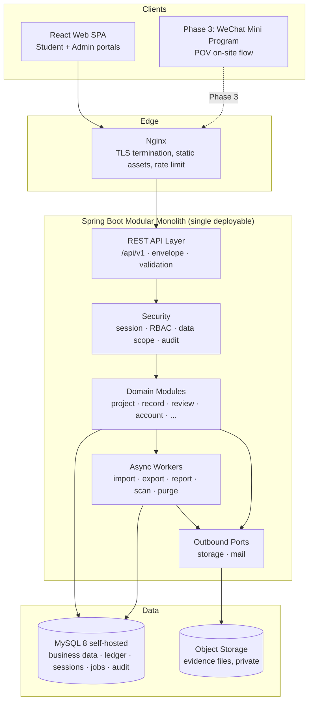

# TimeBank · Backend Design

> This document defines the top-level backend design for the TimeBank Phase 2 web platform: architecture, module decomposition, technology stack, and the reasoning behind each significant technical choice. It is the counterpart to `Docs/frontend/Design.md` and implements the contract defined in `Docs/integration/APIContract.md`. It does **not** contain table DDL, field-level schemas, or a task-level implementation plan — those follow after this document is reviewed and approved.

---

## Part A · Context

## 1. Purpose and Scope

The backend is the single authority for business rules, permissions, state transitions, and account consistency in the TimeBank system. Every capability reaches the frontend through the versioned REST API defined in `APIContract.md`.

**In scope for Phase 2:**

- Authentication, RBAC, and data-scope enforcement.
- Projects, registrations, student event proposals, service records, review workflow, appeals.
- Time-coin accounts and the immutable transaction ledger.
- Progress tracking against grade/phase hour requirements.
- Rules configuration, base data, notifications, dashboards, reports.
- File/evidence upload and controlled access.
- Historical ledger import, data export, audit and login logs.

**Explicitly out of scope for Phase 2 (but must be designed for):**

- Phase 3: POV on-site witness flow, WeChat Mini Program clients, AI review/risk scoring, blockchain attestation.
- Phase 4: redemption, borrowing, value-added/bonus rules.

These are reserved as extension seams (§14) and must not be half-built. Disabled features are gated by feature flags and reject mutations at the API boundary.

## 2. Fixed Constraints (Inherited, Not Re-Litigated)

| Constraint | Source | Implication |
| --- | --- | --- |
| Java + Spring Boot + MySQL | Project decision | No debate on language/framework/RDBMS family |
| REST, `/api/v1`, camelCase JSON, envelope responses | `APIContract.md` §2 | API layer shape is already specified |
| Backend owns all business rules and permissions | `Design.md` §2.1, `APIContract.md` §1 | No rule duplication in frontend; every request re-validated |
| Balances change only through transactions | `APIContract.md` §2.9, §3.7 | No balance-mutating endpoint may exist |
| Submitted/reviewed records are never physically deleted | `APIContract.md` §2.9 | Correction by reversal, not deletion |
| Reviews and approvals are non-overwritable events | `APIContract.md` §3.5 | Append-only decision history |
| Data and nodes stay within mainland China | `06-Legal.md` | Domestic cloud, domestic object storage |
| Minors' personal data, minimum-necessary principle | `05-OnlineSystem.md` §5, `06-Legal.md` | Desensitization, scoped access, short-lived URLs |
| Time coins are non-financial | `01-TimeBankDesign.md` §4.2, `06-Legal.md` | No transfer between students, no cash-out, no tradeable semantics |

## 3. Scale Envelope
`REVIEW-IMPORTANT`: For each single deployment (one school), the project shall support a school with 5000+ students and 500+ teachers, with a peak concurrent user count of 300, do not guess the scale from the mock data of frontend.

### 3.1 Design Target (per deployment / per school)

| Dimension | Design target | Headroom target | Derivation |
| --- | --- | --- | --- |
| Students | 5,000 | 6,000 | Given |
| Teachers / staff / admins | 500 | 600 | Given |
| Total accounts | ~5,500 | ~6,600 | Sum |
| Peak concurrent users | 300 | 500 | Given |
| Service records / year | ~100,000 | ~150,000 | 5,000 students × ~20 records/yr (≈50 h/yr ÷ ~2.5 h per record) |
| Account transactions / year | ~105,000 | ~160,000 | ≈1 per approved record + ~5% adjustments/reversals |
| Evidence files / year | ~200,000 | ~300,000 | ≈2 per record |
| Notifications / year | ~300,000 | ~450,000 | ≈3 per record lifecycle (submitted / reviewed / credited) |
| Projects + proposals / year | ~500 | ~1,000 | Scaled from current ratios |
| Sustained request rate (peak hour) | ~60 req/s | ~150 req/s | 300 concurrent × 1 action/6 s + polling |
| Burst request rate | ~200 req/s | ~500 req/s | Post-event mass submission window |

### 3.2 Data Volume

Volumes are governed by the **tiered retention policy** (§16.3): MySQL holds a hot working set of enrolment + 1 year post-graduation, while the long-term record lives in object storage. The two tiers therefore size very differently.

**MySQL steady state** (reached ~7 years after launch, then flat):

| Table | Steady-state rows | Derivation |
| --- | --- | --- |
| `notification` | ~600,000 | ~1 year retained by age |
| `login_log` | ~1,100,000 | 5,500 users × ~200 logins/yr, 1 year hot |
| `file` (metadata) | ~900,000 | ≈2 per retained record |
| `audit_log` | ~500,000 | 1 year hot |
| `account_transaction` | ~470,000 | ≈1.05 per retained record |
| `service_record` | ~450,000 | 6 enrolled cohorts accumulating + 1 graduated cohort retained |
| **Total database size** | **~10–20 GB** | Comfortably held in the InnoDB buffer pool on a modest host |

**Object storage** (also bounded, not continuously growing):

| Asset | Steady state | Note |
| --- | --- | --- |
| Evidence files | ~550–700 GB | ~7 years retained (6 enrolled + 1 post-graduation), lifecycle-tiered, then deleted with the cohort |

**Why bounded beats large.** The 1-year post-graduation window means the system reaches a steady state and stays there, rather than growing for its whole operational life. Three consequences follow, all favourable:

1. **Restore time — and therefore RTO — drops sharply.** A ~15 GB database restores in a fraction of the time a ~60 GB one does. Given self-hosted MySQL operated by a small team (R1, §17.2), this is the single most valuable side effect of the shorter window.
2. **The working set fits in RAM comfortably**, which is the dominant performance lever (§16.4).
3. **Large-table risk recedes.** With the biggest table around 1.1M rows rather than 11M, migrations, index additions, and `COUNT(*)` queries stay routine. The discipline in §16.1 remains required — it is what keeps them routine — but the failure modes are less punishing.

**Sizing still targets the pre-purge peak**, since the first cohort purge occurs seven years after launch and the system must run correctly until then.

**Consequence — this is a mid-sized system, not a small one and not a large one.** The revised numbers change the engineering posture in three specific ways:

1. **Scalability is no longer free, but it is still not distributed.** ~60 req/s sustained and a ~10–20 GB hot dataset fit comfortably on two stateless application instances and one well-provisioned MySQL instance. Nothing here requires sharding, a message broker, microservices, or a search cluster.
2. **Query discipline becomes load-bearing.** At hundreds of thousands to low millions of rows, an unindexed filter, an N+1 fetch, or an unbounded list will be a visible problem rather than a harmless inefficiency. Indexing, pagination, projection, and streaming move from "good practice" to "acceptance criteria" (§16).
3. **Retention and archival are a design requirement, not an afterthought** — and are what keep the figures above bounded at all. The tiered policy in §16.3 is load-bearing for capacity, not merely for compliance, so it must be built rather than deferred.

> **Revised complexity budget:** spend on correctness, auditability, privacy, **and disciplined data access**. Distributed infrastructure justified by throughput or horizontal scale remains presumptively wrong at 300 peak concurrent users; per-query and per-table discipline is now mandatory.

This principle decides D1 (Redis), D2 (WebSocket), D5 (messaging), D6 (persistence), and §17 (deployment) below.

### 3.3 What Changed From the Frontend Mock Data

The frontend mock fixtures (`MOCK_ADMIN_STATS`: 186 students) describe a **pilot cohort**, not the deployment target. They are demo data and must not be used to size anything. The two decisions most sensitive to this correction are **D1 (Redis)** and **§17 (deployment topology)**; both are re-derived against 5,000 students below, and D12 (derived balances) is now conclusively ruled out rather than merely disfavoured.

## 4. Guiding Principles

1. **Correctness over throughput.** Prefer a locking, transactional, obviously-correct implementation over a fast one. The ledger and review pipeline must be defensible during a graduation audit years from now.
2. **One transaction per business decision.** Review approval writes the review event, updates the record, creates the account transaction, updates progress, and creates the notification atomically or not at all (`APIContract.md` §4.7).
3. **Append-only where it matters.** Reviews, account transactions, audit logs, and revisions are never updated or deleted, only superseded.
4. **The backend never trusts the client.** Permissions, status transitions, hour calculations, and data scope are re-derived server-side on every request.
5. **Boring, mainstream technology.** This system will be maintained by a small team, possibly with turnover, at a school. Every dependency must earn its operational cost.
6. **Extension by seam, not by speculation.** Phase 3/4 get interfaces and reserved namespaces, not partial implementations.
7. **Privacy by construction.** Sensitive contact fields are excluded from list responses by default; access to evidence is short-lived and logged.
8. **Bounded work per request.** Every query is indexed, paginated, and projected. No endpoint may load an unbounded result set, and no report may be computed synchronously over the full ledger. At 1M+ row tables this is a correctness property, not an optimization.
9. **Every table has a lifecycle.** Each table is classified at design time as permanent (ledger, records), archivable (notifications, jobs), or expiring (logs, sessions, idempotency keys). Unbounded growth without a policy is a defect.

---

## Part B · Architecture

## 5. System Architecture



**Deployment topology (Phase 2):** Nginx (or a cloud load balancer) in front of **two stateless Spring Boot instances**, a **self-hosted MySQL primary with a replica** (review decision Q1), and one private object-storage bucket — all in a single domestic cloud region. Two application instances are chosen for rolling deploys and fault tolerance at 5,000 students, not for throughput; one instance would carry the load. See §17.

**Statelessness is a hard requirement**, and it is what makes the two-instance topology cost almost nothing: sessions live in MySQL (D4), uploads go directly to object storage (D9), scheduled jobs are ShedLock-guarded, and async jobs are claimed by lease (D5). No sticky sessions, no shared filesystem.

## 6. Application Layering

Each domain module is internally layered; the layering is a rule about dependency direction, not a mandate for four classes per entity.

| Layer | Responsibility | Rules |
| --- | --- | --- |
| **Web** (`*Controller`) | HTTP binding, request validation, envelope shaping, permission annotations | No business logic. Never returns entities; only DTOs. |
| **Application** (`*Service`) | Use-case orchestration, transaction boundaries, idempotency, event emission | Owns `@Transactional`. Calls domain + repositories + ports. |
| **Domain** (entities, value objects, state machines, policies) | Invariants, status transitions, hour/coin calculation | No Spring, no SQL. Pure and unit-testable. |
| **Infrastructure** (repositories, port adapters) | Persistence, object storage, external services | Implements interfaces declared by the application/domain layer. |

**Dependency rule:** Web → Application → Domain; Infrastructure implements interfaces owned by the inner layers. Domain never imports Infrastructure.

**Anti-pattern to avoid explicitly:** a shared `entity/` package imported by every module. Entities belong to their owning module; cross-module reads go through the owning module's service interface or a read-model query, not by reaching into another module's tables.

## 7. Module Decomposition

Modules mirror the business domains in `Docs/frontend/Design.md` §12 so that frontend and backend share one vocabulary. Package root: `cn.<school>.timebank`.

| Module | Package | Owns | Phase |
| --- | --- | --- | --- |
| Platform / common | `common` | Envelope, error model, request ID, pagination, filtering, idempotency, optimistic locking helpers | 2 |
| Security | `security` | Authentication, session, permission codes, data-scope resolution | 2 |
| IAM | `iam` | Users, roles, permissions, login logs, account lock/reset | 2 |
| Student directory | `student` | Students, classes, grades, academic years, guardians, status changes | 2 |
| Organization | `organization` | Partner organizations, service categories | 2 |
| Project | `project` | Project lifecycle, capacity, registration windows | 2 |
| Proposal | `proposal` | Student event proposals, approval chain, project generation | 2 |
| Enrollment | `enrollment` | Registrations, waitlist, confirmation, completion (the contract's `Application`) | 2 |
| Service record | `servicerecord` | Records, revisions, evidence binding, submission validation | 2 |
| Review | `review` | Review queue, decisions, assignment, SLA | 2 |
| Case flow | `caseflow` | Appeals, supplements, manual corrections (the contract's `Case`) | 2 |
| Account | `account` | Accounts, immutable transaction ledger, freeze, adjustment, reversal | 2 |
| Progress | `progress` | Requirement rules evaluation, per-student progress projection | 2 |
| Rules | `rules` | Rule versions, publication, effective windows, impact preview | 2 |
| Notification | `notification` | In-app notifications, templates, announcements | 2 |
| Reporting | `reporting` | Dashboards, statistics, report queries | 2 |
| Data exchange | `dataexchange` | Import jobs, validation, commit, export jobs, archiving | 2 |
| File | `file` | Upload intents, metadata, scanning, short-lived access URLs | 2 |
| Audit | `audit` | Append-only operation audit log | 2 |

Phase 3 and Phase 4 modules (`pov`, `risk`, `attestation`, `redemption`, `borrowing`) are **not built and not stubbed** — see §14.

**Naming notes:** `case` is a Java reserved word, so the contract's `Case` resource maps to `caseflow`. `Application` is avoided as a package name to prevent confusion with Spring's application context and with `SpringApplication`; the REST path stays `/applications` per the contract while the internal module is `enrollment`.

**Module boundary enforcement:** Spring Modulith (or, if that is judged too much ceremony, an ArchUnit test) verifies that cross-module access goes only through published interfaces. This matters because the modular monolith's only real failure mode is silent erosion into a big ball of mud.

---

## Part C · Technology Stack

## 8. Stack Summary

| Concern | Choice | Notes |
| --- | --- | --- |
| Language / runtime | **Java 21 (LTS)** | Virtual threads, records, pattern matching, sealed types for status modelling |
| Framework | **Spring Boot 3.4.x** | Baseline for Boot 3 / Jakarta EE 10 |
| Web | **Spring MVC** (blocking) + virtual threads | See D3; WebFlux explicitly rejected |
| Security | **Spring Security 6** | Session-based auth, method-level permission checks |
| Session store | **Spring Session JDBC** | See D4 |
| Persistence | **Spring Data JPA (Hibernate 6)** + **JdbcTemplate** for reporting | See D6 |
| Database | **MySQL 8.0+ / 8.4 LTS**, InnoDB, `utf8mb4_0900_ai_ci` | Chinese content requires utf8mb4 throughout |
| Migrations | **Flyway** (versioned SQL) | See D7 |
| Object storage | **S3-compatible port**: Aliyun OSS (prod) / MinIO (dev) | See D9 |
| Caching | **Caffeine** via Spring Cache | Dictionaries, rules, school info only |
| Rate limiting | **Nginx `limit_req`** (security-critical) + **Bucket4j** in-memory (soft business limits) | Login and password reset are limited centrally at the edge so two instances cannot double an attacker's allowance |
| Scheduling | **Spring `@Scheduled` + ShedLock (JDBC)** | ShedLock makes the jump to 2 instances safe |
| Async execution | **Spring `@Async`** + DB-backed job table | See D5 |
| API docs | **springdoc-openapi** (code-first) | See D10 |
| Validation | Jakarta Bean Validation (Hibernate Validator) | Mapped to `fieldErrors` in the error envelope |
| Mapping | MapStruct | Entity ↔ DTO, compile-time, no reflection surprises |
| Excel / CSV | Apache POI (SXSSF) or EasyExcel | Import/export of ledgers; streaming to bound memory |
| Testing | JUnit 5, AssertJ, MockMvc, **Testcontainers (MySQL)** | See §19 |
| Observability | Spring Boot Actuator + structured JSON logging | See §18 |
| Build | Maven (multi-module optional; single module to start) | Gradle acceptable if the team prefers it |
| Container | Docker + Docker Compose | See §17 |

**Deliberately absent:** Redis (D1), WebSocket/STOMP (D2), Kafka/RabbitMQ (D5), Elasticsearch, service mesh, microservices (D11), reactive stack (D3). Each is addressed with a revisit trigger.

---

## Part D · Key Decisions

Each decision below states the question, the realistic options, a comparison, the decision, and — critically — the **revisit trigger** that would overturn it. The revisit trigger is what makes a "no" reversible rather than dogmatic.

## D1. Is Redis Needed?

**Question:** Should the system include Redis for sessions, caching, rate limiting, idempotency, locking, or queuing?

This decision was re-derived after the scale correction in §3 (5,000 students, 500 staff, 300 peak concurrent, two application instances). The conclusion changed in nuance but not in headline: Redis is **not required**, but it is now a *reasonable* addition rather than an obviously wrong one, so the reasoning is given per-role rather than as a blanket rejection.

| Job Redis usually does | Load at design scale | Alternative without Redis | Verdict |
| --- | --- | --- | --- |
| Session store | ~60 req/s × (1 read + 1 last-access write) ≈ 120 ops/s on a ~5,500-row table, all primary-key access | **Spring Session JDBC** — survives restart, already shared across both instances | MySQL is sufficient; see decision note |
| Caching | Rules, categories, grades, permissions, school info — kilobytes to low megabytes, low churn | **Caffeine** per instance, TTL + explicit eviction on rule publication | Sufficient, with a caveat |
| Rate limiting | Login/reset/upload/export throttling across 2 instances | **Nginx** `limit_req` for security-critical paths (centralized) + **Bucket4j** in-memory for soft business limits | Sufficient |
| Idempotency keys | Must be **transactionally consistent with the business write** | **MySQL table with unique constraint**, same transaction | Redis is *categorically worse* here |
| Distributed lock | Scheduled jobs across 2 instances | **ShedLock (JDBC)** | Sufficient |
| Job queue | Import/export/report jobs; durable and queryable via `GET /imports/{id}` | **MySQL job table with lease claim** (needed anyway as the `Job` resource) | Sufficient |

**The two roles where scale genuinely weakened the no-Redis case:**

- **Per-instance cache coherence.** With two instances, a rule published on instance A is stale on instance B until its TTL expires. This is acceptable *specifically because* rule changes are versioned and carry an effective time (§12 invariant 7) — they are never expected to take effect within seconds. A 60-second TTL bounds the staleness, and the effective-time semantics mean no decision is made against a stale rule. If a future feature needs sub-second global invalidation, that is a genuine Redis trigger.
- **Rate limiting arithmetic.** In-memory buckets on two instances give an attacker 2× the intended allowance. This is mitigated by putting the security-critical limits (login, password reset) at Nginx, which is centralized, and leaving only soft business limits in-process.

**Options considered:**

| Option | Pros | Cons |
| --- | --- | --- |
| **A. No Redis; MySQL + Caffeine + Nginx (recommended)** | No stateful service to install, secure, monitor, patch, and back up; idempotency stays transactional; no second datastore to keep consistent; **no new hard availability dependency for authentication** | Cache staleness bounded by TTL across instances; session access costs a DB round-trip; soft rate limits are per-instance |
| B. Redis for cache + rate limiting only, MySQL keeps sessions/idempotency/jobs | Solves both weaknesses above; Redis stays a **soft** dependency — a cache miss falls back to the DB, so an outage degrades rather than breaks | An extra managed service (~¥100–200/month) for problems that are currently bounded and acceptable |
| C. Redis for everything including sessions | Fastest; conventional | Makes Redis a **hard** availability dependency for login — a Redis outage logs out 5,500 users, whereas MySQL is already a hard dependency so sessions there add no new failure mode; tempts idempotency/locks out of the DB transaction, a real correctness risk |

**Decision: A for launch, with B as the pre-approved upgrade.**

MySQL comfortably absorbs ~120 session ops/s and every other role listed. The design keeps Redis a one-line configuration change rather than a refactor: Spring Session, Spring Cache, and Bucket4j all have pluggable backends, so adopting option B later means swapping a starter dependency and a properties block — no application code changes.

**Option C is rejected at any scale.** Sessions and idempotency stay in MySQL permanently, because the former would add a new hard failure mode for authentication and the latter must share a transaction with the business write.

**Revisit triggers (→ adopt option B):**
- Measured MySQL contention attributable to session or cache traffic.
- Scaling beyond ~4 application instances, where per-instance cache duplication and rate-limit dilution stop being acceptable.
- A requirement for sub-second, cluster-wide cache invalidation.
- Phase 3 POV introducing high-volume short-lived shared state (witness QR nonces) — though a MySQL table with a TTL sweep should be measured first.

## D2. Is WebSocket Needed?

**Question:** Do notifications, review queue updates, job progress, or the Phase 3 witness flow require a persistent bidirectional connection?

`APIContract.md` §3.8 already anticipates this: *"The frontend polls the job query endpoint; long-lived connections are not a required dependency."*

**Where real-time-ish behaviour is plausibly wanted:**

| Scenario | Latency actually required | Adequate mechanism |
| --- | --- | --- |
| Unread notification badge | Tens of seconds | Poll `/notifications/unread-count` every 30–60 s |
| Teacher review queue refresh | Manual/次-level | Refetch on navigation and on user action |
| Import/export/report job progress | 1–3 s while a modal is open | Poll `/imports/{id}` every 2 s, only while visible |
| Phase 3: student waiting for witness confirmation | 2–5 s during a ~60 s window | Poll every 2 s during the window, or SSE |

**Polling cost at the corrected scale.** 300 concurrent users polling the unread badge every 30 s is **10 req/s** — roughly 15% of the ~60 req/s peak-hour load. Job-progress polling is negligible because it only runs while a modal is open. This is affordable, but it is no longer free, which imposes a hard requirement (below) rather than a nicety.

**Options considered:**

| Option | Pros | Cons |
| --- | --- | --- |
| **A. HTTP polling (recommended)** | Zero new infrastructure; works through any proxy/school network; trivially debuggable; fully stateless, so it survives the two-instance topology and rolling restarts without sticky sessions; already assumed by the API contract | ~10 req/s of background load at peak; requires the polled endpoints to be genuinely cheap |
| B. Server-Sent Events (SSE) | Unidirectional server→client push is exactly the shape of the need; plain HTTP, no new protocol or broker; simple in Spring MVC (`SseEmitter`); 300 concurrent connections is trivial under virtual threads | 300 held connections split across 2 instances means a notification must reach the instance holding the connection — needing either a DB/Redis fanout or per-instance polling of the DB anyway; needs proxy buffering disabled; still requires a polling fallback |
| C. WebSocket + STOMP | Full duplex; standard Spring support | Bidirectional capability is never needed — no collaborative editing, no chat, no presence; adds handshake/auth/reconnect/heartbeat complexity; **with 2 instances it needs sticky sessions or an external broker**, reintroducing exactly the infrastructure D1 avoided; harder through school networks; a second authentication surface to secure |

**Decision: A — polling for Phase 2. No WebSocket. SSE (option B) remains the sanctioned upgrade path for a specific screen that is measured to need it, most likely the Phase 3 witness-confirmation wait.**

The system has no bidirectional, low-latency, multi-party interaction. Reviews are not collaborative; notifications are informational. Note that the multi-instance topology actively *strengthens* this decision: both SSE and WebSocket would require cross-instance message fanout to deliver an event to the instance holding a given user's connection, whereas polling is indifferent to which instance answers.

**Design implication (now a hard requirement, not a nicety).** Because polling carries ~10 req/s at peak, every polled endpoint must be:

- a single indexed query (`unread-count` is a covering index on `(user_id, is_read)`, not a row scan);
- free of N+1 fetches;
- `ETag`/`304`-capable so an unchanged badge costs a conditional request and no serialization;
- served with a configurable client interval, so the poll frequency can be tuned in production without a frontend release.

**Revisit triggers:**
- A product requirement for genuine real-time collaboration (e.g. two teachers reviewing the same queue with live locking).
- Phase 3 UX testing showing the witness wait feels broken under polling.
- Peak concurrency growing well beyond 300 such that background polling becomes a double-digit percentage of total load *and* the polled endpoints are already optimized.

## D3. Blocking MVC vs Reactive WebFlux

| Option | Pros | Cons |
| --- | --- | --- |
| **A. Spring MVC + Java 21 virtual threads (recommended)** | Simple imperative code; JPA/JDBC work naturally; stack traces and debuggers behave; virtual threads remove the thread-per-request ceiling entirely | Blocking drivers, but the connection pool — not the thread pool — becomes the real limit, which is the correct place for backpressure |
| B. Spring WebFlux + R2DBC | High concurrency per thread | Reactive JPA does not exist (R2DBC means hand-written SQL); transactions, security context, and MDC propagation all get harder; debugging cost is real; solves a throughput problem this system does not have |

**Decision: A.** Enable `spring.threads.virtual.enabled=true`.

The scale correction strengthens this choice rather than weakening it. At 300 concurrent users with occasional slow requests (report queries, upload completion), a classic 200-thread Tomcat pool could plausibly saturate and queue; virtual threads remove that ceiling without any reactive rewrite. The binding constraint then becomes the HikariCP connection pool, which is where load shedding *should* happen — a request waiting for a database connection is honest backpressure, whereas a request waiting for a platform thread is an artificial bottleneck.

**Caveat to verify during implementation:** virtual threads pin to their carrier on `synchronized` blocks in older library code. Hibernate, HikariCP, and the MySQL driver must be on versions where this is not a factor, and a load test at 300 concurrent (§19) is the check.

## D4. Session vs JWT Authentication

`APIContract.md` §2.2 recommends `Secure`, `HttpOnly`, `SameSite` cookies. Confirming and justifying that:

| Option | Pros | Cons |
| --- | --- | --- |
| **A. Server-side session in cookie (recommended)** | **Instant revocation** — required by `POST /users/{id}/unlock`, deactivation, and password reset; no token stored in JS-accessible storage (contract §9 forbids writing tokens to browser storage/logs); XSS cannot exfiltrate an `HttpOnly` cookie; simple mental model | Requires a session store (MySQL, see D1) and CSRF protection |
| B. Stateless JWT in localStorage | No session store; horizontal scale | Cannot revoke before expiry without a blocklist (which reintroduces the session store, worse); localStorage is XSS-readable — unacceptable for minors' data; refresh-token rotation adds complexity |
| C. JWT in HttpOnly cookie | XSS-safe storage | Still no revocation; still needs CSRF handling; gains nothing over A at this scale |

**Decision: A.** Spring Session JDBC, `HttpOnly` + `Secure` + `SameSite=Lax` cookie, CSRF token required on mutations, `Origin`/`Referer` validation, idle timeout (e.g. 8 h staff / 12 h student, configurable) and absolute timeout.

**Phase 3 caveat worth flagging now:** a WeChat Mini Program cannot rely on browser cookie semantics. Rather than retrofitting later, the authentication layer is designed around an `AuthenticationPrincipal` resolved by a pluggable resolver, so Phase 3 can add a **short-lived opaque bearer token** path (server-side token record, same revocation semantics) for Mini Program clients without touching any controller or service. Opaque server-side tokens are preferred over JWT for the same revocation reason.

## D5. Async Work: In-Process vs Message Broker

Async work in this system: import validation/commit, export/report generation, evidence virus scanning, and the cohort retention purge.

**Workload at the corrected scale.** A historical-ledger import now covers 5,000 students and potentially several years of records — on the order of **100,000–500,000 rows per import**. A full-school annual export is ~100,000 records. These are real batch jobs, not trivial ones, though they run rarely (a handful per term).

| Option | Pros | Cons |
| --- | --- | --- |
| **A. DB-backed job table + dedicated `@Async` executor (recommended)** | The `Job` resource must exist in the DB anyway for `GET /imports/{id}` status polling; durable across restarts; inspectable and re-runnable by an admin with SQL; zero new infrastructure; handles 500k rows in minutes with chunked processing | Needs explicit chunking, checkpointing, and pool isolation — all specified below |
| B. RabbitMQ / Kafka | Decoupling; retries; scale | An entire broker to run and monitor for a few jobs per term; job status must still be mirrored into the DB to serve the API; the workload is low-frequency-high-volume, which is the shape brokers help least with |
| C. Spring Batch | Purpose-built chunking, restart, skip policies; genuinely designed for 500k-row imports | Its own schema and abstractions layered on top of the job table the contract already requires; two overlapping job models to reconcile in the API |

**Decision: A**, with three requirements that the increased volume makes mandatory:

1. **Chunked, streaming processing.** Import readers stream from object storage (SAX/streaming Excel via EasyExcel or POI SXSSF), process in chunks of ~500–1,000 rows per transaction, and never materialize the full file in memory. Exports stream directly to object storage. Heap must be bounded regardless of file size.
2. **Checkpointing.** Job rows carry `status`, `progress`, `processedRows`, `checkpointOffset`, `resultRef`, `errorRef`, and lease columns (`claimedBy`, `claimedAt`, `leaseExpiresAt`). A job interrupted by a deploy or crash resumes from its checkpoint rather than restarting — at 500k rows, restart-from-zero is not acceptable.
3. **Executor isolation.** Background jobs run on a **dedicated, bounded executor**, never the request-handling pool. A 500k-row import must not degrade p95 latency for 300 concurrent users. Consider restricting heavy jobs to one instance, or to off-peak windows, via a job-class-to-executor mapping.

Scheduled sweeps (ShedLock-guarded) reclaim jobs whose lease expired, which is what makes the two-instance topology safe.

**Revisit trigger (→ option C):** imports exceeding ~1M rows, or a need for sophisticated skip/retry/restart policies that begin to reimplement Spring Batch badly. At that point adopting Spring Batch *behind* the existing `Job` API resource is the migration, so the contract stays stable.

## D6. Persistence: JPA vs MyBatis vs jOOQ

| Option | Pros | Cons |
| --- | --- | --- |
| **A. Spring Data JPA primary + JdbcTemplate for reporting (recommended)** | `@Version` gives the optimistic locking the contract mandates, for free; `@EntityListeners` gives created/updated auditing for free; entity-level invariants live in the domain model; JPQL/Criteria handles the transactional side; raw SQL is available exactly where it is better | Dynamic multi-field filtering needs Specifications or Querydsl; N+1 must be watched; two query styles in one codebase |
| B. MyBatis(-Plus) only | Full SQL control; familiar to many Chinese teams; excellent for reporting | Optimistic locking, auditing, and dirty-checking become manual; the rich status/ledger domain model tends to degrade into anemic DTOs plus service-layer procedures |
| C. jOOQ only | Type-safe SQL; superb for reporting | Commercial licensing for some databases; less common skill; same manual-locking cost as B |
| D. JPA + MyBatis together | Best of both | Two ORMs, two caches, two mental models, two sets of gotchas — a maintenance tax with no payoff |

**Decision: A.** JPA (Hibernate) owns the transactional write model, where invariants, `@Version`, and auditing matter most. Reporting, dashboards, and any query with heavy dynamic filtering or aggregation use `JdbcTemplate` with hand-written SQL returning purpose-built read DTOs — never entities. Add **Querydsl or JPA Specifications** for the list endpoints' `filter[...]`/`sort`/`search` parameters.

The scale correction makes the read/write split more important, not less: with ~450k service records and ~1.1M log rows in the hot tier, the reporting path is exactly where an ORM's convenience becomes a liability. Three rules follow:

- **Read models never reuse write entities.** A dashboard query returns a `DashboardView`, not a graph of `ServiceRecord` entities.
- **No JPA query may return an unbounded collection.** Anything that could exceed a few hundred rows is either paginated or moved to a streaming `JdbcTemplate` query. Loading 100k entities into the persistence context is a heap incident.
- **Statistics are aggregated in SQL, never in Java.** Participation and compliance rates across 5,000 students are `GROUP BY` queries, not entity loops. Where a report is expensive and frequently viewed, it is materialized by a scheduled job into a summary table rather than computed per request (§16.2).

## D7. Schema Migrations: Flyway vs Liquibase

| Option | Pros | Cons |
| --- | --- | --- |
| **A. Flyway (recommended)** | Plain versioned SQL — reviewable, and exactly what a DBA or future maintainer expects; simplest possible model | MySQL DDL is not transactional, so a failed migration needs manual repair (true for both tools) |
| B. Liquibase | Database-agnostic changelogs; rollback support | XML/YAML abstraction over SQL adds indirection for a project that will only ever target MySQL |

**Decision: A.** `V<n>__description.sql` under `db/migration`. `ddl-auto=validate` in every environment — never `update`. Reference/seed data (permission codes, service categories, default rules) ships as repeatable migrations (`R__`).

**Large-table migration policy (new at this scale).** Once `service_record`, `audit_log`, and `login_log` reach millions of rows, schema changes stop being instantaneous:

- Prefer MySQL 8 **online DDL** (`ALGORITHM=INPLACE, LOCK=NONE`), and state the algorithm explicitly in the migration rather than relying on the default.
- Adding an index to a multi-million-row table is scheduled into a maintenance window, or performed with `pt-online-schema-change` / `gh-ost` if it must be done live.
- Migrations that rewrite table data are split into: add nullable column → backfill in batches via a job → add constraint. Never a single blocking `UPDATE` over a million rows.
- Every migration is timed against a production-sized dataset in staging before release. "It was fast on 186 rows" is precisely the failure mode this document exists to prevent.

## D8. Multi-Tenancy

**Question:** Should a `school_id` discriminator be designed in from day one? `04-Blockchain.md` §11 mentions cross-school blind review, and §8 mentions a multi-school alliance as a long-term possibility.

**Resolved by review.** The scale requirement in §3 is stated explicitly as *"for each single deployment (one school)"*, which settles this: the deployment model is **one instance per school**, sized for 5,000 students each. This is no longer a judgement call.

| Option | Pros | Cons |
| --- | --- | --- |
| **A. Single-tenant per deployment (confirmed by review)** | Matches the stated deployment model; no column, index, filter, or test complexity; every query stays simple; complete data isolation between schools, which is the strongest possible answer to the minors'-privacy requirement in `06-Legal.md` | A future shared-tenant model would need a migration |
| B. `school_id` on every table | Cheap later consolidation | Every query, index, and unique constraint carries it; every test sets it up; a permanent tax contradicting the stated per-school deployment model; weakens isolation between schools' minor-student data |
| C. Database-per-tenant in one app | Isolation with shared compute | Connection-pool-per-tenant and migration fan-out; strictly worse than separate deployments, which achieve the same isolation more simply |

**Decision: A — confirmed.** Two cheap guardrails still apply, because they cost nothing and preserve optionality:

1. Business unique constraints are **scoped**, never global-by-nature — e.g. student number is unique per academic-year cohort, not assumed globally unique forever.
2. School-specific configuration (name, hour requirements, contacts, review SLA) lives in the rules/settings tables, not in code or deployment properties, so a new school is a data-seeding exercise rather than a code fork.

**Implication for cross-school features.** Any future cross-school capability (`04-Blockchain.md` §11) would therefore be **integration between independent deployments**, not a query across a shared table. Out of scope here, and noted only so the single-tenant decision is made with that awareness.

## D9. Evidence Storage

Requirements: private by default, short-lived access URLs, virus/type scanning before a file can be attached to a submitted record, domestic residency, and SHA-256 hashing for integrity and duplicate detection.

**Volume at the corrected scale:** ~200,000 files/year, ~800 GB – 1 TB over ten years. This makes object storage mandatory rather than merely preferable, and makes storage lifecycle a cost lever worth designing.

| Option | Pros | Cons |
| --- | --- | --- |
| **A. S3-compatible port; Aliyun OSS in production, MinIO in dev (recommended)** | Presigned upload/download natively; domestic and compliant; no file-serving load on the app; scales to terabytes without capacity planning; storage-class tiering available; dev/CI works offline with MinIO | One external dependency and credential to manage |
| B. Local filesystem, app-served | No external service | 1 TB of disk to provision, grow, and back up; **incompatible with the two-instance topology** without shared storage (NFS), which is a worse dependency than OSS; the app must implement signed URLs and serve file bytes, consuming request capacity |
| C. Files as MySQL BLOBs | Transactional with metadata; single backup | 1 TB inside MySQL — inflating backups, restore time, and buffer-pool pressure. At this volume this option is disqualifying, not merely suboptimal |

**Decision: A.** A `FileStorage` port with `S3FileStorage` (works for both OSS and MinIO) behind it.

**Lifecycle tiering.** Evidence access is heavily front-loaded — files are viewed during review and then almost never again. An object-storage lifecycle rule transitions objects Standard → Infrequent Access (~90 days) → Archive (~1 year). Objects are **deleted at graduation + 1 year** together with their database rows (§16.3), so no long-lived archive tier accumulates.

**Deletion must cover the objects, not just the rows.** The purge job deletes evidence objects from the bucket in the same pass that removes their `file` metadata. Deleting only the metadata would leave the bucket full of unattributable images of minors — a privacy liability that nothing in the system records the existence of, and storage nobody can safely reclaim.

**Steady-state storage** is therefore ~7 years of evidence (six of enrolment plus one), roughly **550–700 GB**, rather than growing without bound.

**Upload flow, per `APIContract.md` §4.6:**

```text
POST /files/upload-intents  → validate purpose/MIME/size against rules
                            → create file row (status=pending), return presigned PUT + fileId
client PUT direct to OSS    → app never proxies file bytes
POST /files/{id}/complete   → verify object exists, size and content-type match declaration
                            → status=processing → async: magic-byte type check, size, AV scan,
                              image normalization, SHA-256 hash
                            → status=ready | rejected
```

A file in `pending`/`processing`/`rejected` cannot be bound to a record submission — enforced at submit time, not merely in the UI. Downloads always go through `GET /files/{id}`, which checks permission and data scope and then issues a short-lived URL (minutes), and writes an access audit entry for evidence belonging to another student.

## D10. API Contract: Spec-First vs Code-First

`APIContract.md` §10.1 asks for a machine-readable OpenAPI file generated *before* implementation, with the frontend client generated from or validated against it.

| Option | Pros | Cons |
| --- | --- | --- |
| **A. Code-first with springdoc, then generate TS types for the frontend (recommended)** | Spec cannot drift from the implementation; no generated-code build step in the backend; annotations live next to the DTOs | The spec exists only once controllers do; requires discipline on descriptions/examples |
| B. Spec-first, generate server interfaces + TS client | Contract is the single source of truth; parallel development | Generator configuration and regeneration friction; generated Java interfaces fight custom envelope/validation shapes; heavier for a two-surface project |

**Decision: A**, deviating from the letter of `APIContract.md` §10.1 for one specific reason: **the frontend already exists and already implements the whole contract against a mock client.** The contract has therefore been de-risked by a working UI, which is what spec-first was meant to achieve. The pragmatic path is:

1. `APIContract.md` remains the human-authored source of truth for resources, statuses, and permissions.
2. springdoc emits `openapi.json` from the implementation, published at a versioned URL.
3. TypeScript types are generated from `openapi.json` to replace the hand-written types in `frontend/src/app/mock/data.ts`, and `frontend/src/app/api/client.ts` method bodies switch from mock logic to `fetch` — the swap the frontend was built for.
4. A CI check fails the build when the emitted spec diverges from the committed snapshot, so every contract change is a visible, reviewed diff.

## D11. Modular Monolith vs Microservices

| Option | Pros | Cons |
| --- | --- | --- |
| **A. Modular monolith, horizontally scaled (recommended)** | Review approval spans record + review + account + progress + notification in **one ACID transaction** — the contract's hardest requirement; one deployable, one database, one backup, one log stream; being stateless, it scales out by adding instances | Discipline required to keep module boundaries honest (addressed via Spring Modulith/ArchUnit) |
| B. Microservices | Independent scaling and deployment | Distributed transactions or sagas for the core ledger flow — replacing a database transaction with an eventual-consistency protocol and compensating actions; multiplies infrastructure and on-call burden for a school IT team |

**Decision: A**, and the scale correction does not move it.

The relevant question is not "is 5,000 students a lot?" but "does any module need to scale independently of the others?" It does not: the load is uniform across the request surface and the whole system fits in one JVM's working set. A stateless modular monolith scales horizontally by adding instances behind the load balancer — which is exactly what §17 does — while preserving the single-transaction guarantee that the ledger depends on. Microservices would trade that guarantee for elasticity the system cannot use.

**Revisit trigger:** a genuinely divergent workload — most plausibly the Phase 3 AI/risk pipeline, which is CPU/IO-heavy, bursty, and dependent on external services. That is the one component worth extracting later, and §14.3 already isolates it behind ports so extraction would be mechanical.

## D12. Time-Coin Balance: Stored vs Derived

| Option | Pros | Cons |
| --- | --- | --- |
| **A. Stored balance + immutable ledger, updated in the same transaction (recommended)** | O(1) reads; matches the contract's `Account` (balance view) + `AccountTransaction` (ledger) split; row-level locking serializes concurrent credits cleanly | Balance can theoretically drift from the ledger if a bug bypasses the service |
| B. Derived balance (`SUM` of transactions) | Cannot drift by construction | **Disqualified at this scale:** ~1M ledger rows over ten years means every balance read aggregates over a growing partition; a student with 200 lifetime transactions is fine, but the admin account list showing 5,000 balances becomes 5,000 aggregations |
| C. Stored + scheduled reconciliation | A's performance with a drift alarm | One extra scheduled job |

**Decision: C** (A plus a safety net). The scale correction converts B from "disfavoured" to "ruled out". Concretely:

- `account_transaction` is append-only: `id`, `accountId`, `type`, `amount` (signed integer centi-coins, §22.1), `balanceAfter`, `sourceType`, `sourceId`, `reasonCode`, `memo`, `operatorId`, `createdAt`. No `UPDATE`, no `DELETE` — enforced by code review, by a repository that exposes no update method, and optionally by a MySQL trigger.
- Every mutation goes through `AccountService`, which takes `SELECT ... FOR UPDATE` on the account row, appends the transaction, and updates the balance in one transaction.
- Corrections and reversals **append an opposite-signed transaction** referencing the original; the original is never touched.
- **The ledger is never archived or pruned.** It is the permanent record behind every graduation decision, and at ~1M rows over a decade it does not need to be.

**Reconciliation at 5,000 accounts / 1M transactions.** A nightly full re-sum is a single indexed `GROUP BY accountId` over the ledger — seconds to low minutes, run off-peak, and still the right default. To keep it bounded as the ledger grows, the job uses **checkpointed incremental reconciliation**: a periodic full pass (weekly) plus a nightly pass over accounts touched since the last checkpoint. Any mismatch raises an alert identifying the account and the divergence point, since a silent drift in the ledger is the single most damaging failure this system could have.

---

## Part E · Cross-Cutting Design

## 9. API Layer Conventions

**Response envelope.** `APIContract.md` §2.5–2.6 mandates `{data, meta}` / `{data, page, meta}` / `{error}`. This does not fall out of `ResponseEntity<T>` by default, so it is built deliberately:

- A `ResponseBodyAdvice` (or an explicit `ApiResponse<T>` return type — preferred for clarity) wraps successful payloads.
- A single `@RestControllerAdvice` maps exceptions to the error envelope: `MethodArgumentNotValidException` → `422 VALIDATION_FAILED` with `fieldErrors`; `OptimisticLockException`/version mismatch → `409 STATE_CONFLICT`; `AccessDeniedException` → `403 FORBIDDEN`; domain `NotFound`/out-of-scope → `404 RESOURCE_NOT_FOUND`.
- Every response carries `meta.requestId`, propagated from an MDC filter into logs.

**Never expose internals.** Stack traces, SQL, and Hibernate messages never reach the client (`APIContract.md` §9).

**Status transitions are action endpoints.** `POST /projects/{id}/publish`, not `PATCH {status}`. The generic `PATCH` explicitly rejects any attempt to set a status field.

**Enum tolerance.** Adding an enum value is a compatible change; the API never removes or repurposes one within `v1`.

**Sensitive-field suppression.** List responses omit phone numbers, emails, and guardian information by default; detail responses include them only for principals whose permissions allow it, and such access is audited.

## 10. Authentication, Authorization, and Data Scope

Three distinct checks, applied in order:

1. **Authentication** — valid session; otherwise `401 AUTHENTICATION_REQUIRED`.
2. **Permission code** — `@PreAuthorize("hasAuthority('reviews.decide')")`, sourced from role→permission mappings loaded at login into the security context.
3. **Data scope** — row-level: a teacher sees only their authorized grades, classes, and projects.

**Data scope must be applied inside the query, not as a post-filter.** Post-filtering leaks existence through pagination counts and is easy to forget on a new endpoint. Implementation: a `DataScopeResolver` produces a scope descriptor (`ALL` | `GRADES(...)` | `CLASSES(...)` | `PROJECTS(...)` | `SELF`) for the current principal and resource, which list queries incorporate as predicates and which detail lookups verify.

**Existence hiding.** Per `APIContract.md` §2.4, an out-of-scope resource returns `404`, not `403` — a teacher must not be able to probe whether a record in another grade exists. `403` is reserved for "you may not perform this action on a resource you can legitimately see."

**Guardian and student self-access** are modelled as the `SELF` scope rather than as special-case code paths.

## 11. Concurrency and Idempotency

Both are contract requirements (`APIContract.md` §2.8) and both are easy to get subtly wrong.

**Optimistic locking.** Every editable entity carries `version` (JPA `@Version`). Update requests include the client's `version` (or `If-Match`). A mismatch raises `409 STATE_CONFLICT` with the current version, so the frontend can show "someone else changed this" rather than silently overwriting — explicitly listed in the acceptance scenarios (§11.10 of the contract).

**Idempotency.** For record creation, review decisions, account adjustments, and import commits:

```text
Idempotency-Key header + principal + endpoint  →  unique row in `idempotency_record`
  insert (REQUIRES_NEW) with status=IN_PROGRESS, request fingerprint = SHA-256(canonical body)
  ├─ insert succeeds       → execute business transaction → store response snapshot, status=DONE
  ├─ duplicate key, DONE, same fingerprint      → replay stored response (same status + body)
  ├─ duplicate key, DONE, different fingerprint → 409 STATE_CONFLICT
  └─ duplicate key, IN_PROGRESS                 → 409 STATE_CONFLICT (request already in flight)
```

Storing the key in MySQL rather than Redis is what makes "the key was recorded" and "the business write happened" consistent under failure — the reason D1 rejects Redis for this role.

**Ledger serialization.** `SELECT ... FOR UPDATE` on the account row (§D12), keeping concurrent credits from interleaving.

## 12. Domain Invariants

The state machines in `APIContract.md` §3 are implemented as explicit, testable transition tables — not as scattered `if (status == ...)` checks. Each aggregate exposes `canTransition(from, to, actor)` and a single `transition()` entry point that records the change.

**The invariants that must never be violated:**

| # | Invariant |
| --- | --- |
| 1 | An account balance changes only via an appended `account_transaction`. No code path updates a balance directly. |
| 2 | A transaction, once written, is never updated or deleted. Corrections append reversing entries. |
| 3 | A review decision is an appended event. Changing a decision appends another; history is complete. |
| 4 | A submitted, reviewed, or credited service record is never physically deleted. Only drafts are deletable. |
| 5 | Approving a service record performs — atomically — review event, status update, account transaction, progress update, notification. Partial completion is impossible. |
| 6 | Approving an event proposal atomically creates the official `Project` draft and backfills `approvedProjectId`. An `approved` proposal without a linked project cannot exist. |
| 7 | A published rule version is immutable. Changes create a new version with an effective time; historical rules remain readable so past decisions stay explicable. |
| 8 | Progress and credited hours are computed from the rule version in effect at the service date, not the current one. |
| 9 | The same service cannot be credited twice — enforced by duplicate detection on submission plus idempotency on approval. |
| 10 | Audit log rows are append-only and unreachable by any admin mutation API. |

**Hours and coins are integers.** Durations are stored as integer **minutes**; coins as integer **centi-coins** (1 coin = 100 units), per review decision Q3 (§22.1). The 0.5-hour minimum unit from `01-TimeBankDesign.md` §8.1 is a *rule* — a 30-minute rounding granularity applied when computing the credited amount — not a constraint on entry and not a floating-point value. The default conversion is 1 hour → 1 coin (60 minutes → 100 centi-coins), configurable in the rules table.

No `double` or `float` appears anywhere in the duration or coin path. `BigDecimal` is unnecessary because every stored quantity is an integer; rounding happens once, explicitly, at crediting time, under a versioned rule — never implicitly through arithmetic.

## 13. Audit, Logging, and Traceability

- **Operation audit** (`audit_log`): actor, permission used, action, resource type/id, before/after summary, reason code, requestId, IP, user agent, timestamp. Written for login, permission changes, review decisions, account changes, rule publication, import/export, and evidence access. Append-only; exposed read-only via `GET /audit-logs`.
- **Business timeline**: each aggregate exposes `GET /{resource}/{id}/timeline`, derived from its own event/revision tables — this is the user-facing traceability the frontend renders, distinct from the security audit log.
- **Login logs** (`login_log`): separate resource with its own permission (`securityLogs.read`), per the contract.
- **Application logs**: structured JSON with `requestId`, `userId`, module, and latency. Never log tokens, session ids, evidence URLs, or full request bodies containing personal data.
- **Retention**: audit and login logs retained for the full student lifecycle plus a school-defined period (see open question Q7) — with the lifecycle policy in §16.3, since at ~16M combined rows over ten years these are the two largest tables in the system.

**Write-path cost.** Audit logging is on the critical path of every mutation, so at ~60 req/s it must not double the write cost of a request. The audit row is written in the same transaction as the business change (so it cannot be lost or contradicted), but it is a single narrow insert with no secondary-index churn beyond `(resource_type, resource_id)` and `(actor_id, created_at)`. Before/after summaries are stored as compact JSON, not full entity snapshots.

---

## Part F · Extension Seams

## 14. Phase 3 and Phase 4 Readiness

**Current scope is the Phase 2 backend on self-hosted MySQL. Nothing for Phase 3 or Phase 4 is designed or built now** — no POV module, no AI or risk engine, no blockchain attestation, no redemption or borrowing. `03-AutoAudit.md`, `04-Blockchain.md`, and `07-AI.md` remain the references for when those phases are taken up.

The Phase 2 obligation is only to **avoid foreclosing them**, which costs nothing beyond what the system already does for its own reasons:

| Later capability | What Phase 2 already provides | What Phase 2 does *not* build |
| --- | --- | --- |
| Feature flags | A `feature_flag` table driving the flags in `/me`; reserved endpoints return `FEATURE_DISABLED` or `404`, and mutations are rejected at the API boundary rather than merely hidden in the UI | Any flagged feature itself |
| POV (Phase 3) | Service records, review pipeline, and ledger that POV will feed into unchanged | `pov` module, witness/peer/guardian confirmation, Mini Program auth |
| AI / risk (Phase 3) | An async job mechanism (D5) that advisory scoring can later run on | Any AI port, risk engine, or witness credit scoring |
| Blockchain attestation | SHA-256 hashes computed on evidence during upload processing (D9), plus immutable review and ledger history — both present for their own reasons | `attestation` table, `AttestationProvider`, evidence-package hashing, signing keys. **Including the local-signature path D** proposed in an earlier draft |
| Redemption / borrowing (Phase 4) | An immutable ledger that new transaction types extend without schema change | The modules, rules, or transaction types themselves |

The single structural rule carried forward: **later phases extend the existing record, review, and ledger model — they never create a parallel one.** POV produces ordinary `ServiceRecord`s; redemption produces ordinary `AccountTransaction`s. That constraint costs nothing today and is what keeps the extension cheap later.

---

## Part G · Operations

## 15. Security and Compliance

Beyond authentication and authorization (§10):

- **Transport**: HTTPS only, HSTS, TLS terminated at Nginx.
- **CSRF**: token required on all cookie-authenticated mutations; `Origin`/`Referer` validated against an allowlist.
- **Rate limiting**: login and password reset at Nginx (centralized across both instances, per-IP and per-account); upload intents and export creation in-process via Bucket4j. The split matters — in-process limits alone would give an attacker double the intended allowance across two instances.
- **Database exposure**: the self-hosted MySQL and its replica are reachable only from the application subnet, never from the public internet, with credentials distinct per environment.
- **Password storage**: BCrypt (cost ≥ 10) or Argon2id. Account lockout after repeated failures, with an admin unlock path.
- **Uploads**: MIME allowlist verified by magic bytes (not the declared header or extension), size caps, AV scanning, and image re-encoding to strip EXIF for non-POV evidence.
- **Minors' data** (`06-Legal.md`, PIPL): guardian consent recorded as a first-class field; minimum-necessary collection; sensitive contact fields hashed or scope-restricted; exports permission-gated and audited.
- **Data residency**: all compute, database, object storage, and backups in a mainland-China region.
- **Secrets**: never in the repository. Environment variables or the cloud provider's secret manager; database and object-storage credentials get the strictest handling.
- **Non-financial guardrail**: no API exists — now or later — that transfers coins between students or converts them to money. This is a design red line from `06-Legal.md`, not a configuration option.

## 16. Performance, Capacity, and Data Lifecycle

At the corrected scale this section moves from advisory to binding. The system does not need distributed infrastructure, but it does need every query to be deliberate.

### 16.1 Query and Index Discipline

- **Index every filter and sort path** the contract exposes. At minimum: `(student_id, status)`, `(status, submitted_at)`, `(grade_id, academic_year_id)`, `(account_id, created_at)`, `(project_id, status)`, `(assigned_reviewer_id, status)`, `(user_id, is_read)` for the polled unread count.
- **Composite index order follows the query, not the schema.** Equality columns first, then range/sort columns — verified with `EXPLAIN` against production-sized data, not assumed.
- **No N+1.** Entity graphs/fetch joins on the write side; explicit SQL projections on the read side. A CI test asserting query counts on the heaviest endpoints is required, not optional.
- **Pagination is mandatory** on every list, with a hard server-side max page size (e.g. 100). No endpoint may return an unbounded collection.
- **Deep pagination is bounded.** `OFFSET 50000` over a 1M-row table is a scan; admin list endpoints use keyset (seek) pagination where the contract's `page[number]` semantics permit, or cap the reachable depth and steer users to filters. This must be decided per endpoint during detailed design.
- **`COUNT(*)` for `totalItems`** is itself a cost on million-row filtered queries. Options per endpoint: exact count (small/filtered result sets), cached count, or approximate count for very large unfiltered admin lists.

### 16.2 Expensive Reads

- **Dashboards** cache for 30–60 s and return `generatedAt` (`APIContract.md` §8).
- **Statistics and reports** across 5,000 students are aggregated in SQL. Where a report is both expensive and frequently viewed (participation rate, compliance rate by grade), it is **materialized by a scheduled job into a summary table** and served from there, with `generatedAt` exposed so users understand the freshness. Reports are never computed synchronously over the full ledger.
- **Exports** are always async jobs, streamed to object storage, never built in the request thread.
- **Progress tracking** is a stored projection updated in the approval transaction, not a recomputation over a student's full history on every page load.

### 16.3 Retention

**Student data is retained for enrolment plus one year after graduation, then deleted** (review decision Q7). There is no summary tier, no archive format, and no restore path.

A single cohort-scoped job, running at **graduation + 1 year**, deletes the student's rows (`service_record`, `account_transaction`, `review`, `case`, `enrollment`, `file`, notifications, student and guardian records) and their evidence objects in object storage.

**Retaining anything longer is a business process, not a system feature.** Before a cohort's purge date, an administrator can produce a cohort report through the **existing export capability** (`POST /exports`, `APIContract.md` §4.13) and file it wherever the school keeps its permanent student records. This deliberately adds nothing to the system: no summary table, no second job, no new retention tier. What the school preserves outside the system is the school's decision.

**Constraints:**

1. **Cohort-scoped, never row-age-scoped.** The purge key is the student's graduation year. A naive "delete rows older than N years" would destroy records for currently enrolled students — a Grade 11 student's Grade 6 records are six years old and must be retained. Getting this wrong is unrecoverable.
2. **Objects are deleted with their rows.** The job removes evidence files from the bucket in the same pass as the `file` metadata. Deleting only the metadata would leave a bucket of unattributable photographs of minors that nothing records the existence of and nobody can safely reclaim.
3. **The purge is audited.** Which cohort, when, how many rows, under which policy version — retained after the data is gone, so the school can demonstrate compliance.
4. **The job must actually run.** PIPL minimum-necessary (`06-Legal.md`) makes deletion an obligation, so a purge that silently fails for years is a compliance failure. It alerts on non-execution.
5. **Dry-run first.** The job reports what it would delete before any run that deletes, and the first production run is executed deliberately rather than on a timer.

Logs follow a simple age rule: `login_log` and `audit_log` are kept for **1 year** and partitioned by month (`PARTITION BY RANGE`), so pruning is an instant `DROP PARTITION` rather than a multi-million-row `DELETE`. `session` and `idempotency_record` expire in days. Decided at first migration, since retrofitting partitioning is expensive.

### 16.4 Capacity and Targets

- **Connection pool**: HikariCP, ~20–30 connections per instance (2 instances → ~40–60 total). Sized against MySQL's `max_connections`, not guessed upward; with virtual threads the pool is the intended bottleneck.
- **JVM heap**: ~2–4 GB per instance. Bounded by streaming imports/exports and paginated reads rather than by heap sizing.
- **Database host**: sized so the InnoDB buffer pool holds the hot working set — indexes and rows for the active academic year. This is the single most effective performance lever available, and on a self-hosted instance (Q1) it is a sizing decision the project owns: budget ~60–70% of the database host's RAM to `innodb_buffer_pool_size`, on a host with enough memory to cover the active-year working set with headroom.

**Targets** (verified by load test, §19): p95 < 300 ms for list/detail endpoints, p95 < 1 s for dashboards, at 300 concurrent users with production-sized data.

## 17. Deployment and Operations

One deployment per school (D8), sized for 5,000 students, with **self-hosted MySQL** per review decision Q1.

### 17.1 Topology

```text
┌──────────────────────────────────────────────────────────────┐
│ Domestic cloud VPC (single region)                           │
│                                                              │
│   LB / Nginx ──┬──► Spring Boot instance #1 (Docker)         │
│    │           └──► Spring Boot instance #2 (Docker)         │
│    │                      │                                  │
│    │                      ├──► MySQL 8 primary (self-hosted) │
│    │                      │        │ async replication       │
│    │                      │        ▼                         │
│    │                      │    MySQL 8 replica               │
│    │                      │    (standby + backup source)     │
│    │                      │        │                         │
│    │                      │        ▼                         │
│    │                      │    Backups → Object Storage      │
│    │                      └──► Object Storage (private,      │
│    │                             lifecycle-tiered)           │
│    └── TLS, HSTS, static SPA assets, login rate limiting     │
└──────────────────────────────────────────────────────────────┘
```

- **Two application instances, stateless.** Chosen for rolling deploys and fault tolerance, not throughput — one instance carries the load. Because the app holds no local state (D4 sessions in MySQL, D9 uploads direct to object storage, D5 lease-claimed jobs, ShedLock-guarded schedules), the second instance costs configuration only.
- **Artifact**: a single Spring Boot fat JAR in a Docker image; Docker Compose for local development (app + MySQL + MinIO).
- **Environments**: local, staging, production. **Staging must hold a production-sized anonymized dataset** — ~450k service records, ~1.1M login-log rows, and full evidence-metadata volume — because index and migration decisions cannot be validated against a small dataset. This is a prerequisite for the load test in §19.
- **Configuration**: Spring profiles; all secrets injected at runtime.
- **Rolling deploys.** Two instances make rolling restarts natural; database migrations must therefore be backward-compatible for one release (expand/contract) so both versions can run briefly. Where a migration cannot be made compatible, a short maintenance window is acceptable and preferable to a fragile deploy.
- **Archiving**: per-academic-year archival and export, as required by `05-OnlineSystem.md` §2.2, implemented via the lifecycle policy in §16.3.

### 17.2 Self-Hosted MySQL Operations

Choosing self-hosted MySQL (Q1) moves durability from a provider's responsibility to the project's. Combined with an operating team of basic DevOps experience (Q10), the database plan must be **explicit, automated, and rehearsed** rather than left to convention. This is the most operationally demanding part of the system and should be treated as a first-class deliverable, not an afterthought at deployment time.

**Minimum required setup:**

| Concern | Requirement |
| --- | --- |
| Topology | Primary + one asynchronous replica on a separate host. The replica serves as standby and as the backup source, so backups never load the primary |
| Binary logs | `binlog` enabled with `ROW` format, retained ≥ 7 days — this is what makes point-in-time recovery possible at all |
| Full backups | Nightly physical backup (Percona XtraBackup, or `mysqldump` if the dataset stays small enough), streamed to object storage with versioning and a lifecycle rule |
| PITR | Continuous binlog shipping to object storage, enabling recovery to any point within the retention window |
| Verification | **Automated weekly restore test** into a scratch instance with a row-count and checksum assertion. An unverified backup is not a backup, and this is the single highest-value automation in the whole operations plan |
| Failover | Documented **manual** promotion runbook. Automatic failover (MHA/Orchestrator) is *not* recommended here — with a two-node setup and a small team, automated failover more often causes split-brain than it prevents downtime |
| Durability config | `innodb_flush_log_at_trx_commit = 1`, `sync_binlog = 1`. Non-negotiable for a ledger; the throughput cost is irrelevant at ~60 req/s |
| Monitoring | Replication lag, disk headroom, buffer-pool hit ratio, slow query log, backup success/failure alerting |
| Upgrades | Documented minor-version patching procedure; MySQL is internet-exposed to nothing, but unpatched database servers are a standing risk |

**Recovery objectives to agree explicitly:** an RPO of ≤ 5 minutes (bounded by binlog shipping frequency) and an RTO of ≤ 4 hours (bounded by restore time for a ~60 GB dataset plus manual promotion) are realistic for this topology. Both must be **measured during acceptance**, not assumed — `01-TimeBankDesign.md` §16 lists data loss as a top institutional risk, and the ledger is the one dataset in the system that cannot be reconstructed from anything else.

**A managed database remains the lower-risk option** and is worth revisiting if budget allows, precisely because it converts most of this table into a provider's problem. This document records self-hosting as the decision taken, with the mitigations above as the condition for taking it safely.

## 18. Observability

- **Actuator**: `/health` (liveness/readiness — both needed for load-balancer registration across two instances), `/metrics`, restricted to internal access.
- **Business metrics**: pending reviews, review SLA breaches, failed jobs, ledger reconciliation mismatches, login failure rate, upload rejection rate.
- **Technical metrics** (now warranted at 5,000 students): p95/p99 latency per endpoint, HikariCP pool saturation and wait time, slow-query count, InnoDB buffer-pool hit ratio, table growth rate, background-job queue depth and duration. Pool saturation and buffer-pool hit ratio are the two leading indicators of the failure modes §16 is written to prevent.
- **Slow query log enabled** in production with a threshold around 500 ms, reviewed regularly. This is the cheapest possible early warning for a missing index.
- **Alerting**: ledger mismatch, job failure, purge job non-execution, replication lag, disk/DB capacity, error-rate spike, sustained pool saturation.
- **Metrics stack**: Actuator with Micrometer exporting to the cloud provider's monitoring service is sufficient and avoids running Prometheus/Grafana. At 5,000 students, retaining latency and DB metrics is no longer optional the way it was at pilot scale — capacity questions must be answerable with data.
- **Log aggregation** is required rather than nice-to-have: with two instances, per-container logs are no longer greppable in place, and `requestId` correlation across instances is the primary debugging tool.

## 19. Testing Strategy

Testing effort concentrates on the invariants in §12, because those are what a manual audit years later will depend on.

| Level | Tool | Coverage focus |
| --- | --- | --- |
| Unit | JUnit 5 + AssertJ | Status machines, hour/coin calculation, rule evaluation, progress computation, risk rules (Phase 3) |
| Integration | Testcontainers (real MySQL) + `@SpringBootTest` | Repositories, transactions, optimistic locking, idempotency replay, ledger concurrency |
| API | MockMvc | Envelope shape, error codes, validation mapping, permission and data-scope enforcement per endpoint |
| Architecture | ArchUnit / Spring Modulith | Layer direction, module boundaries, no entity leakage into controllers |
| Contract | OpenAPI snapshot diff in CI | Detects unintended API changes |
| **Performance** | **k6 / Gatling + JMeter, against a production-sized staging dataset** | **Newly required at this scale — see below** |

**Non-negotiable correctness test cases**, drawn from `APIContract.md` §11:

- Concurrent approval of the same record credits exactly once.
- Duplicate `Idempotency-Key` replays rather than double-writes.
- A teacher accessing another grade's record receives `404`, not `403`.
- Concurrent edits produce `409`, never a silent overwrite.
- Reversal produces an opposite transaction and leaves the original intact.
- Rule changes do not retroactively alter already-credited records.
- A failure midway through review approval rolls back all five side effects.

**Performance acceptance criteria (new).** The scale correction makes load testing a release gate rather than an optional exercise, because every claim in §16 is a hypothesis until measured. Against a staging dataset of ~5,000 students / ~450k service records / ~1.1M login-log rows:

- 300 concurrent users sustained: p95 < 300 ms for list and detail endpoints, p95 < 1 s for dashboards.
- Burst test: mass submission by ~500 students within 30 minutes, including evidence uploads, with no error-rate increase.
- A 500k-row historical import runs to completion with bounded heap, resumes correctly after a forced restart mid-job, and does not degrade p95 latency for concurrent interactive users.
- No endpoint issues an unindexed scan — verified by enabling the slow query log during the run and asserting it stays empty.
- Virtual-thread pinning check under load (D3 caveat).
- Full backup restore timed end-to-end on the production-sized dataset.

**Test data generation** is therefore a deliverable in its own right: a seeder producing a realistic 5,000-student dataset with plausible distributions (records per student, review states, file counts). Without it, none of the above can be verified, and the project would repeat exactly the mistake this revision corrects.

---

## Part H · Review

## 20. Delivery Sequence (Indicative)

Ordered so that the highest-risk core is proven first; detailed task planning follows this document's approval.

1. **Foundation** — project skeleton, Flyway baseline, envelope/error handling, requestId, auditing infrastructure, Docker Compose, CI.
2. **Test data seeder** — generates a production-sized dataset (5,000 students, ~1M records, realistic distributions). Built *early*, not late, because every performance and migration decision from milestone 5 onward depends on it (R2).
3. **Identity** — users, roles, permission codes, session auth, data scope, `/me`, login logs.
4. **Base data** — students, classes, grades, academic years, organizations, service categories, rules. Includes seeding the 1:1 conversion, 0.5 h rounding, and honour tiers, and agreeing the coin unit representation with the frontend (R8).
5. **Core loop** — service records, evidence upload, submission validation, review queue, review decisions, **ledger + progress in one transaction**. The riskiest part, built early, matching `Docs/frontend/Design.md` §13.3.
6. **Projects** — projects, registrations, waitlist, completion.
7. **Proposals** — event proposals, approval chain, atomic project generation.
8. **Cases** — appeals, supplements, manual corrections.
9. **Admin surface** — dashboards, reports, notifications, exports, historical ledger import.
10. **Data lifecycle** — log partitioning and the cohort purge job with dry-run (§16.3). Small, but log partitioning must be decided with the first migration rather than retrofitted.
11. **Hardening** — rate limiting, reconciliation job, **load test against the production-sized dataset**, index and slow-query review, end-to-end acceptance against the real frontend.
12. **Database operations** — replication, backup automation, PITR, **verified restore drill with measured RPO/RTO**, failover runbook (§17.2, R1). Runs in parallel from milestone 1 rather than at the end; it is the highest-risk item in the project and must not be discovered late.
13. **Seams** — feature flags only; Phase 3/4 endpoints reject cleanly. Nothing else reserved or stubbed (§14).

## 21. Risks

| ID | Risk | Impact | Mitigation |
| --- | --- | --- | --- |
| **R1** | **Self-hosted MySQL operated by a small team with basic DevOps experience (Q1 + Q10)** | **Permanent loss or corruption of the ledger — the one dataset that cannot be reconstructed** | Replica + binlog PITR + nightly backups to object storage; **automated weekly restore verification**; documented manual failover runbook; measured RPO/RTO in acceptance (§17.2). Revisit managed database if budget allows |
| R2 | Performance assumptions untested against real data volumes | Endpoints that work in development degrade badly at 1M rows — the exact failure this revision exists to prevent | Production-sized staging dataset, load test as a release gate, slow query log asserted empty (§19) |
| R3 | Data-scope check omitted on a new endpoint | Cross-grade leak of minors' data | Scope applied in query builders, not controllers; a permission/scope test required per endpoint before it is "done" |
| R4 | Ledger drift from a code path bypassing `AccountService` | Incorrect balances, loss of institutional trust | Repository exposes no balance setter; checkpointed reconciliation with alerting; code review rule |
| R5 | Retention purge implemented as row-age rather than cohort-scoped, or summary built incorrectly | Irreversible deletion of currently enrolled students' records, or a permanent summary that misstates a graduate's hours | Purge keyed to graduation year; **ledger reconciliation gate before deletion** (§16.3); dry-run and audited; both jobs alert on non-execution |
| R6 | Import of historical paper ledgers with dirty data | Wrong balances at launch, at 5,000-student scale | Mandatory validate-before-commit, row-level error report, dry-run, reversible import batch id |
| R7 | Rule versioning implemented late | Historical records become unexplainable after any rule change | Rule version referenced by records from the first migration, not retrofitted |
| R8 | Coin unit scale (centi-coins) not agreed with the frontend before integration | Balances rendered 100× wrong, or a late schema change | Settle the API representation during detailed design, before the frontend leaves its mock client (§22.1) |
| R9 | Module boundaries erode into a big ball of mud | Long-term maintainability by a rotating team | ArchUnit/Modulith enforcement in CI from day one |
| R10 | Frontend/backend contract drift during integration | Rework late in the schedule | OpenAPI snapshot in CI; integrate against the real frontend from milestone 5 onward |
| R11 | Background job saturating shared resources | Interactive latency degrades for 300 concurrent users during an import | Dedicated bounded executor, chunked processing, off-peak scheduling (D5) |

## 22. Review Decisions (Resolved)

All ten questions raised in the first draft were answered during review. The answers are recorded here as decisions, with their effect on the design.

| # | Question | Decision | Effect on design |
| --- | --- | --- | --- |
| Q1 | Cloud provider, managed vs self-hosted MySQL | **Self-hosted MySQL** | §17 rewritten: backup, PITR, and failover are now the project's responsibility. See §17.2 and risk R1 |
| Q2 | SSO / unified identity required? | **No** — account + password | Simplifies authentication; D4 unchanged. No IdP integration in Phase 2 |
| Q3 | Minimum recording unit and conversion | **0.5 h minimum, round to nearest 0.5 h; conversion configurable, default 1 h → 1 coin (1:1)** | Consistent with `01-TimeBankDesign.md` §4.2 and the §13.3 honour tiers. See note below |
| Q4 | Guardian accounts in Phase 2? | **Defer to Phase 3** | Guardian data is a student field only; no guardian role, login, or permission set in Phase 2 |
| Q5 | Is travel time creditable? | **No** | Submission validation rejects travel time; the "includes travel time" field from `02-ManualAudit.md` §2.2 becomes a disclosure flag that blocks crediting, not a duration component |
| Q6 | Must off-campus service be pre-registered? | **No** — follow the original design | Off-campus service is recorded directly; the retroactive-entry / compensation path (`01-TimeBankDesign.md` §8.5) remains the mechanism for late or unsigned cases. No new workflow, no contract change |
| Q7 | Retention after graduation | **1 year, then delete** | §16.3 is now one cohort purge job. Bounds the database (~10–20 GB) and object storage (~550–700 GB), and cuts restore time and RTO (mitigating R1). No summary tier, no archive, no restore path |
| Q8 | Attestation path D → A | **Deferred — nothing blockchain-related in Phase 2** | §14.2 removed, including the local-signature path D from the earlier draft. No `attestation` table, no provider interface, no signing key |
| Q9 | Second campus / federation within ~3 years? | **No** | D8 single-tenant confirmed |
| Q10 | Who operates it after handover? | **School IT staff, basic DevOps** | Constrains acceptable operational complexity; reinforces D1 (no Redis), D5 (no broker), and shapes §17 |

### 22.1 Consequences Requiring Design Attention

**Q3 — 1:1 conversion confirmed, and the resulting unit design.** The conversion is **1 hour → 1 coin**, matching `01-TimeBankDesign.md` §4.2 and keeping the §13.3 honour thresholds (25 / 75 / 150 / 300) directly comparable to accumulated hours. Combined with the 0.5 h minimum unit, the smallest creditable amount is **half a coin**, which interacts with the contract's integer-only rule (`APIContract.md` §2.1: no floating-point, amounts as minimum-accounting-unit integers). Resolution:

| Quantity | Storage | Example |
| --- | --- | --- |
| Service duration | Integer **minutes** — the canonical, never-derived value | 90 minutes |
| Rounded creditable duration | Integer minutes, rounded to nearest 30 at crediting | 90 minutes |
| Time coins | Integer **centi-coins** (1 coin = 100 units), the "cents" model | 150 units = 1.5 coins |

- **Why centi-coins rather than half-coin units.** A half-coin minimum unit would represent 1.5 coins as `3`, which is unreadable in the database and breaks the moment any rule produces a non-half value. Centi-coins keep every amount an exact integer while leaving headroom for the Phase 4 appreciation multipliers (`01-TimeBankDesign.md` §8.4: continuous-service, high-responsibility, and special-project bonuses), which will otherwise force a schema migration the first time someone configures a 1.5× bonus.
- **Rounding is a versioned rule applied at crediting**, not a constraint on data entry. A student enters real start/end times; the system stores exact minutes and rounds only when computing the credited amount.
- **The conversion ratio is a rule-table field.** Changing it is a data change, not a code change, and because rules are versioned and applied as of the service date (§12 invariant 8), a future change never retroactively alters credited records.

**One API detail to confirm during detailed design:** the contract specifies amounts as minimum-accounting-unit integers, so `/accounts` would return `7550` for 75.5 coins. Either the API documents the scale factor explicitly so the frontend formats correctly, or coin amounts are exposed in a display-friendly form alongside the raw integer. This needs settling before the frontend swaps off its mock client, since the existing UI renders coin balances directly.

**Q7 — one year, then delete.** This is the simplest policy available and the cheapest to build: a single cohort-scoped job, no summary tier, no archive format, no restore path. It bounds every storage tier — the database settles around 10–20 GB and object storage around 550–700 GB, neither growing without limit — and it deletes minors' personal data and photographs promptly rather than holding them for years, which is the right direction for PIPL minimum-necessary (`06-Legal.md`).

**What it means in practice:** after graduation + 1 year the system holds nothing about a former student. Any longer-term record the school wants — a cohort summary for transcripts or verification — is produced through the **existing export capability before the purge date** and filed with the school's own permanent student records. That keeps the retention question where it belongs, as a school business process rather than a system feature, and adds no code.

The consequences for appeals and post-graduation verification are a policy matter for the school to settle when it writes the student-facing privacy notice; they are **deferred to a later phase** and are not a backend design concern.

**Q6 — off-campus service needs no pre-registration; the original design stands.** Students record off-campus service directly, and the existing compensation / retroactive-entry path (`01-TimeBankDesign.md` §8.5, the `Case` resource with `type = supplement`) handles cases where a supervisor signature or proof was not obtained at the time. This means:

- No new resource, no new workflow, and **no change to `APIContract.md`** — the previously flagged contract gap is withdrawn.
- `sourceType` continues to distinguish project-linked, off-campus, and self-initiated records without one of them carrying an extra precondition.
- Authenticity for off-campus service continues to rest where the institutional design puts it: supervisor contact details, proof materials, review scrutiny, and sampled telephone verification (`02-ManualAudit.md` §9), rather than a gate at submission time.
- This also preserves the spontaneous-volunteering principle in `CONTRIBUTING.md` (「不得因此限制或官僚化自发的公益行为」), which a pre-registration requirement would have worked against.

**Q5 — travel time.** The record schema keeps the "includes travel time" disclosure field for audit purposes, but any declared travel minutes are excluded from creditable duration and the record is routed to manual review rather than silently reduced, so the student sees why their credited hours differ from their claim.

**Q1 + Q10 — the principal operational risk.** Self-hosted MySQL operated by staff with basic DevOps experience is the highest-risk combination in this design: it places backup correctness, point-in-time recovery, replication, and failover on a team without deep database operations experience, guarding a ledger that must survive for the full student lifecycle. This is addressed concretely in §17.2 and tracked as risk R1. It also further justifies keeping the infrastructure surface minimal — every service *not* adopted (Redis, a broker, a search cluster) is one fewer thing this team must operate.

---

## 23. Decision Register

All decisions below were re-derived against the corrected scale in §3 (5,000 students, 500 staff, 300 peak concurrent). The **Changed?** column records what the correction moved.

| ID | Decision | Rationale in one line | Changed? |
| --- | --- | --- | --- |
| D1 | **No Redis at launch; MySQL + Caffeine + Nginx. Option B (Redis for cache + rate limiting) pre-approved as the upgrade** | MySQL absorbs ~120 session ops/s comfortably; sessions and idempotency stay in MySQL permanently | **Nuance changed** — Redis is now reasonable-but-unnecessary rather than clearly wrong, and the upgrade path is explicit |
| D2 | **No WebSocket; HTTP polling, SSE as upgrade path** | No bidirectional need; multi-instance topology makes push *harder*, not easier | Unchanged; **strengthened** by the two-instance topology. Polled endpoints now carry hard cheapness requirements |
| D3 | Spring MVC + virtual threads, not WebFlux | Imperative simplicity; the connection pool becomes the correct bottleneck | Unchanged; **strengthened** at 300 concurrent |
| D4 | Cookie session (Spring Session JDBC), not JWT | Instant revocation and XSS-safe storage matter more than statelessness | Unchanged |
| D5 | DB job table + dedicated `@Async` executor, no broker — **now with mandatory chunking, checkpointing, and pool isolation** | The job resource must exist anyway; imports grew to 100k–500k rows | **Requirements added** |
| D6 | JPA for writes + JdbcTemplate for reads | Optimistic locking and auditing where invariants live; SQL where reporting lives | Unchanged; **more important** at 1M rows |
| D7 | Flyway | Plain reviewable SQL — **plus a large-table migration policy** (online DDL, batched backfills) | **Policy added** |
| D8 | Single-tenant, one deployment per school | Confirmed by review (Q9 = no federation; scale stated per-school) | **Confirmed by review** |
| D9 | S3-compatible storage (OSS prod / MinIO dev) — **plus lifecycle tiering** | ~1 TB over ten years makes local disk and BLOBs disqualifying, not merely suboptimal | **Strengthened**; tiering added |
| D10 | Code-first OpenAPI + generated TS types | The frontend already validated the contract; drift-proof beats ceremony | Unchanged |
| D11 | Modular monolith, horizontally scaled | The core requirement is a multi-entity ACID transaction; no module needs independent scaling | Unchanged |
| D12 | Stored balance + immutable ledger + **checkpointed** reconciliation | Derived balances are now **disqualified**, not merely disfavoured | **Alternative ruled out** |

**Net effect of the scale correction:** no decision reversed. Two gained explicit upgrade paths (D1, D5), three gained new requirements (D5, D7, D9), one alternative was disqualified (D12), and one was confirmed by review (D8). The substantive additions are elsewhere: the deployment topology moved to two instances plus self-hosted database operations (§17), and data lifecycle, query discipline, and load testing became binding requirements (§16, §19).

---

## 24. Related Documents

| Document | Relationship |
| --- | --- |
| `Docs/integration/APIContract.md` | **Authoritative** for endpoints, statuses, permissions, error codes. This document explains how they are implemented, never what they are. |
| `Docs/frontend/Design.md` | Consumer of this backend; defines pages, flows, and acceptance criteria |
| `Design/chinese/01-TimeBankDesign.md` | Institutional rules: hour requirements, time-coin semantics, roles, incentives |
| `Design/chinese/02-ManualAudit.md` | Review workflow and service-record data fields |
| `Design/chinese/03-AutoAudit.md` | Phase 3 POV model, risk control, witness credit |
| `Design/chinese/04-Blockchain.md` | Attestation package design, chain selection, path A–D options |
| `Design/chinese/05-OnlineSystem.md` | System positioning, module inventory, phased implementation plan |
| `Design/chinese/06-Legal.md` | Legal red lines: non-financial, data residency, minors' data |
| `Design/chinese/07-AI.md` | Phase 3 AI module integration and cost estimates |

> **Pending**: a Chinese counterpart `Docs/backend/Design_CN.md` should be produced once this document is reviewed and stabilized, mirroring its structure exactly (per the repository convention for `Design.md` / `Design_CN.md` and `APIContract.md` / `APIContract_CN.md`).
