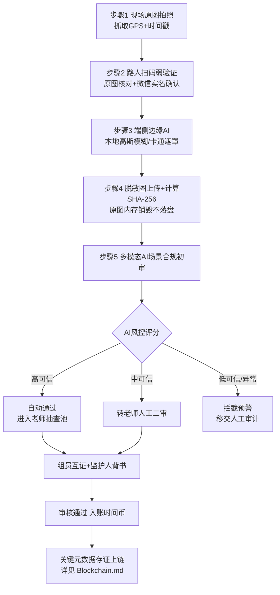

# 时间银行 · 自动审核方案（AutoAudit / POV 见证者审核）

> 本文档是《时间银行方案设计》（`TimeBankDesign.md`）的子方案，面向**自发性、随时随地**的志愿服务场景，设计以"见证者证明（Proof of Volunteering, POV）"为核心的自动化审核机制。数据字段沿用 `ManualAudit.md`；存证上链见 `Blockchain.md`；承载系统见 `OnlineSystem.md`。

## 1. 背景与目标

校内集中组织的志愿服务可由老师现场确认，但学生**自发性公益**（如社区清洁、随手公益、社区互助）缺乏老师随行，传统人工签字难以覆盖。自动审核方案要解决三大问题：

- **信任不对称**：无老师陪同时，如何证明服务真实发生、时长真实。
- **作弊博弈**：服务挂钩升学/评优后，存在伪造见证人、刷时长、倒填日期等动机。
- **隐私合规**：涉及未成年人及受助者肖像，需在采集环节即完成脱敏。

目标：在**不破坏自发公益初衷**的前提下，通过"轻量前端 + 端侧脱敏 + 见证者弱验证 + 统计学风控 + 多模态 AI 初审"实现高真实性、低人工成本、可审计的自动审核闭环。

## 2. 核心概念：POV 见证者证明

POV 指由服务现场的**路人见证者 / 受助者 / 同行组员 / 监护人**对一次自发公益行为的真实性进行多方背书，结合设备元数据（GPS、时间戳）与 AI 场景识别，形成可信度评分，驱动自动或半自动审核。

POV 的可信度由四类证据加权构成：

- **设备证据**：GPS 坐标、精确时间戳、设备指纹。
- **见证证据**：见证者实名（微信手机号）确认。
- **内容证据**：照片/视频经多模态 AI 识别的场景与行为标签。
- **社会证据**：组员互证、监护人背书、同伴公示监督。

### 2.1 术语说明：为何用 Proof of Volunteering 而非 Proof of Witness

本方案命名为 **Proof of Volunteering（POV）**，而非 "Proof of Witness"，原因有三：

- **命名层级正确**：POV 描述的是「**证明什么**」——要证明的目标是"这次志愿服务真实发生过"；而"见证（Witness）"只是「**怎么证明**」的手段之一。把手段当作方案名会窄化外延。
- **与多源加权设计一致**：POV 可信度由设备、见证、内容、社会**四类证据加权**构成，"见证"仅为其中一类。若命名为 Proof of Witness，会与本方案的多源加权设计自相矛盾。
- **避免缩写冲突**：Proof of Witness 缩写 PoW 与区块链 "Proof of Work" 严重撞名，在含区块链存证（见 `Blockchain.md`）的本项目中极易混淆；POV 无歧义。

因此，**POV 作为方案名，"见证者证明"作为其核心机制**，对老师、家长等非技术受众也更直观。

## 3. 参与者与职责

| 角色 | 职责 |
| --- | --- |
| 公益参与学生 | 现场拍照打卡、展示核销码、如实填写服务信息 |
| 路人见证者/受助者 | 微信扫码、核对现场、一键确认见证属实 |
| 同行组员 | 结伴公益时互相佐证（GPS 围栏 + 互签） |
| 监护人（家长） | 对学生当日自发公益进行线上签名背书并承担连带信用 |
| 值班老师/班主任 | 对 AI 初审通过的记录进行一键复核与抽查 |
| 学生发展中心 | 制定规则、处理争议、组织高价值证书盲评 |

## 4. POV 完整审核流程

### 4.1 时序流程



### 4.2 步骤详解

- **步骤 1 · 现场记录**：学生在公益现场通过微信小程序拍摄含组员、环境、受助对象的原图，系统自动抓取底层 GPS 坐标与精确时间戳。
- **步骤 2 · 见证者弱验证**：学生出示核销二维码，见证者用微信扫码，经官方实名接口仅需点击"确认见证属实"，系统无感获取其微信绑定实名手机号；见证者端展示**无码原图**用于核对现场与学生一致。
- **步骤 3 · 端侧脱敏**：见证者确认瞬间，小程序本地（WASM/JS）激活边缘模型，0.1 秒内对所有未成年人与受助者面部做高斯模糊或卡通遮罩。
- **步骤 4 · 上传与销毁**：仅上传**已脱敏图片**至云存储，并计算 SHA-256 哈希；原图在手机内存销毁，绝不落盘、绝不上传。
- **步骤 5 · AI 初审**：后端多模态模型识别场景/物体标签，比对申报内容与画面一致性，输出可信度评分。
- **步骤 6 · 多方佐证**：组员互证 + 监护人线上签名背书。
- **步骤 7 · 人工抽查/二审**：老师对高可信记录抽查、对中可信记录二审。
- **步骤 8 · 入账与存证**：通过后转换时间币，关键元数据哈希上链存证。

### 4.3 脱敏与见证的矛盾及解决方案

**核心矛盾**：若照片在手机端**拍摄即打码**，见证者扫码时看到的是满屏马赛克，无法核对"照片里是不是眼前这几个孩子、是不是这个公益场所"，见证将失去意义。为同时满足**未成年人隐私保护**与**见证真实性**，提供两种闭环方案。

#### 方案 A · 时序隔离法（先见证、再脱敏上传，推荐）

逻辑：现场见证时照片保持**原图**，见证者确认并签名后，系统在本地后台打码，再上传与上链。

- 步骤 1：现场拍摄含组员、环境、见证人的清晰**原图**。
- 步骤 2：见证者扫码，手机屏幕显示**无码原图**，核对"人对、地点对、时间对"后点击签字确认。
- 步骤 3：确认瞬间，本地代码（WASM/JS）在 0.1 秒内对所有未成年人/老人面部打码。
- 步骤 4：仅上传**脱敏图**并计算哈希上链，原图在手机内存销毁、绝不上传。
- 可行性：见证者见证的是"当下活生生的现场与刚拍的原图"，而互联网/链上记录的是"已脱敏、不可溯源真人但防篡改的社会资产"。

#### 方案 B · 局部可见法（人脸打码、环境留存）

逻辑：见证者本就站在孩子面前，无需看孩子的脸，只需核对**背景与内容**是否属于该公益场所。

- 拍照瞬间调用本地轻量模型（如 BlazeFace），**仅对未成年人人脸**实时打码或贴卡通面具（小太阳/小红花）。
- 见证者看到"脸上贴小红花、但养老院背景清晰"的照片，结合眼前真人核对衣着、身形与背景即可见证。
- 该"局部打码图"直接上传上链，隐私保护与见证证明统一。

#### 方案对比与推荐

| 维度 | 方案 A 时序隔离 | 方案 B 局部可见 |
| --- | --- | --- |
| 见证信息完整度 | 高（见证原图） | 中（仅环境+体型） |
| 隐私强度 | 高（最终图全脱敏） | 中（环境可见） |
| 实现复杂度 | 中（需时序控制） | 低（拍照即打码） |
| 误触风险 | 确认前原图短暂存在内存 | 几乎无原图暴露 |
| 适用场景 | 需强见证（陌生路人见证） | 见证者已在现场（组员/家长/基地管理员） |

> **推荐**：以**方案 A（时序隔离）为主**，用于陌生路人见证的强真实性场景；**方案 B（局部可见）为辅**，用于见证者已在现场、隐私优先的场景。两者均要求**原图绝不落盘上传**。

## 5. 见证者验证与身份真实性

### 5.1 弱验证「两秒闭环」

为保护见证者积极性，扫码核销必须"两秒闭环"：

```text
扫码 → 微信自动授权手机号 → 点击"同意见证" → 结束
```

- **不强制**见证者下载 App、注册账号或输入验证码。
- 见证者端按方案 A/B 展示原图或局部打码图用于现场核对。
- 页面底部标注震慑文案："本证书已由区块链存证以防欺诈，系统将对约 2% 的见证进行电话回访"，以极低成本劝退熟人/家长协助作弊。
- 系统仅留存见证者手机号与微信 UnionID 的**加密哈希**（详见第 9 节），不明文存储、不对外展示完整号码。

### 5.2 见证者身份真实性（反 Sybil）四路径对比与推荐

**问题**：若"见证者"是学生用小号伪造或根本不存在，整条证据链将崩塌。在国内合规前提下，由浅入深有四条路径。

| 路径 | 做法 | 公信力 | 开发成本 | 对自发公益的友好度 |
| --- | --- | --- | --- | --- |
| 1. 微信实名生态借力（弱验证） | 见证者扫码授权微信实名手机号/UnionID（加密上链） | 中高 | 极低（零开发） | 高（不破坏随手公益） |
| 2. 公益基地白名单预制 | 提前与社区/养老院/图书馆签约，仅白名单管理员可扫码确认 | 最高 | 中（需签约运营） | 低（限定场所） |
| 3. 见证者信用分风控 | 用大数据行为分析对散点见证者动态评分、拉黑刷子 | 中高 | 中（需风控模型） | 高 |
| 4. 熟人圈多重背书 | 组员互证 + 监护人二审签名 + 连带信用 | 中高 | 低 | 高 |

> **推荐组合**：
> - **日常定点公益** → 走**路径 2（白名单基地）**，见证人为基地登记管理员，从源头解决"确有其人"。
> - **自发零散公益** → **路径 1 + 3 + 4** 叠加：路人微信实名弱验证 + 单次时间币设低上限 + AI 频次/时空风控 + 熟人圈背书。
>
> 注意：若把公益**死死限制在白名单基地**，就退化为"刷学时"，扼杀"随手捡垃圾、帮邻居奶奶提行李"的自发初衷。因此整体策略是**从"事前卡死"转向"事后风控"**。

### 5.3 定点基地模式 vs 开放自发模式

| 模式 | 真实性保障 | 优点 | 缺点 | 适用 |
| --- | --- | --- | --- | --- |
| 定点基地（事前授信） | 白名单管理员扫码 | 公信力最高、易审计 | 限定场所、抑制自发性 | 周末固定公益、长期合作项目 |
| 开放自发（事后风控） | 微信实名+互证+AI风控+公示 | 保护自发初衷、覆盖随手公益 | 依赖风控与抽查 | 路边捡垃圾、社区互助、随手公益 |

> **推荐**：两种模式**并行**，按服务来源自动适配审核强度；开放模式配合"低额度 + 软激励"（见第 14 节）从源头消解作弊动机。

## 6. 公益参与者需要做的操作

- 打卡前确保定位与相机权限开启。
- 现场拍摄真实照片/短视频，包含可识别的公益场景与行为。
- 邀请现场见证者扫码确认（如有）。
- 填写服务类型、简述、时长。
- 结伴时确保组员同时打卡（触发 GPS 围栏互证）。
- 回家后请监护人线上背书确认。

### 具体操作案例

- **案例 1 · 定点养老院（白名单）**：小明周末到签约养老院陪伴老人 2 小时，由养老院白名单管理员扫码确认 → 高可信，自动通过并进入抽查池。
- **案例 2 · 开放路边公益**：小红与小刚在公园捡塑料瓶 1 小时（方案 A 时序隔离拍照），路人"张先生"微信扫码弱验证，两人 GPS 互证重合，回家后家长背书 → 中高可信，进抽查池；按自发公益当日上限计入时间币。
- **案例 3 · 帮邻居奶奶提行李**：单人随手公益，无路人见证，仅家长背书 + GPS/时间 → 中可信，转老师二审。

## 7. 互证与多方背书机制

### 7.1 组员互证

2-3 名同学结伴公益时，系统比对多部手机的 GPS 围栏与时间窗口，自动建立互证关系，单人造假难度显著提升。

### 7.2 监护人连带背书

学生当日公益须由家长微信签名背书。一旦事后查实造假，**全组学生与所有背书家长**的"联合信用分"清零并通报，大幅提高作弊心理成本。

### 7.3 社会化动态公示墙

通过初审的动态（仅展示脱敏图、脱敏姓名、见证人姓氏如"张先生 135****8888"）实时推送至班级动态墙，引入同伴监督；内置"存证质疑"按钮。

## 8. 审核标准与可信度评分

### 8.1 自动通过/转人工/拦截规则

| 评分区间 | 处理 | 触发条件示例 |
| --- | --- | --- |
| 高可信 | 自动通过 + 抽查 | GPS/时间正常、AI 场景匹配、见证者实名、组员互证齐全 |
| 中可信 | 转老师二审 | 缺见证者、单人公益、AI 标签部分匹配 |
| 低可信 | 拦截预警 | 时空冲突、场景不符、疑似翻拍/P 图、见证人异常 |

### 8.2 多模态 AI 审核维度

- **场景一致性**：申报"垃圾分类宣传"但识别为室内网吧/游乐场且无清洁工具 → 拦截。
- **EXIF 与一致性**：拍摄时间、光圈是否与打卡时间相符。
- **翻拍/篡改检测**：频域分析识别是否对屏幕二次翻拍或 P 图。

### 8.3 统计学异常风控（反洗钱/反刷单模型）

在利益诱惑下家长伪造见证人的手段会升级，但**统计学规律无法伪造**。借鉴金融"反洗钱/反刷单"模型：

- **梅特卡夫离散度过滤**：真正的自发公益，其时间、地点、见证人手机号、同行同学应**高度离散随机**。若某学生 20 次公益中有 15 次见证人手机号属同一号段、或这些见证人在微信生态关联度极高 → 判定为"家庭作弊链"，直接降权或取消评优资格。
- **频次围栏**：同一见证手机号短期内跨区域为多名不相干学生高频签字，或固定给特定学生签字 → 判为"职业见证人"，熔断该链路。
- **时空围栏（Geo-fencing）**：同一学生前后两次打卡坐标差超过交通行驶极限（如半小时内相距 30 公里）→ 橙色预警移交人工。
- **季节/环境一致性**：照片植被显示为夏天，但 GPS+时间戳为冬天 → 多模态 AI 直接拦截。

### 8.4 见证者信用分机制

对散点（无法预绑白名单）的路人见证者引入动态信用分：

- 见证人手机号**首次出现**为某学生签字 → 初审可通过。
- 该号短期内频繁为多名不相干学生签字、或出现时空冲突 → 判为"虚假身份/刷子"，**拉入黑名单**并扣除相关学生由其见证的时间币。
- 信用分与第 7 节"连带信用"联动：作弊一经查实，学生、背书家长、同行同学微信号信用分同步下调。

## 9. 见证元数据存储设计

### 9.1 存储原则

- **最小化**：仅存审核与存证必需字段，敏感信息一律哈希化。
- **脱敏优先**：图片仅存脱敏版本；原图不落盘。
- **分层存储**：业务库存可读元数据，链上仅存哈希指纹（见 `Blockchain.md`）。

### 9.2 元数据字段

| 字段 | 说明 | 敏感级 |
| --- | --- | --- |
| 记录编号 | POV 记录唯一 ID | 低 |
| 学生 ID | 关联学生账户 | 中 |
| 服务时间窗 | 开始/结束时间戳 | 低 |
| GPS 坐标 | 打卡经纬度（可做模糊化） | 中 |
| 设备指纹哈希 | 设备唯一标识哈希 | 中 |
| 脱敏图 URL | 云存储地址（仅脱敏版） | 中 |
| 脱敏图 Hash | 脱敏图 SHA-256 | 低 |
| 见证者手机号 Hash | 实名手机号加盐哈希 | 高（仅哈希） |
| 见证者 UnionID Hash | 微信唯一标识加密哈希，反 Sybil 查重 | 高（仅哈希） |
| 见证类型 | 路人/受助者/组员/监护人/基地管理员 | 低 |
| 组员互证 ID 列表 | 关联组员记录 | 中 |
| 监护人背书 Hash | 家长确认签名哈希 | 高（仅哈希） |
| AI 评分与标签 | 可信度分及场景标签 | 低 |
| 审核老师签名 | 二审/抽查老师数字签名 | 中 |
| 审核状态 | 通过/二审/拦截/驳回 | 低 |
| 上链交易哈希 | 存证 TxHash（如启用） | 低 |

### 9.3 留存与销毁

- 原图：**不存储**（端侧销毁）。
- 脱敏图：按学年留存，毕业归档后按隐私政策定期清理。
- 手机号/背书：仅保存加盐哈希，便于查重比对但不可反推。

## 10. 实现路径利弊分析

### 10.1 端侧脱敏方案

| 路径 | 优点 | 缺点 |
| --- | --- | --- |
| 端侧边缘 AI（WASM，如 MediaPipe/BlazeFace，<1MB） | 原图不出本地、隐私最优、不耗服务器算力 | 低端机性能波动、需做兼容性适配 |
| 云端脱敏 | 实现简单、效果稳定 | 原图需上传，隐私风险高，合规压力大 |

**推荐：端侧脱敏**，云端仅作为不支持机型的降级兜底（上传即脱敏即焚）。

### 10.2 见证者验证方案

| 路径 | 优点 | 缺点 |
| --- | --- | --- |
| 微信扫码 + 实名手机号弱验证 | 两秒闭环、零打扰、实名可信 | 依赖微信生态、需合规授权 |
| 见证者短信验证码 | 不依赖微信 | 打扰大、放弃率高 |
| 见证者 App 强验证 | 信息最全 | 路人几乎不会安装，不可行 |

**推荐：微信扫码弱验证**为主，老师二审为辅。

### 10.3 审核自动化程度

| 路径 | 优点 | 缺点 |
| --- | --- | --- |
| 全自动 AI 审核 | 人工成本最低 | 误判风险、对未成年人评价不够稳妥 |
| AI 初审 + 老师抽查/二审（推荐） | 平衡成本与公正、责任可追溯 | 仍需一定人工投入 |
| 纯人工 | 最可靠 | 无法覆盖自发公益规模 |

**推荐：AI 初审 + 人工抽查/二审**的半自动模式。

### 10.4 综合推荐方案

> **端侧脱敏 + 微信扫码弱验证 + 多模态 AI 初审 + 组员互证/监护人背书 + 老师抽查二审 + 关键元数据哈希上链**。
> 高价值证书（升学相关）额外触发"跨校盲评"（见第 11 节）。

## 11. 高价值证书的跨校盲评

当学生申请与升学相关的"综合素质荣誉证书"时触发盲评：

- 自动导出该生全年公益轨迹与脱敏材料，抹去姓名、班级、性别、校名等身份信息。
- 随机分发给**其他学校**家委会代表或校外志愿者协会评审员组成的盲评委。
- 评审员就持续性、社会价值、真实感无记名投票；因事前无法得知材料归属，寻租空间被技术锁死。

## 12. 容错与兜底机制

- **断网容错**：山区无信号时支持本地缓存，先锁定带 GPS 的加密相册，恢复网络后异步上传与补签。
- **无智能机受助者**：切换"现场标志物拍摄 + 班主任/家长家访录音证实"特批通道。
- **AI 误判申诉**：学生可对拦截结果提交申诉，转人工审计复核。

## 13. 风险控制机制

| 风险 | 控制措施 |
| --- | --- |
| 伪造见证人/刷分 | 微信实名 + 频次/时空围栏熔断职业见证人 |
| 翻拍、P 图 | EXIF 校验 + 频域分析 + 多模态场景比对 |
| 倒填日期 | 时间戳铁印 + 关键元数据上链（见 `Blockchain.md`） |
| 家长参与作弊 | 监护人连带信用清零 + 高价值材料跨校盲评 |
| 隐私泄露 | 端侧脱敏、原图不落盘、敏感字段仅哈希 |
| AI 误判 | 半自动模式 + 申诉复核兜底 |
| 见证者被骚扰 | 仅哈希留存、不公示完整号码、两秒闭环 |

## 14. 时间币激励经济学（低额度 + 软激励）

学生伪造见证人刷分的根因是"时间币太值钱"。把自发公益的激励设计得"刚刚好"，即可从源头消解作弊动机。

### 14.1 额度上限天花板

- 自发零散公益（捡垃圾、扶老人等）设**每日时间币硬上限**（示例：每日最多 2 币）。
- 兑换锚定使作弊无利可图（示例：换一块橡皮需 10 币，而每日自发公益封顶 2 币）。

### 14.2 分流激励（精神为主、物质为辅）

| 服务类型 | 时间币（物质） | 精神激励 | 理由 |
| --- | --- | --- | --- |
| 自发零散公益 | 低（每日封顶） | 高：勋章、称号、班级排名 | 无巨大物质利益，不值得花精力伪造见证人 |
| 定点基地/有初审项目 | 中高 | 中 | 有白名单或老师初审，作弊门槛高 |
| 阅读等高投入项目 | 较高 | 中 | 有读后感初审，且时间脑力成本高，作弊门槛本就极高 |

> **推荐**：自发公益走"低额度 + 高荣誉"，保护纯粹荣誉感；高门槛/可初审项目给予较高时间币。该机制与第 5.2/5.3 节风控形成"源头治理 + 过程风控"双保险。本节为审核侧落地口径，与 `TimeBankDesign.md` 顶层激励体系一致。

## 15. 端到端案例演示

以"小红与小刚公园捡塑料瓶"为例，串联全流程：

1. **拍摄**：两人完成清理，按方案 A 拍含双方、垃圾袋、公园环境与路人的原图，系统抓取 GPS+时间戳。
2. **见证**：路人张先生微信扫码，屏幕显示无码原图，核对无误点"同意并授权手机号"（2 秒）。
3. **脱敏**：确认瞬间本地打码两人面部，仅上传脱敏图并计算 SHA-256，原图内存销毁。
4. **互证**：两人手机 GPS 围栏重合、时间窗一致，自动建立组员互证。
5. **AI 初审**：多模态识别"公园/垃圾袋/清理"标签匹配，季节与 GPS 一致，张先生手机号首次出现且离散 → 高可信。
6. **家长背书**：当晚双方家长微信签名确认。
7. **入账**：审核通过，按自发公益当日上限计入时间币 + 发放"环保小卫士"勋章。
8. **存证**：记录编号、脱敏图 Hash、见证手机号/UnionID 哈希、家长背书哈希、时间戳批量上链（见 `Blockchain.md`）。
9. **公示与抽查**：动态推送"爱心动态墙"（张先生 138****8888），系统按 2%-5% 概率抽中则由家委会志愿者 10 秒电话回访。

## 16. 与其他方案的衔接

- 数据字段与 `ManualAudit.md` 保持一致，人工审核作为兜底与争议处理通道。
- 审核通过后的关键元数据（哈希、时间、签名）按 `Blockchain.md` 上链存证。
- 全部能力由 `OnlineSystem.md` 描述的线上系统承载。
