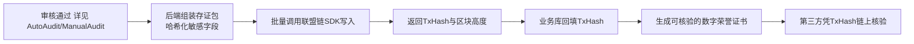

# 时间银行 · 区块链存证方案（Blockchain）

> 本文档是《时间银行方案设计》（`TimeBankDesign.md`）的子方案，定义区块链在时间银行中的**存证用途**。审核数据来源见 `ManualAudit.md` 与 `AutoAudit.md`，承载系统见 `OnlineSystem.md`。

## 1. 定位：存证，而非交易

**区块链在本项目中仅用于"志愿服务行为与荣誉的存证"，不用于任何代币交易。**

- **存证**：将审核通过的服务记录关键信息（哈希、时间、签名）写入链上，使其**不可篡改、可追溯、可第三方核验**。
- **非交易**：系统**不发行任何代币（Token）、不挖矿、不上交易所、不与法币挂钩**。
- **兑换不视为交易**：时间币/爱心积分的校内兑换是**学校内部积分核销**行为，仅在中心化业务库记账，**不在链上转账、不构成金融交易**。链上只存"该学生获得过某荣誉/完成过某服务"的事实存证。

> 一句话：**链上存事实指纹，链下管业务积分。**

## 2. 为什么需要区块链

| 痛点 | 区块链作用（TRUST 模型） |
| --- | --- |
| 内部人员受托篡改数据 | **T 可追溯**：记录审核人、盲评人数字签名，终身责任制 |
| 升学前倒填日期、虚增时长 | **R 防倒填**：上链时间由区块高度铁印锁死 |
| 高校/第三方难以采信 | **U 社会级公信**：凭 TxHash 在链上浏览器直接核验，无需人工背调 |

## 3. 合法合规要求（以中国法律法规为准）

### 3.1 核心红线

- **不发币、不交易**：严格规避《关于防范代币发行融资风险的公告》《关于进一步防范和处置虚拟货币交易炒作风险的通知》等监管红线。全系统禁止出现"Token、代币、挖矿、数字货币、提现"等表述，对外统一称"荣誉存证""爱心积分"。
- **使用合规联盟链**：弃用任何带原生代币的公链（以太坊、Solana 等），采用**国内备案的开放联盟链**。
- **区块链信息服务备案**：依据《区块链信息服务管理规定》，所用区块链信息服务应已完成网信办备案；学校作为应用方核实服务商备案号。
- **个人信息保护**：依据《个人信息保护法》《未成年人保护法》《儿童个人信息网络保护规定》：
  - 处理未成年人信息须取得**监护人同意**。
  - **链上绝不写入明文个人信息或可识别肖像**，仅写入哈希指纹。
  - 落实最小必要原则与数据脱敏（详见 `AutoAudit.md` 第 9 节）。
- **数据出境**：链节点与数据存储应在境内，避免数据跨境合规风险。

### 3.2 主体与实名

- 以**学校、教育主管部门或合法登记的民非组织（NGO）**为主体，在联盟链平台完成企业级实名认证（KYC）。
- 学生与见证者**无需**持有数字钱包或私钥。

### 3.3 无感 Gas（人民币结算）

- 上链燃料费由项目方/学校在后端以**人民币预存套餐**批量支付。
- 用户端零感知，不接触任何加密资产。

## 4. 上链数据设计

### 4.1 上链原则

- **只上哈希，不上原文**：原始材料与个人信息存于境内业务库/对象存储，链上仅存其 SHA-256 指纹与必要元数据。
- **可验证不可反推**：手机号、监护人签名等敏感项加盐哈希。
- **批量上链**：审核通过后按批次写入，降低成本与频次。

### 4.2 上链字段（存证包）

| 字段 | 说明 |
| --- | --- |
| 记录编号 | 服务/荣誉记录唯一 ID |
| 学生 ID 哈希 | 学生标识哈希（不存明文） |
| 服务时长 | 审核确认的时长 |
| 脱敏图 Hash | 脱敏图片 SHA-256 |
| 见证者手机号 Hash | 加盐哈希 |
| 见证者 UnionID Hash | 微信唯一标识加密哈希（反 Sybil：批量伪造数十个实名微信刷分成本极高） |
| 监护人背书 Hash | 加盐哈希 |
| 审核老师签名 | 审核人数字签名 |
| 时间戳/区块高度 | 上链时间铁印 |

### 4.3 上链流程

## 5. 公链/联盟链选型

> 本项目所称"公链选择"指**国内合规的开放联盟链**，非境外公有链。

| 选型 | 简介 | 优点 | 缺点 |
| --- | --- | --- | --- |
| **文昌链（基于 BSN，首选）** | BSN 官方开放联盟链 | 国家级基础设施、合规清晰、人民币计费、开放许可链对中小应用友好、存证成本极低 | 生态相对垂直，需熟悉 BSN 接入规范 |
| 蚂蚁链开放联盟链 | 蚂蚁集团 | 文档完善、SDK 成熟、存证产品化程度高 | 商业计费、对学校长期成本需评估 |
| 长安链（ChainMaker） | 国产自主可控开源链 | 自主可控、可私有化部署、性能强 | 需自建/托管节点，运维门槛较高 |
| 腾讯至信链 | 腾讯 | 司法存证生态强、与微信打通好 | 商业合作门槛、计费需洽谈 |

**推荐：首选文昌链（BSN 开放联盟链）**，以其国家级背书、合规清晰、人民币计费与极低存证成本，最契合学校长期、低成本、合规的存证需求；蚂蚁链作为备选。

## 6. 费用评估

| 项目 | 估算 | 说明 |
| --- | --- | --- |
| 单次存证成本 | 约 ￥0.01–￥0.05 | 开放联盟链上链/存证调用费 |
| 年度上链量（示例） | 假设 1000 学生 × 年均 20 条 = 2 万条 | 按校规模估算 |
| 年度存证费用（示例） | 约 ￥200–￥1000 | 2 万条 × 单价，批量后更低 |
| 节点/接入 | 开放联盟链免自建节点 | 选择托管模式可省去节点运维 |
| 对象存储/业务库 | 另计 | 脱敏图与业务数据存储成本，详见 `OnlineSystem.md` |

> 成本控制要点：**批量上链**、**只上哈希**、**优先开放联盟链托管模式**，避免自建节点的硬件与运维投入。

## 7. 开发难度与易用性分析

| 维度 | 评估 |
| --- | --- |
| 接入难度 | 中低。开放联盟链提供 RESTful/SDK，后端调用即可，前端用户无感 |
| 钱包/私钥 | 用户端无需私钥；密钥由项目方后端托管，需做好密钥安全管理 |
| 学习成本 | 主要为熟悉所选链的存证 API 与备案流程 |
| 运维 | 托管模式下几乎零节点运维；私有化部署（长安链）运维成本高 |
| 易用性 | 对学生/见证者/老师完全透明，仅后端集成 |

## 8. 实现路径利弊分析与推荐

| 路径 | 优点 | 缺点 | 适用 |
| --- | --- | --- | --- |
| **A. 开放联盟链托管 + 只上哈希（推荐）** | 合规清晰、零节点运维、成本极低、用户无感 | 依赖服务商可用性 | 学校长期低成本存证 |
| B. 自建/私有化联盟链（长安链） | 自主可控、数据完全自持 | 节点运维与硬件成本高、周期长 | 大型机构或多校联盟 |
| C. 第三方司法存证 SaaS（至信链等） | 司法采信强、产品成熟 | 商业计费、灵活性受限 | 重司法效力场景 |
| D. 不使用区块链，仅中心化数据库 + 数字签名 | 成本最低、最简单 | 防篡改与第三方公信力弱 | 试运行早期阶段 |

**推荐演进路线：**

- **早期试运行**：可先用路径 D（中心化 + 数字签名 + 操作日志）验证业务。
- **正式阶段**：采用**路径 A（文昌链开放联盟链托管 + 只上哈希 + 批量上链）**作为长期方案。
- **远期（多校/司法需求）**：评估升级到路径 B 或叠加路径 C。

## 9. 与其他方案的衔接

- 上链数据来源于 `ManualAudit.md` 与 `AutoAudit.md` 审核通过的记录。
- 链上仅存哈希指纹；脱敏图、业务数据与时间币账户由 `OnlineSystem.md` 描述的中心化系统管理。
- 时间币兑换为校内积分核销，**不上链、不构成交易**。
