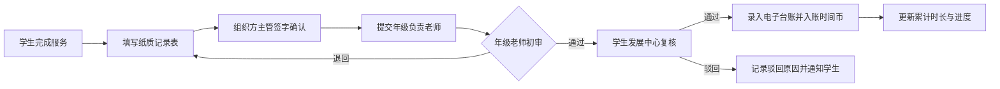

# 时间银行 · 人工审核方案（ManualAudit）

> 本文档是《时间银行方案设计》（`TimeBankDesign.md`）的子方案，描述**当前阶段**基于纸质表单与人工核验的志愿服务审核机制，并定义服务记录的数据字段。自动化审核方案见 `AutoAudit.md`，上链存证见 `Blockchain.md`，线上系统见 `OnlineSystem.md`。

## 1. 适用范围与定位

人工审核方案适用于线上系统上线前的过渡阶段，也作为自动审核方案的兜底与复核手段。其核心特征为：

- **以纸质《示例中学学生志愿者服务记录表》为原始证明材料。**
- **由组织方主管签字、年级负责老师初审、学生发展中心复核。**
- **审核结果以电子台账形式沉淀，作为时间币入账依据。**

人工审核强调流程可控、证据可查、责任到人，是制度落地的第一阶段方案。

## 2. 数据设计

人工与自动方案共用以下数据结构，便于后期向电子台账和线上系统平滑迁移。

### 2.1 学生基础信息

| 字段 | 说明 |
| --- | --- |
| 学生姓名 | 学生中文或英文姓名 |
| 学号 | 学生唯一识别编号 |
| 班级 | 当前所在班级 |
| 年级 | 当前所在年级 |
| 邮箱 | 学生或学校邮箱 |
| 电话 | 联系电话，可选 |

### 2.2 服务记录信息

| 字段 | 说明 |
| --- | --- |
| 服务记录编号 | 每条记录唯一编号 |
| 服务日期 | 实际服务日期 |
| 开始时间 | 服务开始时间 |
| 结束时间 | 服务结束时间 |
| 总时长 | 以小时为单位，可支持 0.5 小时 |
| 是否包含路途时间 | 如包含需注明原因 |
| 服务地点 | 校内或校外具体地址 |
| 组织名称 | 学校、社区、公益机构等 |
| 组织类型 | 非营利机构、学校活动、政府机构、其他 |
| 服务性质 | 活动助理、导师、环保、食品分发等 |
| 服务描述 | 学生实际完成的任务说明 |
| 主管姓名 | 组织方或项目负责人姓名 |
| 主管联系方式 | 电话或邮箱 |
| 证明材料 | 签名、照片、邮件、证书等 |
| 审核状态 | 待审核、通过、退回、驳回 |
| 审核人 | 年级老师或学生发展中心老师 |
| 审核时间 | 审核完成日期 |
| 入账时间币 | 审核通过后转换的时间币数量 |

### 2.3 时间币账户信息

| 字段 | 说明 |
| --- | --- |
| 当前余额 | 已审核且未兑换、未冻结的时间币 |
| 累计获得 | 学生历史累计获得时间币 |
| 累计兑换 | 学生历史累计兑换时间币 |
| 借入数量 | 尚未归还的借贷时间币 |
| 冻结数量 | 因审核、争议或规则限制暂不可用的时间币 |
| 毕业要求进度 | 当前累计时长 / 阶段要求时长 |

## 3. 人工审核流程



### 3.1 步骤说明

- **第一步 · 服务完成与记录**：学生完成服务后填写《示例中学学生志愿者服务记录表》。
- **第二步 · 组织方签字**：组织方或项目负责人核实服务时长与内容并签字，留下可联系方式。
- **第三步 · 提交初审**：学生将纸质表与证明材料提交至年级负责老师；校外服务建议附照片、邮件、组织证明。
- **第四步 · 年级老师初审**：核对信息完整性、签字有效性与项目合规性。
- **第五步 · 学生发展中心复核**：抽查真实性、确认时长合理性，决定是否入账。
- **第六步 · 入账与统计**：审核通过后录入电子台账，转换为时间币并更新累计进度。

## 4. 审核标准

审核人员应重点检查：

- 服务内容是否属于学校认可范围。
- 服务时间是否合理，与任务内容是否匹配。
- 表格信息是否完整。
- 组织方或主管签字是否有效、可核验。
- 是否存在重复提交或明显异常。
- 校外服务是否具有足够证明材料。

## 5. 审核状态

| 状态 | 含义 |
| --- | --- |
| 待提交 | 学生已记录但未提交 |
| 待审核 | 材料已提交，等待审核 |
| 通过 | 审核通过并入账 |
| 退回补充 | 材料不完整，需补充后再审 |
| 驳回 | 不符合认定标准，不计入时长 |
| 复核中 | 学生对结果有异议，进入复核 |

-合并审核中和复核中

## 6. 审核周期

- **校内服务**：活动结束后 5 个工作日内完成审核。
- **校外服务**：材料提交后 10 个工作日内完成审核。
- **毕业或升学节点**：设立集中审核窗口，提前提醒学生补足材料。

## 7. 异常处理

| 异常情况 | 处理方式 |
| --- | --- |
| 材料不完整 | 退回学生补充材料 |
| 时长异常偏高 | 要求组织方二次确认 |
| 项目不符合公益原则 | 不予认定 |
| 重复提交同一服务 | 保留一次有效记录，其余驳回 |
| 主管无法联系 | 要求学生提供替代证明或重新提交 |
| 学生对审核结果有异议 | 提交复核申请，由学生发展中心复核 |

## 8. 线下材料与电子台账管理

### 8.1 纸质材料

使用《示例中学学生志愿者服务记录表》作为原始证明材料，归档时按编号留存，便于追溯与审计。

### 8.2 电子台账

由学生发展中心或年级负责老师建立统一电子表格，字段至少包括：

- 学生姓名 / 学号 / 年级班级
- 服务日期 / 服务项目 / 服务组织 / 服务时长
- 审核状态 / 审核人 / 累计总时长 / 备注

建议按学年建立台账，例如：

- `2026-2027_TimeBank_Service_Log`
- `2026-2027_TimeBank_Account_Balance`
- `2026-2027_TimeBank_Redemption_Record`

### 8.3 编号规则

```text
TB-学年-年级-学号-序号
```

示例：

```text
TB-2026-G06-12345-001
```

该编号用于纸质归档、电子台账查询和未来线上系统数据迁移。

### 8.4 公示与提醒

每月或每学期向学生提供个人累计进度提醒，不公开个人隐私信息；对低于阶段进度要求的学生，由班主任或年级负责老师一对一提醒。

## 9. 风险控制机制

| 风险 | 表现 | 控制措施 |
| --- | --- | --- |
| 虚假服务 | 提交未实际发生的服务 | 要求主管签名、联系方式与证明材料，抽样电话回访 |
| 时长夸大 | 实际服务少于申报 | 建立合理时长基准，异常记录二次确认 |
| 签字伪造 | 伪造组织方签字 | 复核阶段抽查主管联系方式，必要时致电核验 |
| 重复提交 | 同一服务多次入账 | 编号唯一性校验，台账查重 |
| 项目泛化 | 非公益活动包装为志愿服务 | 明确认定标准，学生发展中心终审 |
| 审核积压 | 表单堆积导致延误 | 固定审核周期与集中审核窗口 |
| 材料丢失 | 纸质遗失或台账混乱 | 纸质编号归档，电子台账定期备份 |

## 10. 与其他方案的衔接

- 人工审核产生的服务记录字段，与 `AutoAudit.md` 的自动审核数据结构保持一致。
- 审核通过的记录可作为 `Blockchain.md` 中存证上链的原始数据来源。
- 线上系统上线后，人工审核作为复核与兜底通道保留，详见 `OnlineSystem.md`。
