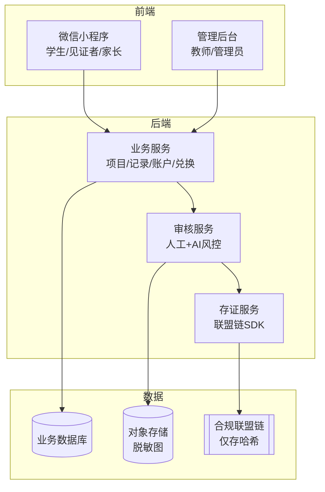

# 时间银行 · 线上系统方案（OnlineSystem）

> 本文档是《时间银行方案设计》（`TimeBankDesign.md`）的子方案，描述承载时间银行业务的线上系统。审核能力见 `ManualAudit.md` 与 `AutoAudit.md`，存证能力见 `Blockchain.md`。

## 1. 定位与目标

线上系统是时间银行的统一承载平台，整合**项目发布、报名、服务记录、审核（人工/自动）、时间币账户、兑换、统计与存证**等能力，提升管理效率并沉淀学生成长数据。建议以**微信小程序 + 管理后台**为主形态，便于打卡、扫码见证与家长背书。

## 2. 用户端功能

### 2.1 学生端

- 查看并在线认领可报名志愿服务项目。
- 现场打卡、上传脱敏材料、邀请见证者扫码（自动审核场景，详见 `AutoAudit.md`）。
- 提交服务记录与证明材料。
- 查看审核状态、累计服务时长、时间币余额与毕业要求进度。
- 申请补录、复核、借贷或兑换。

### 2.2 见证者端（无需注册）

- 微信扫码核对现场原图，一键"确认见证属实"，两秒闭环。

### 2.3 家长端

- 对学生当日自发公益进行线上签名背书（承担连带信用）。

### 2.4 教师端

- 发布与管理志愿服务项目。
- 审核学生服务记录、处理 AI 转人工的二审与抽查。
- 查看年级/班级/个人统计，导出数据。
- 发送未达标提醒，处理复核、补录、借贷申请。

### 2.5 管理端

- 配置服务时长规则与时间币兑换规则。
- 管理组织方与项目类别。
- 查看全校数据看板。
- 管理权限与操作日志、对接存证上链。

## 3. 关键模块

| 模块 | 功能 |
| --- | --- |
| 项目管理 | 发布、编辑、关闭志愿服务项目 |
| 报名管理 | 学生报名、名额控制、候补名单 |
| 服务记录 | 提交服务时长与证明材料、现场打卡 |
| 审核中心 | 人工审核 + AI 自动审核 + 二审/抽查（见 `ManualAudit.md`/`AutoAudit.md`） |
| AI 服务 | 端侧人脸脱敏（WASM BlazeFace）、多模态内容审核、图像真实性检测、统计学风控引擎、见证者信用评分（详见 `AI.md`） |
| 时间币账户 | 自动入账、余额查询、流水记录 |
| 兑换中心 | 兑换项目、兑换申请、兑换审核（校内积分核销，不上链） |
| 借贷管理 | 借贷申请、审批、归还跟踪 |
| 存证服务 | 关键元数据哈希上链、TxHash 回填（见 `Blockchain.md`） |
| 数据看板 | 年级统计、项目统计、达标情况 |
| 通知提醒 | 审核提醒、未达标提醒、兑换结果通知 |
| 权限管理 | 学生、家长、见证者、教师、管理员、学生负责人权限 |

## 4. 系统架构建议

- **端侧脱敏**在小程序本地完成，原图不落盘（见 `AutoAudit.md`）。
- **业务数据**与**脱敏图**存于境内业务库与对象存储。
- **链上仅存哈希指纹**（见 `Blockchain.md`）。

## 5. 数据安全与隐私

- 学生个人信息仅限授权人员查看。
- 系统记录审核、修改、兑换、借贷、上链等关键操作日志。
- 校外组织方/见证者联系方式仅用于核验，不公开展示，敏感项仅存哈希。
- 数据导出需限权限，防止隐私泄露。
- 时间币账户变动保留流水，确保可追溯。
- 未成年人信息处理须取得监护人同意，遵循最小必要原则。

## 6. 简略实施计划

| 阶段 | 周期建议 | 主要工作 |
| --- | --- | --- |
| 一 · 需求与原型 | 1 个月 | 梳理需求、确定形态（小程序+后台）、产品原型与权限体系设计 |
| 二 · 核心功能开发 | 1 个学期 | 项目发布、报名、记录、人工审核、时间币账户、统计看板 |
| 三 · 自动审核与存证 | 1 个学期 | 端侧脱敏、见证扫码、AI 初审风控、联盟链存证接入 |
| 四 · 兑换与拓展 | 系统稳定后 | 兑换中心、借贷管理、增值机制、数据分析与持续优化 |

实施过程中，人工审核（`ManualAudit.md`）始终作为复核与兜底通道保留；存证上链（`Blockchain.md`）可在第三阶段按需启用。

## 7. 与其他方案的衔接

- 审核逻辑遵循 `ManualAudit.md` 与 `AutoAudit.md`。
- 存证逻辑遵循 `Blockchain.md`。
- 制度规则、时长要求、激励体系遵循 `TimeBankDesign.md`。
- AI 各模块的技术实现、接入方案与成本估算见 `AI.md`。
