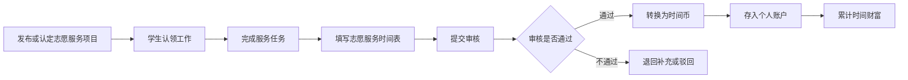

# 示例中学学生志愿服务「时间银行」方案设计

## 1. 项目概述

「时间银行」（Time Bank）是一种面向示例中学中学部学生的志愿服务管理模式。系统将学生参与志愿服务所产生的服务时长，按照统一规则转换为可记录、可累计、可查询、可审核的「时间币」，形成学生个人的「时间财富」。

本文档为时间银行的**顶层方案设计**，聚焦制度目标、核心概念、服务要求、核心功能、角色分工与激励体系，不包含审核、数据、线上线下与区块链的具体实现细节。相关实现拆分为以下独立子方案：

- **`ManualAudit.md`**：当前阶段人工审核方案与服务记录数据设计。
- **`AutoAudit.md`**：自动审核方案（POV 见证者审核）、见证元数据与实现路径分析。
- **`Blockchain.md`**：区块链存证方案、合规要求、公链选型与费用评估。
- **`OnlineSystem.md`**：线上系统设计与简略实施计划。
- **`Legal.md`**：中国法律法规下区块链应用的合法性约束、时间币的法律限制与合法化路径。
- **`AI.md`**：AI 技术应用方案，涵盖端侧人脸脱敏、多模态内容审核、图像真实性检测、统计学异常风控与见证者信用评分。

## 2. 项目背景与建设意义

### 2.1 背景

学校目前已建立学生志愿服务要求，并通过纸质版《示例中学学生志愿者服务记录表》记录学生服务信息。现有方式能够满足基础登记与审核需求，但在长期管理中存在以下问题：

- **记录分散**：学生个人服务记录主要依赖纸质表格，归档、查询和统计效率较低。
- **审核链路较长**：服务完成后需人工提交、人工核验、人工汇总，容易产生遗漏或延迟。
- **激励机制不足**：服务时长目前主要用于毕业或升学要求，缺少持续性的价值反馈。
- **数据沉淀不足**：学校难以基于志愿服务数据开展学生成长分析、公益项目优化和资源统筹。

### 2.2 建设意义

时间银行通过将志愿服务时长转化为「时间币」，在满足毕业服务时长要求的基础上，进一步建立学生公益参与的长期激励机制。

- **对学生**：明确服务目标，积累个人公益成果，获得成就感与成长记录。
- **对学校**：提升志愿服务管理效率，形成可统计、可追踪、可评估的数据体系。
- **对社区与公益组织**：建立稳定的学生志愿服务供给，促进学校与社会公益资源联动。
- **对学生发展中心**：形成统一的服务认定、审核、记录和反馈机制。

## 3. 项目目标

### 3.1 总体目标

建设一套适用于示例中学中学部的学生志愿服务时间银行机制，实现志愿服务的标准化管理、数字化沉淀和激励化运营。

### 3.2 阶段目标

| 阶段 | 目标 | 说明 |
| --- | --- | --- |
| 第一阶段：线下运行 | 建立统一规则与纸质记录流程 | 使用现有志愿服务时间表进行人工记录、定期审核和累计统计 |
| 第二阶段：半数字化管理 | 建立电子台账与查询机制 | 将纸质表单数据录入电子表格，支持按学生、年级、项目统计 |
| 第三阶段：线上系统管理 | 建设时间银行平台 | 支持活动发布、报名、时长记录、审核、时间币账户、兑换等功能 |
| 第四阶段：价值拓展 | 建立兑换、借贷、增值机制 | 在安全可控前提下探索商品、服务、荣誉、补偿和增值功能 |

## 4. 核心概念定义

### 4.1 志愿服务时间

学生在学校认可的校内、校外、社区、公益组织或学生发展中心认定项目中，实际完成志愿服务所产生的有效服务时长。

### 4.2 时间币

时间币是志愿服务时间的记录单位。基础转换规则为：

> 1 小时志愿服务 = 1 枚时间币

时间币不等同于真实货币，不具备现金属性，不可私下买卖，不可转让，不可用于商业交易。其用途仅限于学校认可的志愿服务管理、激励、兑换、补偿和成长记录场景。

### 4.3 时间财富

学生在时间银行中累计形成的个人志愿服务成果，包括累计服务小时数、累计时间币、服务类别、服务项目、审核记录、荣誉记录和兑换记录。

### 4.4 有效服务

有效服务需同时满足以下条件：

- **项目来源合规**：属于学校认可的志愿服务渠道。
- **服务内容真实**：学生实际参与并完成服务任务。
- **记录信息完整**：包含服务日期、时长、地点、组织、主管签名或证明材料。
- **审核通过**：经学生发展中心或年级负责老师审核确认。

## 5. 适用对象与管理范围

### 5.1 适用对象

本方案适用于示例中学中学部学生，重点覆盖：

- 六年级至八年级初中学生
- 九年级至十一年级高中学生
- 参与志愿服务组织、记录、审核与管理的教师和学生负责人

### 5.2 管理范围

时间银行覆盖以下志愿服务管理事项：

- 志愿服务项目发布与认领
- 学生报名与任务分配
- 服务过程记录
- 服务时长审核
- 时间币转换与存储
- 毕业服务要求统计
- 借贷、兑换、补偿与激励机制
- 数据分析与成长档案沉淀

## 6. 志愿服务时长要求

### 6.1 初中阶段要求

| 年级 | 年度要求 | 阶段累计要求 | 说明 |
| --- | --- | --- | --- |
| 六年级 | 每年至少 25 小时 | 毕业累计 75 小时 | 从六年级开始累计 |
| 七年级 | 每年至少 25 小时 | 毕业累计 50 小时 | 插入七年级或从七年级统计的学生需达到累计要求 |
| 八年级 | 满足升学要求 | 总计 25 小时 | 需完成升学前最低服务要求 |

初中阶段建议以三年累计 75 小时作为完整目标，并允许根据学生入学年级、转学情况和学校当年政策进行个案认定。

### 6.2 高中阶段要求

| 年级 | 年度要求 | 阶段累计要求 | 说明 |
| --- | --- | --- | --- |
| 九年级 | 每年至少 75 小时 | 毕业累计 300 小时 | 高中阶段志愿服务累计起点 |
| 十年级 | 每年至少 75 小时 | 毕业累计 300 小时 | 持续累计服务时长 |
| 十一年级 | 满足毕业要求 | 总计 75 小时 | 应在毕业审核前完成缺口补足 |

高中阶段以三年累计 300 小时作为毕业资格相关要求。对于转入学生、特殊项目学生或因客观原因未能按年度完成的学生，应由学生发展中心建立补充审核机制。

## 7. 志愿服务获取途径

### 7.1 校内志愿服务

校内志愿服务是学生参与学校公共事务和校园活动的重要渠道，包括：

- **校园活动组织**：策划、筹备、执行校园各类活动。
- **活动现场管理**：维护活动秩序，协助安全保障和现场引导。
- **学术活动协助**：支持讲座、研讨会、开放日、展示活动等。
- **学生自主项目**：由学生自主发起，经学生发展中心认定的创新性志愿服务。
- **其他认定工作**：学生发展中心根据实际情况审核认可的服务任务。

### 7.2 校外志愿服务

校外志愿服务需强调真实性、公益性和安全性，包括：

- **社区志愿服务**：社区建设、环境美化、居民协助、公共服务等。
- **公益组织合作项目**：与校外公益机构、非营利组织合作开展的服务。
- **政府或公共机构项目**：经学校认可的公共服务类志愿项目。
- **社会公益专项活动**：如公益宣传、环保活动、助老助残、教育支持等。

### 7.3 项目认定原则

志愿服务项目应符合以下原则：

- **公益性**：以服务他人、服务社区、服务公共利益为目的。
- **非营利性**：不得以商业销售、个人获利或变相劳动替代为主要目的。
- **安全性**：服务地点、任务内容和组织方需具备基本安全保障。
- **可证明性**：服务过程和时长可被记录、证明和审核。
- **教育性**：能够促进学生责任感、合作能力、社会理解和自我成长。

## 8. 核心功能设计

### 8.1 储蓄功能 Saving Function

储蓄功能是时间银行的基础功能，用于记录并保存学生志愿服务时长。

#### 功能内容

- 记录学生每次服务的日期、时长、地点、组织和任务内容。
- 审核通过后，将服务时长转换为时间币。
- 在学生个人账户中累计形成时间财富。
- 支持按学生、班级、年级、服务类别和项目来源统计。

#### 运行规则

- 审核通过的有效服务才可入账。
- 1 小时有效服务记为 1 枚时间币。
- 不足 1 小时的服务可按 0.5 小时为最小单位记录，具体由学校统一规定。
- 同一服务不得重复提交、重复入账。

### 8.2 借贷功能 Borrowing Function

借贷功能是待开发功能，主要用于解决个别学生在毕业或升学节点临时未达标的问题。

#### 适用场景

- 学生因转学、病假、特殊家庭情况等客观原因导致服务时长不足。
- 学生临近毕业或升学审核节点，存在少量服务时长缺口。
- 经学生发展中心评估，学生有明确后续补足计划。

#### 建议规则

- 借贷额度应设置上限，例如不超过阶段总要求的 10%。
- 借贷需由学生本人申请，班主任或年级负责老师确认，学生发展中心审批。
- 借入时间币仅用于临时满足毕业或升学审核，不可用于兑换商品或服务。
- 学生需在规定期限内通过后续志愿服务补足借贷时长。
- 未按期归还的学生应进入提醒、约谈和补救流程。

### 8.3 兑换功能 Redemption Function

兑换功能是时间币价值实现的重要方式，目前处于洽谈和后续开发阶段。

#### 可兑换内容

- **荣誉类**：志愿服务证书、年度公益之星、优秀志愿者称号。
- **成长类**：学生成长档案记录、推荐信素材、公益项目展示机会。
- **服务类**：校内活动优先报名、工作坊名额、导师交流机会。
- **实物类**：学校文创、公益主题纪念品等低价值非现金物品。

#### 兑换原则

- 兑换机制应突出教育意义和公益价值，避免过度物质化。
- 时间币不可兑换现金，不可用于商业消费。
- 兑换应设置不同层级，引导学生长期参与。
- 兑换记录应保留在个人时间银行账户中。

### 8.4 增值功能 Appreciation Function

增值功能属于后期拓展方向，用于鼓励持续、高质量、长期投入的志愿服务。

#### 可能机制

- **连续服务加成**：连续多个学期稳定参与同类项目，可获得额外荣誉积分或时间币奖励。
- **高责任岗位加成**：担任项目负责人、培训新志愿者、承担组织协调任务，可获得额外认定。
- **专项项目加成**：学校重点公益项目、长期社区合作项目可设置特别激励。

#### 风险控制

增值功能应谨慎设计，避免学生为了追求时间币而忽视服务质量。所有加成规则需公开、透明、可审核。

### 8.5 补偿机制 Compensation Function

补偿机制用于处理特殊情况下的服务时长认定。

#### 适用情况

- 学生实际完成服务，但因组织方原因未能及时签字。
- 学校统一组织活动后，学生名单或时长统计存在遗漏。
- 学生因不可抗力错过服务机会，需要安排替代项目。

#### 处理方式

- 学生提交补录申请和相关证明材料。
- 年级负责老师进行初审。
- 学生发展中心复核并决定是否补录。
- 补录记录需标注原因，便于后续追溯。

## 9. 业务流程设计

### 9.1 总体流程

时间银行的基础流程如下：

### 9.2 流程步骤（概览）

- **项目发布或认定**：学校发布、学生自主申请或校外合作项目，明确内容、时间地点、人数、负责人与时长认定方式。
- **学生认领**：学生按兴趣与时间认领任务。
- **完成服务**：学生按要求完成并遵守纪律与安全规范。
- **记录服务**：学生填写服务记录。
- **提交审核**：通过人工或自动审核核验真实性与合规性。
- **入账与存证**：审核通过后转换为时间币并累计，关键信息可上链存证。

> 记录字段、审核标准、异常处理等实现细节，见独立文档 `ManualAudit.md`（人工审核）与 `AutoAudit.md`（自动审核）。

## 10. 角色与职责

### 10.1 学生

- 主动了解服务要求和时间银行规则。
- 参与学校认可的志愿服务项目。
- 如实填写服务记录表。
- 按时提交审核材料。
- 关注个人累计时长和时间币余额。

### 10.2 项目负责人或组织方主管

- 明确服务任务和服务要求。
- 记录学生实际服务情况。
- 核实服务时长并签字确认。
- 向学校提供必要的联系方式和证明材料。

### 10.3 年级负责老师

- 协助本年级学生理解服务要求。
- 初步审核学生提交材料。
- 提醒未达标学生及时补足时长。
- 与学生发展中心同步年级数据。

### 10.4 学生发展中心

- 制定时间银行规则和服务认定标准。
- 审核校内外志愿服务项目。
- 管理学生服务记录和时间币账户。
- 处理补录、复核、借贷、兑换等特殊事项。
- 定期发布统计报告和提醒。

### 10.5 学生负责人

- 协助宣传时间银行制度。
- 协助收集学生问题和反馈。
- 支持志愿服务项目组织与报名。
- 参与学生端使用体验优化。

## 11. 数据设计

服务记录、学生账户与时间币账户的数据字段设计，统一定义于独立文档：

- **人工审核与数据字段**：见 `ManualAudit.md`。
- **自动审核与见证元数据**：见 `AutoAudit.md`。

## 12. 审核机制

审核是时间银行真实性的核心保障，分为两类实现，各自包含独立的风险控制机制：

- **人工审核（当前阶段）**：纸质表单 + 组织方签字 + 老师初审 + 学生发展中心复核，详见 `ManualAudit.md`。
- **自动审核（POV 见证者审核）**：端侧脱敏 + 见证者弱验证 + AI 风控 + 多方互证，详见 `AutoAudit.md`。
- **存证**：审核通过的关键信息可哈希上链存证（用于存证而非交易），详见 `Blockchain.md`。

## 13. 激励体系设计

### 13.1 精神收益

时间银行应强调公益向善的成就感，让学生通过服务获得自我价值实现和内心满足感。

可采用以下方式强化精神激励：

- 志愿服务成长记录
- 年度志愿服务报告
- 公益故事展示
- 优秀志愿者采访
- 校园公益榜单
- 学生主导公益项目展示

### 13.2 实际收益

实际收益应服务于教育目标，不应弱化公益属性。

可设计为：

- 时间币兑换学校文创或纪念品
- 优先参与公益项目培训
- 获得公益项目负责人竞选资格
- 获得学生发展中心推荐或认证
- 纳入学生综合素质评价材料

### 13.3 荣誉等级

| 等级 | 建议累计时长 | 激励方式 |
| --- | --- | --- |
| 青铜志愿者 | 25 小时 | 电子徽章或阶段认证 |
| 白银志愿者 | 75 小时 | 志愿服务证书 |
| 黄金志愿者 | 150 小时 | 校园展示与表彰 |
| 卓越志愿者 | 300 小时 | 年度公益荣誉、成长档案重点记录 |

具体等级阈值可根据学校年度政策调整。

### 13.4 差异化激励原则（防功利化）

不同来源服务应采用差异化的时间币与精神激励配比，从源头弱化作弊与功利动机：

- **自发零散公益**（如随手捡垃圾、社区互助）：给予较低时间币（建议设每日上限），但给予较高精神激励（勋章、称号、班级排名），保护纯粹的公益荣誉感。
- **定点基地或可初审项目**：因有机构背书或教师初审，作弊门槛高，可给予中高时间币。
- **高投入项目**（如阅读读后感）：有初审且时间脑力成本高，可给予较高时间币。

兑换价值应与时间币产出形成合理锚定，使作弊"无利可图"。该原则的审核侧落地与风控细则见 `AutoAudit.md`。

## 14. 落地与运营（人工阶段）

线上系统上线前，采用「纸质表单 + 电子台账」过渡模式：由组织方签字、年级老师初审、学生发展中心复核，并定期向学生提醒进度。具体流程、台账规范与表单模板见 `ManualAudit.md`。

## 15. 线上系统与数字化

时间银行的线上承载平台（项目发布、报名、记录、审核、账户、兑换、统计、存证）的设计与实施计划见 `OnlineSystem.md`；其中自动审核见 `AutoAudit.md`，区块链存证见 `Blockchain.md`。

## 16. 风险与控制措施（顶层）

下表为制度层面的总体风险概览；人工审核、自动审核与区块链存证的**详细风险控制机制**分别见 `ManualAudit.md`、`AutoAudit.md` 与 `Blockchain.md`。

| 风险 | 表现 | 控制措施 |
| --- | --- | --- |
| 虚假服务 | 学生提交未实际发生的服务 | 要求主管签名、联系方式和证明材料，抽样回访 |
| 时长夸大 | 实际服务少于申报时长 | 建立合理时长标准，异常记录二次审核 |
| 项目泛化 | 非公益活动被包装为志愿服务 | 明确认定标准，由学生发展中心最终审核 |
| 过度功利化 | 学生只关注兑换收益 | 兑换以荣誉和成长激励为主，弱化物质奖励 |
| 审核积压 | 表单大量堆积导致延误 | 设置固定审核周期和集中审核窗口 |
| 数据丢失 | 纸质材料遗失或电子表格混乱 | 纸质归档编号，电子台账定期备份 |
| 借贷滥用 | 学生依赖借贷完成要求 | 设置额度上限、审批条件和归还期限 |

## 17. 实施计划

### 17.1 第一阶段：制度确认与试运行

周期建议：1 个月

- 明确服务认定范围和时长规则。
- 确认初中、高中阶段服务要求。
- 统一纸质表单与电子台账模板。
- 明确办公室、学生发展中心、年级老师和学生负责人分工。
- 选择一个年级或若干项目进行试运行。

### 17.2 第二阶段：全校推广与数据沉淀

周期建议：1 个学期

- 面向所有中学部学生宣讲时间银行规则。
- 建立月度或学期统计机制。
- 形成学生个人累计服务记录。
- 收集学生、老师和组织方反馈。
- 梳理线上系统需求。

### 17.3 第三阶段：线上系统建设

周期建议：1 至 2 个学期（详细方案与实施计划见 `OnlineSystem.md`）

- 设计产品原型和权限体系。
- 建设项目发布、报名、记录、审核、账户、统计功能。
- 导入历史服务数据。
- 小范围测试后逐步推广。
- 建立系统使用说明和管理规范。

### 17.4 第四阶段：兑换与拓展机制上线

周期建议：线上系统稳定后

- 确定兑换项目和兑换比例。
- 试点荣誉类、成长类兑换。
- 谨慎开放借贷和增值功能。
- 根据数据评估持续优化。

## 18. 组织架构与联系方式

### 18.1 办公地点

- H300
- H504

### 18.2 学生发展中心

- Wei 陈老师
- Mei 赵老师

### 18.3 年级负责老师

- Y6：Alex 林
- Y7：Jordan
- Y8：Nina 江

### 18.4 学生负责人

- 学生会主席：Derek 冯致宁

## 19. 成功指标

项目实施后，可通过以下指标评估效果：

- **参与率**：参与志愿服务的学生比例。
- **达标率**：达到年度或毕业服务要求的学生比例。
- **审核效率**：服务记录从提交到审核完成的平均时间。
- **项目数量**：学校认可志愿服务项目数量。
- **服务总时长**：全校累计志愿服务小时数。
- **学生满意度**：学生对服务机会、记录方式和激励机制的反馈。
- **数据完整率**：服务记录字段完整、证明材料齐全的比例。
- **公益影响力**：服务对象、社区或合作组织的反馈。

## 20. 后续待确认事项

为确保方案落地，仍需学校进一步确认以下事项：

- 初中阶段不同年级入读学生的累计要求是否统一调整。
- 高中阶段 300 小时毕业要求的具体适用年级与审核节点。
- 是否允许以 0.5 小时作为最小记录单位。
- 校外服务是否必须提前报备。
- 路途时间是否可计入服务时长，以及适用条件。
- 借贷功能是否上线及额度上限。
- 兑换功能的可兑换项目、兑换比例和审批方式。
- 线上系统建设预算、周期和技术负责人。

## 21. 附录：表单与台账规范

纸质服务记录表字段、电子台账命名规则与服务记录编号规则，统一定义于 `ManualAudit.md`。

## 22. 总结

示例中学学生志愿服务时间银行不仅是一个记录服务时长的工具，更是一套促进学生公益参与、社会责任培养和成长档案建设的综合机制。通过「服务时间—时间币—时间财富—成长激励」的闭环设计，学校可以在满足毕业服务要求的同时，进一步激发学生长期参与志愿服务的动力。

短期内，建议以纸质表单和电子台账完成制度落地；中期建设线上系统提升管理效率；长期逐步发展兑换、借贷、增值和数据分析功能，使时间银行成为示例中学中学部学生发展体系中的重要组成部分。
